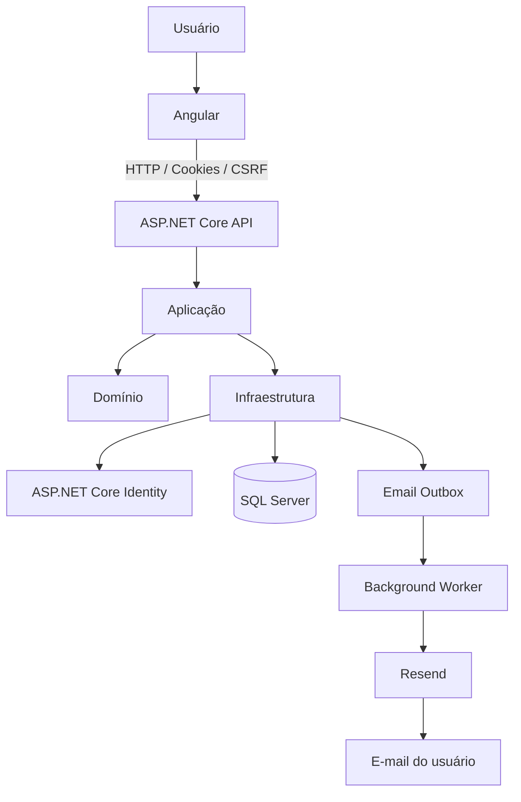
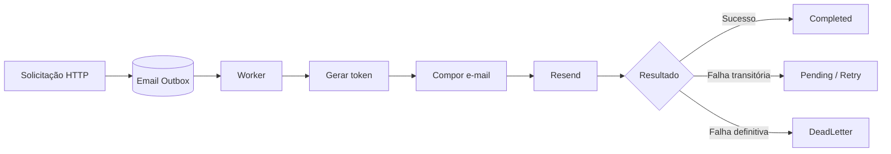
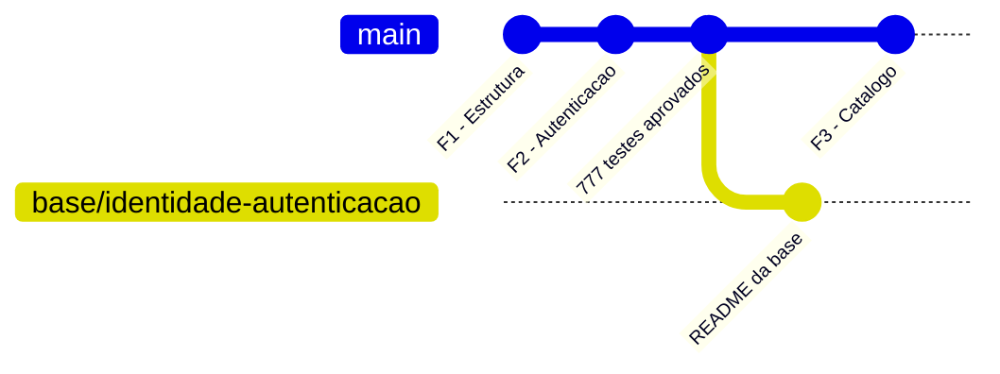

<div align="center">

# 🔐 Base de Identidade e Autenticação

### .NET 10 + Angular 22

**Uma base completa de autenticação, segurança e gerenciamento de contas, pronta para ser adaptada a novos projetos.**

[](https://dotnet.microsoft.com/)
[](https://angular.dev/)
[](https://www.typescriptlang.org/)
[](https://www.microsoft.com/sql-server)


[Sobre](#-sobre-a-base) •
[Funcionalidades](#-funcionalidades) •
[Arquitetura](#-arquitetura) •
[Instalação](#-como-executar) •
[Reutilização](#-como-reutilizar-em-um-novo-projeto) •
[Testes](#-testes-e-qualidade)

</div>

---

## 📖 Sobre a base

Esta branch preserva a implementação completa da fase de **Identidade e Autenticação (F2)** do projeto **Xaquiamuni — Produtos Naturais**, desenvolvido para o Trabalho de Conclusão de Curso da Academia do Programador.

Seu objetivo é servir como ponto de partida para novos sistemas que necessitem de cadastro de usuários, autenticação segura, confirmação de e-mail, recuperação de senha e gerenciamento de sessões.

Em vez de reconstruir toda a infraestrutura de autenticação a cada novo projeto, é possível utilizar esta base, adaptar as regras de negócio e concentrar o desenvolvimento nas funcionalidades específicas do novo sistema.

> Esta branch é uma referência reutilizável derivada da Xaquiamuni. Não é uma biblioteca independente nem um template totalmente genérico. Alguns elementos de domínio, como CPF, perfil de cliente e endereço, precisam ser adaptados conforme o novo projeto.

### 🌿 Projeto de origem

| Informação | Descrição |
|---|---|
| Projeto | Xaquiamuni — Produtos Naturais |
| Repositório | [Xaquiamuni](https://github.com/GustavoTessaro/Xaquiamuni) |
| Branch | `base/identidade-autenticacao` |
| Fase preservada | F2 — Identidade e Autenticação |
| PRD | v0.5 |
| TDD | v0.4 |
| Validação final | 14/11/2026 |

---

## ✨ Funcionalidades

### 👤 Cadastro e gerenciamento de identidade

- Cadastro de clientes com nome, CPF, e-mail, telefone e endereço.
- Validação de dados no frontend e backend.
- Proteção criptográfica do CPF.
- Perfil de cliente associado ao ASP.NET Core Identity.
- Cadastro transacional com solicitação inicial de confirmação de e-mail.
- Interface de cadastro concluído com orientação para confirmação.

### 🔑 Autenticação e sessões

- Login e logout com ASP.NET Core Identity.
- Autenticação por cookies seguros.
- Sessão com duração absoluta de 8 horas.
- Consulta do usuário autenticado.
- Proteção antiforgery contra CSRF.
- Validação do SecurityStamp.
- Bloqueio de login para clientes com e-mail não confirmado.
- Respostas genéricas para credenciais inválidas.

### 📧 Confirmação de e-mail

- Token de confirmação com validade de 24 horas.
- Envio inicial solicitado automaticamente no cadastro.
- Confirmação por link seguro.
- Reenvio de confirmação.
- Controle de cooldown e limite de solicitações.
- Prevenção de mensagens duplicadas.
- Interface específica para confirmação pendente.
- Template de e-mail personalizado.

### 🔄 Recuperação de senha

- Solicitação de recuperação para contas elegíveis.
- Token de redefinição com validade de 1 hora.
- Validação da nova senha.
- Redefinição segura pelo ASP.NET Core Identity.
- Invalidação das sessões anteriores.
- Cancelamento de solicitações antigas incompatíveis com a nova geração de credenciais.
- Proteção contra concorrência entre solicitações e redefinições.
- Sem autenticação automática após a redefinição.

### 📬 Infraestrutura de e-mail

- Integração com a API do Resend.
- Processamento assíncrono através de Email Outbox.
- Worker em segundo plano.
- Retry com backoff e jitter.
- Deduplicação de mensagens.
- Controle de concorrência com lease e RowVersion.
- Tratamento de falhas definitivas através de DeadLetter.
- Geração de tokens somente durante o processamento.
- Ausência de tokens, links e corpos de e-mail persistidos na Outbox.

---

## 🛠️ Tecnologias

| Tecnologia | Finalidade |
|---|---|
| .NET 10 | Plataforma backend |
| ASP.NET Core | API REST |
| ASP.NET Core Identity | Usuários, senhas, papéis e tokens |
| Entity Framework Core | Persistência e migrations |
| SQL Server | Banco de dados relacional |
| Angular 22 | Aplicação frontend |
| TypeScript | Tipagem e desenvolvimento frontend |
| Tailwind CSS 4 | Estilização das interfaces |
| Resend | Envio de e-mails transacionais |
| xUnit | Testes automatizados backend |
| Angular Test Runner | Testes automatizados frontend |

---

## 🏗️ Arquitetura

A solução utiliza uma arquitetura modular, com separação entre domínio, aplicação, infraestrutura e apresentação.



### 📂 Estrutura do projeto

```text
Xaquiamuni/
│
├── client/
│   ├── public/
│   ├── src/
│   │   └── app/
│   │       ├── core/
│   │       ├── cadastro/
│   │       ├── login/
│   │       ├── confirm-email/
│   │       ├── forgot-password/
│   │       └── reset-password/
│   ├── angular.json
│   └── package.json
│
├── docs/
│   ├── prd.md
│   └── tdd.md
│
├── server/
│   ├── src/
│   │   ├── Admin/
│   │   ├── Api/
│   │   ├── Aplicacao/
│   │   ├── Dominio/
│   │   └── Infraestrutura/
│   ├── tests/
│   │   └── Xaquiamuni.Tests/
│   └── Xaquiamuni.slnx
│
└── README.md
```

### Responsabilidades das camadas

| Camada | Responsabilidade |
|---|---|
| Domínio | Entidades e regras de negócio |
| Aplicação | Casos de uso e contratos |
| Infraestrutura | Identity, EF Core, SQL Server, criptografia e e-mail |
| API | Endpoints, autenticação, autorização e HTTP |
| Admin | Projeto reservado à área administrativa |
| Client | Interfaces Angular e comunicação com a API |
| Tests | Testes unitários e de integração |

---

## 🔌 Endpoints de autenticação

| Método | Endpoint | Descrição |
|---|---|---|
| GET | `/api/auth/csrf` | Obter token antiforgery |
| POST | `/api/auth/register` | Cadastrar cliente |
| POST | `/api/auth/login` | Autenticar usuário |
| GET | `/api/auth/me` | Consultar sessão atual |
| POST | `/api/auth/logout` | Encerrar sessão |
| POST | `/api/auth/confirm-email` | Confirmar e-mail |
| POST | `/api/auth/resend-confirmation-email` | Solicitar nova confirmação |
| POST | `/api/auth/forgot-password` | Solicitar recuperação |
| POST | `/api/auth/reset-password` | Redefinir senha |

### Principais contratos HTTP

| Status | Significado |
|---|---|
| `200 OK` | Consulta bem-sucedida |
| `201 Created` | Cadastro realizado |
| `202 Accepted` | Solicitação de e-mail recebida |
| `204 No Content` | Operação concluída sem corpo |
| `400 Bad Request` | Dados ou token inválidos |
| `401 Unauthorized` | Credenciais inválidas ou sessão ausente |
| `403 Forbidden` | Cliente não confirmado após credenciais corretas |
| `429 Too Many Requests` | Limite de solicitações atingido |

> As operações de confirmação, recuperação e autenticação utilizam contratos específicos. Consulte o TDD para os detalhes de cada endpoint.

---

## 🔐 Segurança

A segurança foi considerada desde a modelagem da autenticação até os testes de integração.

### Configurações principais

| Recurso | Configuração |
|---|---|
| Cookie | `__Host-Xaquiamuni.Auth` |
| HttpOnly | Habilitado |
| Secure | Habilitado |
| SameSite | Lax |
| Sessão | 8 horas, duração absoluta |
| Token de confirmação | 24 horas |
| Token de redefinição | 1 hora |
| Senha mínima | 12 caracteres |
| Senha máxima | 256 caracteres |
| Proteção CSRF | Antiforgery |
| CPF | AES-GCM e fingerprint HMAC |
| Sessões antigas | Invalidação por SecurityStamp |

A senha exige letras maiúsculas, minúsculas, números e caracteres especiais.

### Papéis de acesso

| Papel | Finalidade |
|---|---|
| `ADMIN` | Administração do sistema |
| `FUNCIONARIO` | Acesso operacional conforme permissões |
| `CLIENTE` | Conta do consumidor |

A infraestrutura de papéis está implementada. As permissões detalhadas dos módulos de negócio pertencem às fases posteriores do projeto.

### Confirmação obrigatória

O login de um usuário `CLIENTE` com credenciais corretas e e-mail não confirmado retorna:

```json
{
  "code": "EMAIL_NOT_CONFIRMED"
}
```

O status HTTP é `403 Forbidden`, sem criação de sessão.

A configuração global `RequireConfirmedEmail` permanece `false`, pois a regra de confirmação obrigatória é aplicada explicitamente ao perfil `CLIENTE`.

### Proteção dos links

Os links de confirmação e recuperação utilizam fragmentos da URL:

```text
/confirm-email#email=...&token=...
/reset-password#email=...&token=...
```

O frontend remove os dados sensíveis da URL antes de realizar as operações HTTP. Os tokens não são armazenados em localStorage ou sessionStorage.

### Limites de solicitações

- Cooldown de 2 minutos por conta.
- Até 5 solicitações aceitas por conta em uma janela móvel de 1 hora.
- Limite de 10 requisições por minuto por IP nos endpoints protegidos de confirmação/reenvio e recuperação, conforme suas políticas específicas.
- Confirmação e recuperação possuem controles independentes.

Os limites por IP são locais à instância da aplicação. Uma implantação distribuída exige avaliação adicional.

---

## 📬 Email Outbox

O envio de e-mails é desacoplado das requisições HTTP.

O cadastro ou a solicitação de recuperação registra uma mensagem na Outbox. Um worker processa essa mensagem, gera o token necessário e utiliza o Resend para realizar o envio.



### Estados das mensagens

| Estado | Descrição |
|---|---|
| `Pending` | Aguardando processamento |
| `Processing` | Reservada por um worker |
| `Completed` | Envio aceito pelo provedor |
| `DeadLetter` | Falha definitiva ou tentativas esgotadas |
| `Cancelled` | Mensagem não é mais elegível |

### Garantias e limitações

- O cadastro e a criação da solicitação inicial são transacionais.
- Mensagens concorrentes são controladas por lease e RowVersion.
- Solicitações duplicadas são controladas por chaves de deduplicação.
- Falhas transitórias podem ser reprocessadas.
- O envio externo não mantém uma transação SQL aberta.
- O processamento possui semântica de entrega pelo menos uma vez; duplicações podem ocorrer em situações excepcionais.
- `Completed` significa que o provedor aceitou o envio, não necessariamente que o destinatário recebeu ou abriu o e-mail.

---

## 🚀 Como executar

### Pré-requisitos

Antes de iniciar, instale:

- [.NET SDK 10](https://dotnet.microsoft.com/download)
- [Node.js](https://nodejs.org/) em versão compatível com Angular 22
- [SQL Server Express](https://www.microsoft.com/sql-server/sql-server-downloads) ou outra instância SQL Server compatível
- [Git](https://git-scm.com/)
- [Visual Studio Code](https://code.visualstudio.com/)

### 1. Clonar a branch

```bash
git clone --branch base/identidade-autenticacao --single-branch https://github.com/GustavoTessaro/Xaquiamuni.git

cd Xaquiamuni
```

### 2. Restaurar o backend

```bash
cd server

dotnet restore Xaquiamuni.slnx
dotnet build Xaquiamuni.slnx
```

### 3. Configurar o banco de dados

Utilize um banco exclusivo para o ambiente de desenvolvimento.

Exemplo de connection string local:

```text
Server=.\SQLEXPRESS;Database=MeuProjetoDev;Integrated Security=True;Encrypt=True;TrustServerCertificate=True;
```

Configure a connection string através de User Secrets, sem inserir credenciais no repositório.

A partir da raiz do projeto:

```powershell
dotnet user-secrets set "ConnectionStrings:SqlServer" "Server=.\SQLEXPRESS;Database=MeuProjetoDev;Integrated Security=True;Encrypt=True;TrustServerCertificate=True;" --project server/src/Api/Xaquiamuni.Api.csproj
```

> TrustServerCertificate=True é utilizado neste exemplo somente para desenvolvimento local. Configure certificados confiáveis em produção.

### 4. Configurar as chaves de proteção do CPF

A base utiliza chaves independentes para criptografia e fingerprint.

As configurações necessárias incluem:

```text
CpfProtection:CurrentEncryptionKeyVersion
CpfProtection:EncryptionKeys:<versao>

CpfProtection:CurrentFingerprintKeyVersion
CpfProtection:FingerprintKeys:<versao>
```

Gere chaves criptograficamente seguras e exclusivas para cada projeto.

Utilize o User Secrets para armazená-las durante o desenvolvimento. Consulte `CpfProtectionOptions.cs` e o TDD para os requisitos exatos de formato e tamanho.

**Nunca reutilize as chaves da Xaquiamuni em outro sistema.**

### 5. Aplicar as migrations

Instale a ferramenta do Entity Framework Core, caso necessário:

```bash
dotnet tool install --global dotnet-ef
```

Utilize uma versão compatível com os pacotes EF Core do projeto.

Confira primeiro as migrations disponíveis:

```powershell
dotnet ef migrations list --project server/src/Infraestrutura/Xaquiamuni.Infraestrutura.csproj --startup-project server/src/Infraestrutura/Xaquiamuni.Infraestrutura.csproj
```

Configure a conexão exigida pela fábrica de design-time para apontar exclusivamente ao novo banco.

Aplique as migrations:

```powershell
dotnet ef database update --project server/src/Infraestrutura/Xaquiamuni.Infraestrutura.csproj --startup-project server/src/Infraestrutura/Xaquiamuni.Infraestrutura.csproj
```

> Confira a implementação de design-time do DbContext antes da execução. O projeto Api pode não possuir o pacote EF Core Design necessário para ser utilizado diretamente como startup project da ferramenta.

A base preserva cinco migrations relacionadas à identidade, aos perfis e à infraestrutura de e-mail.

### 6. Configurar HTTPS local

```bash
dotnet dev-certs https --trust
```

### 7. Executar a API

A partir da raiz:

```bash
dotnet run --project server/src/Api/Xaquiamuni.Api.csproj
```

Confira a URL apresentada pelo terminal.

A configuração local utilizada no projeto de origem é:

```text
https://localhost:7230
```

### 8. Executar o Angular

Em outro terminal:

```bash
cd client

npm ci
npm start
```

Acesse:

```text
http://localhost:4200
```

O frontend utiliza um proxy para encaminhar as requisições `/api` ao backend.

Caso a porta da API seja alterada, ajuste o destino no arquivo:

```text
client/proxy.conf.json
```

Em ambientes que necessitam do certificado confiável do sistema operacional, utilize a configuração Node.js apropriada, como `--use-system-ca`.

---

## ✉️ Configuração do Resend

A base mantém o sender e o worker desabilitados por padrão, evitando envios acidentais.

Para habilitar o envio em um ambiente de desenvolvimento, configure:

```text
ResendEmail:Enabled = true
ResendEmail:ApiKey = <sua-chave>
ResendEmail:FromEmail = <remetente-autorizado>

EmailOutboxWorker:Enabled = true

EmailConfirmation:PublicFrontendBaseUrl = http://localhost:4200
```

Armazene a API Key através de User Secrets ou de um gerenciador de segredos.

Exemplo:

```powershell
dotnet user-secrets set "ResendEmail:ApiKey" "<sua-chave>" --project server/src/Api/Xaquiamuni.Api.csproj
```

Configure as demais opções conforme o ambiente.

### Ambiente de testes

O remetente de teste do Resend possui restrições de destinatários. Para enviar e-mails a clientes reais, configure um domínio de envio verificado.

### Ambiente de produção

Antes de habilitar o worker e o sender em produção:

- Configure domínio e remetente autorizados.
- Utilize URL pública HTTPS.
- Configure segredos de produção.
- Garanta persistência das chaves de Data Protection.
- Configure proxies confiáveis.
- Valide a entrega e o monitoramento de e-mails.

A integração real com Resend foi validada em ambiente isolado. A implantação de produção não faz parte desta branch.

---

## ♻️ Como reutilizar em um novo projeto

Esta é a seção principal para quem deseja aproveitar a base em outro sistema.

### 1. Criar um novo repositório

Crie um repositório vazio no GitHub para o novo projeto.

Não desenvolva o novo sistema diretamente na branch base da Xaquiamuni.

### 2. Clonar a base com outro nome

```bash
git clone --branch base/identidade-autenticacao --single-branch https://github.com/GustavoTessaro/Xaquiamuni.git MeuNovoProjeto

cd MeuNovoProjeto
```

### 3. Configurar o novo repositório remoto

```bash
git remote rename origin xaquiamuni-base

git remote add origin https://github.com/SEU-USUARIO/MeuNovoProjeto.git

git branch -m main

git push -u origin main
```

Confira:

```bash
git remote -v
```

O resultado deverá apresentar o novo projeto como `origin` e a Xaquiamuni como referência `xaquiamuni-base`.

Assim, o histórico da base é preservado, mas o desenvolvimento do novo sistema acontece em seu próprio repositório.

> Não utilize force push para sobrescrever um repositório que já contém código. O exemplo considera um novo repositório vazio.

### 4. Adaptar a identidade do projeto

| Elemento | O que adaptar |
|---|---|
| Solução | Nome do arquivo `.slnx` |
| Projetos .NET | Nomes dos `.csproj` |
| Namespaces | Substituir referências específicas da Xaquiamuni |
| Frontend | Nome, título, identidade visual e textos |
| Cookie | Nome exclusivo para o novo sistema |
| Banco | Nome e connection string próprios |
| User Secrets | Identificadores e valores exclusivos |
| E-mails | Marca, remetente, textos e URL pública |
| Documentação | PRD, TDD e README do novo projeto |

Ao renomear os projetos .NET, atualize também as referências entre projetos, os namespaces, os testes e os arquivos de configuração.

### 5. Adaptar o modelo de usuário

A Xaquiamuni utiliza um perfil de cliente com CPF, telefone e endereço.

Avalie os requisitos do novo projeto:

- O usuário precisa informar CPF?
- O endereço é obrigatório?
- Quais dados devem existir no perfil?
- Quais papéis de acesso serão utilizados?
- A confirmação de e-mail será obrigatória para todos os usuários ou somente determinados perfis?

Preserve a infraestrutura de segurança e adapte apenas as regras específicas do novo domínio.

### 6. Criar um novo banco

Cada projeto deve possuir seu próprio banco de dados.

Não reutilize:

- O banco `XaquiamuniDev`.
- Bancos temporários da Xaquiamuni.
- Credenciais de outros projetos.
- Dados pessoais de clientes.
- Chaves criptográficas da aplicação original.

Se o modelo de identidade permanecer compatível, as migrations existentes podem ser utilizadas em um banco vazio.

Se o domínio for alterado significativamente, revise as migrations e decida se serão mantidas ou substituídas por uma nova migration inicial.

Não apague ou reescreva migrations de um banco existente sem planejamento.

### 7. Configurar segredos independentes

Crie um conjunto exclusivo de configurações para o novo sistema:

```text
ConnectionStrings
CpfProtection
ResendEmail
EmailConfirmation
Data Protection
```

Se o novo projeto não utilizar CPF, remova essa funcionalidade de maneira planejada, incluindo suas dependências, validações e testes.

### 8. Revisar autenticação e autorização

Mantenha ou adapte:

- Política de senha.
- Configuração do cookie.
- Tempo de sessão.
- Antiforgery.
- SecurityStamp.
- Papéis e permissões.
- Política de confirmação de e-mail.
- Recuperação de senha.
- Rate limiting.

A infraestrutura existente reduz o trabalho inicial, mas as decisões de segurança devem ser adequadas ao novo sistema.

### 9. Validar a base adaptada

Depois de realizar as alterações:

```bash
cd server

dotnet restore
dotnet build Xaquiamuni.slnx
dotnet test Xaquiamuni.slnx
```

Substitua o nome da solução caso tenha sido renomeada.

No frontend:

```bash
cd client

npm ci
npm test -- --watch=false
npm run build
```

Adapte os testes que dependem de nomes, papéis, dados de cadastro ou regras específicas da Xaquiamuni.

O objetivo é preservar as garantias de segurança e comportamento, não simplesmente manter a mesma quantidade de testes.

### Checklist de reutilização

- [ ] Novo repositório criado.
- [ ] Branch base clonada.
- [ ] Remote origin configurado para o novo projeto.
- [ ] Solução, projetos e namespaces adaptados.
- [ ] Identidade visual e templates de e-mail adaptados.
- [ ] Modelo de usuário revisado.
- [ ] Papéis e permissões definidos.
- [ ] Banco exclusivo configurado.
- [ ] Migrations revisadas.
- [ ] Novos segredos e chaves gerados.
- [ ] Cookie e Data Protection isolados.
- [ ] URLs e proxy configurados.
- [ ] Testes automatizados aprovados.
- [ ] Build backend e frontend aprovados.

---

## 🧪 Testes e qualidade

A fase F2 foi encerrada com todos os testes aprovados.

<div align="center">

| Backend | Frontend | Total |
|:---:|:---:|:---:|
| 638 | 139 | **777** |
| Aprovados | Aprovados | Aprovados |


</div>

### Testes backend

```bash
cd server

dotnet test Xaquiamuni.slnx
```

### Testes de integração SQL Server

Os testes de integração utilizam bancos descartáveis exclusivos na instância SQL Server Express local.

Para habilitá-los no PowerShell:

```powershell
cd server

$env:XAQUIAMUNI_RUN_SQLSERVER_INTEGRATION = "1"

dotnet test Xaquiamuni.slnx

Remove-Item Env:XAQUIAMUNI_RUN_SQLSERVER_INTEGRATION
```

A fixture cria e remove seus próprios bancos temporários.

**Nunca direcione testes automatizados a um banco de produção.**

### Testes frontend

```bash
cd client

npm test -- --watch=false
```

### Builds

Backend:

```bash
dotnet build server/Xaquiamuni.slnx
```

Frontend:

```bash
cd client

npm run build
```

### Cobertura funcional

A suíte contempla, entre outros cenários:

- Cadastro e validação de usuários.
- Autenticação e cookies.
- Confirmação e reenvio de e-mail.
- Recuperação e redefinição de senha.
- Tokens inválidos, expirados e reutilizados.
- Invalidação de sessões.
- Concorrência e transações SQL.
- Deduplicação e retry da Outbox.
- Falhas do provedor de e-mail.
- Proteção antiforgery.
- Rate limiting.
- Estados e formulários Angular.
- Parsing e remoção de dados sensíveis das URLs.

---

## 📚 Documentação

| Documento | Descrição |
|---|---|
| [PRD](docs/prd.md) | Requisitos, regras de negócio e critérios de aceite |
| [TDD](docs/tdd.md) | Arquitetura, contratos técnicos e decisões de implementação |

O PRD e o TDD preservam também o contexto original da Xaquiamuni e suas fases futuras.

Para um novo projeto, utilize esses documentos como referência técnica e produza requisitos próprios para o novo domínio.

---

## 🌳 Estratégia de branches



| Branch | Finalidade |
|---|---|
| `main` | Desenvolvimento contínuo da Xaquiamuni |
| `base/identidade-autenticacao` | Referência reutilizável da F2 |

A branch base preserva a autenticação antes da implementação dos módulos de catálogo, estoque, produção, vendas e financeiro.

O diagrama representa a estratégia planejada de evolução do projeto.

---

## ⚠️ Limitações e cuidados de produção

Esta base foi implementada e validada em ambiente de desenvolvimento, com testes automatizados e testes manuais isolados.

Antes de uma implantação real:

- Configure domínio público e HTTPS.
- Utilize banco de dados exclusivo e protegido.
- Armazene segredos em um gerenciador apropriado.
- Persista e compartilhe as chaves de Data Protection conforme a topologia.
- Configure corretamente proxies e forwarded headers.
- Avalie rate limiting distribuído quando houver múltiplas instâncias.
- Configure monitoramento da Outbox e tratamento de DeadLetter.
- Revise permissões e políticas específicas do novo sistema.
- Configure backups e procedimentos de recuperação.
- Valide a entrega de e-mails no domínio definitivo.

Os testes aprovados não substituem a homologação do ambiente de produção.

---

## 👨‍💻 Autor

<div align="center">

**Gustavo Tessaro**

Desenvolvedor de Software | Ciência da Computação | Academia do Programador

[](https://github.com/GustavoTessaro)

---

*Construído para aprender, evoluir e reutilizar.*

**Uma base sólida hoje para os projetos de amanhã.**

</div>
