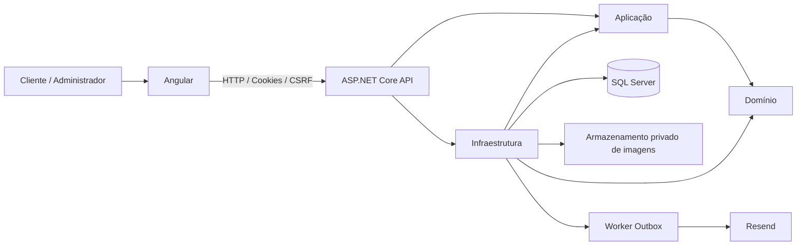
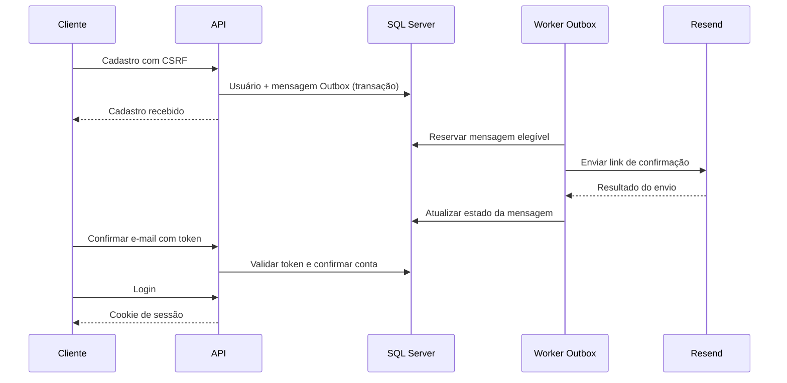
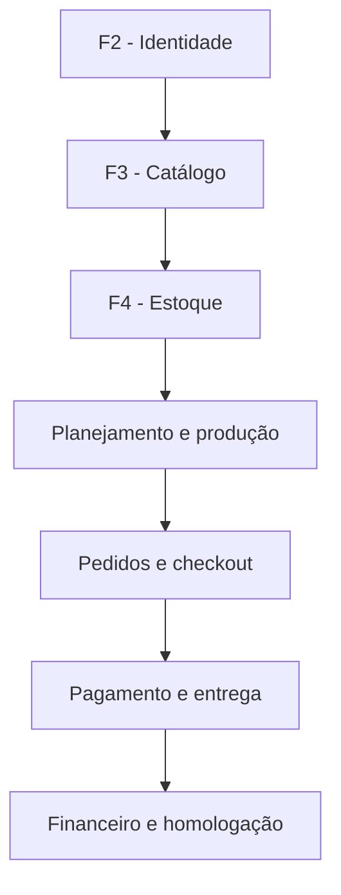

<div align="center">

# 🛍️ Base de Catálogo E-commerce

### Uma base reutilizável para lojas virtuais modernas

**Angular · ASP.NET Core · SQL Server**

[](https://dotnet.microsoft.com/)
[](https://angular.dev/)
[](https://www.typescriptlang.org/)
[](https://learn.microsoft.com/sql/)
[](https://tailwindcss.com/)


**Autenticação completa, administração de produtos e uma vitrine pública pronta para evoluir.**

[Visão geral](#-visão-geral) • [Funcionalidades](#-funcionalidades) • [Instalação](#-instalação-e-execução) • [API](#-api) • [Reutilização](#-como-reutilizar-em-outro-projeto)

</div>

---

## 🌿 Visão geral

Esta branch preserva uma base de e-commerce desenvolvida no projeto **Xaquiamuni — Produtos Naturais**, TCC da Academia do Programador. A loja original é dedicada a sabonetes artesanais e velas aromáticas de produção própria.

O objetivo desta versão é permitir que novos projetos comecem com identidade, segurança, administração e catálogo já implementados, sem reconstruir essas funcionalidades do zero.

> **Checkpoint:** F2 (Identidade e autenticação) + F3 (Catálogo). Esta é uma base de desenvolvimento, não uma plataforma de vendas pronta para produção.

| Branch | Finalidade |
|---|---|
| `main` | Desenvolvimento contínuo do Xaquiamuni |
| `base/identidade-autenticacao` | Base independente de identidade, preservada ao final da F2 |
| `base/catalogo-ecommerce` | Identidade + administração + loja pública, preservadas ao final da F3 |

## ✨ Funcionalidades

### 🔐 Identidade e segurança

- Cadastro de clientes com CPF protegido, endereço, telefone e e-mail.
- Login, logout e sessão por cookies HttpOnly/Secure; proteção CSRF.
- Confirmação de e-mail obrigatória para login do cliente; reenvio com limites.
- Recuperação de senha com token temporário e invalidação de sessões anteriores.
- Outbox persistente para envio de e-mails, tentativas, deduplicação e processamento em segundo plano.
- Resend como provedor de e-mail configurável.
- Papéis `ADMIN`, `FUNCIONARIO` e `CLIENTE`; acesso administrativo efetivo restrito a ADMIN nesta versão.

### 📦 Administração do catálogo

- Categorias com ativação/desativação.
- Produtos simples e produtos com variantes, preço e opção padrão.
- Características personalizadas, como fragrância, cor e tamanho.
- Peso e volume em unidades canônicas (g e ml), separados da unidade comercial.
- Galeria de até cinco imagens, ordenação, foto principal e vínculos com variantes.
- Upload JPEG/PNG/WebP, processamento e armazenamento privado em WebP.
- Listagem administrativa com busca, indicadores de imagens e publicação controlada.

### 🛒 Loja pública

- Homepage responsiva com identidade visual e apresentação institucional.
- Catálogo acessível sem cadastro, com pesquisa, categorias e paginação.
- Cards com fotos, preços em reais e medidas.
- Página individual com galeria e seleção de combinações reais de variantes.
- Estados de carregamento, erro, catálogo vazio e imagem indisponível.
- Navegação integrada com autenticação existente.

**Não há compra nesta versão:** a publicação não comprova disponibilidade de estoque. O carrinho e o checkout serão implementados em fases posteriores.

## 🖼️ Demonstração

<details>
<summary>🏠 Homepage</summary>


</details>
<details>
<summary>🛍️ Catálogo público</summary>


</details>
<details>
<summary>📦 Detalhes do produto</summary>


</details>
<details>
<summary>⚙️ Painel administrativo</summary>


</details>
<details>
<summary>📷 Galeria de imagens</summary>


</details>

> A demonstração visual foi complementada com capturas reais do ambiente local. Não são incluídas imagens fictícias nem dados de clientes.

## 🏗️ Arquitetura

Monólito modular com separação entre domínio, aplicação, infraestrutura e API. O Angular consome contratos HTTP; as regras de negócio e a autorização são verificadas no servidor.



| Camada | Responsabilidade |
|---|---|
| Domínio | Entidades, valores e invariantes de negócio |
| Aplicação | Casos de uso e contratos |
| Infraestrutura | EF Core, Identity, persistência, CPF, e-mails e imagens |
| API | Endpoints, autenticação, autorização e tratamento de erros |
| Admin | Provisionamento interativo de administrador |
| Angular | Interface pública e administrativa |

## 📁 Estrutura do repositório

```text
Xaquiamuni/
├── client/
│   ├── public/
│   ├── src/
│   │   ├── app/
│   │   │   ├── admin/
│   │   │   ├── core/
│   │   │   ├── public-store/
│   │   │   └── app.routes.ts
│   │   └── styles.css
│   ├── angular.json
│   ├── package.json
│   ├── package-lock.json
│   └── proxy.conf.json
├── server/
│   ├── src/
│   │   ├── Api/
│   │   ├── Aplicacao/
│   │   ├── Dominio/
│   │   ├── Infraestrutura/
│   │   └── Admin/
│   ├── tests/
│   │   └── Xaquiamuni.Tests/
│   └── Xaquiamuni.slnx
├── docs/
│   ├── prd.md
│   └── tdd.md
└── README.md
```

## 🧰 Tecnologias

| Tecnologia | Versão declarada |
|---|---|
| .NET / ASP.NET Core | 10 / net10.0 |
| EF Core / Identity / OpenAPI | 10.0.13 |
| Microsoft.Data.SqlClient | 6.1.8 |
| SkiaSharp | 4.156.1 |
| Angular | ^22.2.0 |
| Angular CLI / Build | ^22.2.5 |
| TypeScript | ~6.0.2 |
| RxJS | ~7.8.0 |
| Tailwind CSS | ^4.3.3 |
| Vitest | ^5.0.0 |
| xUnit | 2.9.3 |
| npm | 11.19.1 |

As versões frontend são intervalos declarados no `package.json`; o lockfile determina a instalação efetiva. Não há `global.json` ou versão Node fixada em `engines` no checkpoint.

## 🚀 Instalação e execução

### 1. Pré-requisitos

- SDK .NET 10, Node.js compatível com Angular 22 e npm.
- SQL Server Express local, instância `.\SQLEXPRESS` para o fluxo de desenvolvimento original.
- Git e PowerShell (os exemplos abaixo usam Windows).
- Certificado HTTPS de desenvolvimento confiável.

### 2. Clonar a base

```powershell
git clone --branch base/catalogo-ecommerce --single-branch https://github.com/GustavoTessaro/Xaquiamuni.git
cd Xaquiamuni
dotnet restore server\Xaquiamuni.slnx
cd client
npm ci
cd ..
```

### 3. Configurar banco e segredos

Use um banco **novo e dedicado**. O provisionador original exige `XaquiamuniDev` na instância local; se esse banco já contém dados, não o reutilize inadvertidamente. Para outro nome, adapte o guard do provisionador antes de executá-lo.

```powershell
$api = 'server\src\Api\Xaquiamuni.Api.csproj'
$connection = 'Server=.\SQLEXPRESS;Database=XaquiamuniDev;Trusted_Connection=True;Encrypt=True;TrustServerCertificate=True;'
dotnet user-secrets set 'ConnectionStrings:SqlServer' $connection --project $api
```

`TrustServerCertificate=True` é uma concessão exclusivamente para desenvolvimento local: não valida a identidade do servidor SQL. Em produção, use certificado confiável e validação TLS.

Para uma instalação nova, gere duas chaves independentes de 32 bytes, em Base64. Exemplo PowerShell 7:

```powershell
$enc = [Convert]::ToBase64String([System.Security.Cryptography.RandomNumberGenerator]::GetBytes(32))
$fp = [Convert]::ToBase64String([System.Security.Cryptography.RandomNumberGenerator]::GetBytes(32))
dotnet user-secrets set 'CpfProtection:CurrentEncryptionKeyVersion' '1' --project $api
dotnet user-secrets set 'CpfProtection:EncryptionKeys:1' $enc --project $api
dotnet user-secrets set 'CpfProtection:CurrentFingerprintKeyVersion' '1' --project $api
dotnet user-secrets set 'CpfProtection:FingerprintKeys:1' $fp --project $api
Remove-Variable enc, fp
```

Não substitua chaves de um banco existente sem planejar a migração dos dados protegidos. User Secrets é um recurso de desenvolvimento, não um cofre de produção.

### 4. Aplicar migrations

Instale o `dotnet-ef` 10 compatível com os pacotes do projeto, se necessário:

```powershell
dotnet tool install --global dotnet-ef --version 10.0.13
```

A factory de design-time lê `ConnectionStrings__SqlServer` explicitamente. Execute na raiz:

```powershell
$env:ConnectionStrings__SqlServer = $connection
$infra = 'server\src\Infraestrutura\Xaquiamuni.Infraestrutura.csproj'
dotnet ef database update --project $infra --startup-project $infra
Remove-Item Env:\ConnectionStrings__SqlServer
```

A cadeia contém nove migrations, desde `InitialIdentitySchema` até `AddProdutoImagens`, incluindo perfis, endereços, Outbox, recuperação de senha, categorias, produtos e características. Não recrie a migration inicial para um banco existente.

### 5. Provisionar administrador

```powershell
$env:ConnectionStrings__SqlServer = $connection
dotnet run --project server\src\Admin\Xaquiamuni.Admin.csproj -- --provision-admin
Remove-Item Env:\ConnectionStrings__SqlServer
```

O CLI solicita confirmação do destino, e-mail e senha oculta. Não executa migrations. O guard restringe o destino original a `.\SQLEXPRESS` / `XaquiamuniDev`; não é um provisionador de produção.

### 6. Executar a aplicação

```powershell
dotnet dev-certs https --trust
dotnet run --project server\src\Api\Xaquiamuni.Api.csproj --launch-profile https
```

Em outro terminal, na raiz:

```powershell
cd client
npm start
```

| Serviço | Endereço local |
|---|---|
| Loja | http://localhost:4200/ |
| Administração | http://localhost:4200/admin/login |
| API | https://localhost:7230 |
| Health | https://localhost:7230/health |

O proxy Angular encaminha `/api/**` para a API HTTPS. Se Node não confiar no certificado local, configure a confiança no certificado do sistema (por exemplo, `NODE_OPTIONS=--use-system-ca` em uma versão Node que suporte essa opção), sem desabilitar a validação TLS.

### 7. Habilitar e-mails reais (opcional)

Para confirmar clientes e recuperar senhas pelo fluxo real, configure o Resend e habilite o worker:

```powershell
dotnet user-secrets set 'EmailConfirmation:PublicFrontendBaseUrl' 'http://localhost:4200' --project $api
dotnet user-secrets set 'ResendEmail:ApiKey' '<SUA_CHAVE>' --project $api
dotnet user-secrets set 'ResendEmail:FromEmail' '<REMETENTE_AUTORIZADO>' --project $api
dotnet user-secrets set 'ResendEmail:Enabled' 'true' --project $api
dotnet user-secrets set 'EmailOutboxWorker:Enabled' 'true' --project $api
```

Sem envio habilitado, o cadastro pode enfileirar a confirmação, mas não haverá entrega real de e-mail. Em produção, use domínio/remetente verificado e URL pública HTTPS. Não versione segredos.

## ⚙️ Configuração de referência

| Chave | Finalidade |
|---|---|
| `ConnectionStrings:SqlServer` | Conexão da API |
| `ConnectionStrings__SqlServer` | Variável de ambiente para design-time e CLI |
| `CpfProtection:CurrentEncryptionKeyVersion` | Versão ativa de criptografia |
| `CpfProtection:EncryptionKeys:<versão>` | Chave AES-GCM Base64 de 32 bytes |
| `CpfProtection:CurrentFingerprintKeyVersion` | Versão ativa de fingerprint |
| `CpfProtection:FingerprintKeys:<versão>` | Chave independente Base64 de 32 bytes |
| `EmailConfirmation:PublicFrontendBaseUrl` | Base dos links de confirmação e reset |
| `ResendEmail:Enabled` | Envio habilitado (padrão false) |
| `ResendEmail:ApiKey` | Credencial do provedor |
| `ResendEmail:FromEmail` | Remetente autorizado |
| `EmailOutboxWorker:Enabled` | Worker habilitado (padrão false) |
| `EmailOutboxWorker:CycleInterval` | Intervalo padrão 15 s |
| `EmailOutboxWorker:BatchSize` | Lote padrão 10 |
| `ProductImages:Storage:RootPath` | Diretório absoluto opcional de imagens |

O storage local usa `LocalApplicationData/Xaquiamuni/product-images` por padrão. A configuração de cookies é feita em código, não por chaves JWT.

## 📐 Regras de negócio

| Tema | Regra |
|---|---|
| Produto | Nasce não publicado, com categoria e uma variante padrão ativa |
| Produto simples | Variante interna `Padrão`, sem tipo persistido separado |
| Preço | Positivo, até duas casas decimais |
| Unidades | UN, KIT, PAR, PCT, CX, CJ; KIT não possui composição |
| Características | Valores normalizados, pertencentes ao produto; combinações explicitamente cadastradas |
| Medidas | Peso em g, volume em ml; opcionais, sem inferência por texto |
| Publicação | Categoria ativa, variante padrão ativa e foto principal |
| Galeria | Até 5 imagens, uma principal, ordenação e vínculos com variantes do mesmo produto |
| Upload | JPEG/PNG/WebP, até 5 MiB por arquivo, reencodado em WebP |
| Catálogo público | Somente produtos elegíveis e variantes ativas; sem promessa de estoque |

Produtos legados publicados sem imagem são preservados, mas excluídos do catálogo público. A última foto de um produto publicado não pode ser removida antes de despublicá-lo. Desativar categoria despublica seus produtos.

## 🔌 API

### Autenticação

| Método | Rota | Acesso |
|---|---|---|
| GET | `/api/auth/csrf` | Público |
| POST | `/api/auth/register` | Público |
| POST | `/api/auth/confirm-email` | Público |
| POST | `/api/auth/resend-confirmation-email` | Público |
| POST | `/api/auth/forgot-password` | Público |
| POST | `/api/auth/reset-password` | Público |
| POST | `/api/auth/login` | Público |
| GET | `/api/auth/me` | CLIENTE |
| POST | `/api/auth/logout` | CLIENTE |
| POST | `/api/admin/auth/login` | Público; autentica ADMIN |
| GET | `/api/admin/auth/me` | ADMIN |
| POST | `/api/admin/auth/logout` | ADMIN |

Mutações de autenticação exigem antifalsificação. Reenvio, solicitação de recuperação e reset possuem limites próprios de requisições.

### Categorias administrativas

Prefixo `/api/admin/categorias` — ADMIN.

| Método | Sufixo | Operação |
|---|---|---|
| GET | `/` | Listar |
| GET | `/{id}` | Consultar |
| POST | `/` | Criar |
| PUT | `/{id}` | Editar |
| PATCH | `/{id}/status` | Ativar/desativar |

### Produtos e variantes administrativas

Prefixo `/api/admin/produtos` — ADMIN.

| Método | Sufixo | Operação |
|---|---|---|
| GET | `/` | Listar |
| GET | `/{id}` | Consultar |
| POST | `/` | Criar |
| PUT | `/{id}` | Editar |
| POST | `/{id}/variantes` | Adicionar variante |
| PUT | `/{id}/variantes/{varianteId}` | Editar variante |
| PUT | `/{id}/variantes/{varianteId}/padrao` | Definir padrão |
| PATCH | `/{id}/variantes/{varianteId}/status` | Alterar status |
| PATCH | `/{id}/publicacao` | Publicar/despublicar |

### Imagens administrativas

Prefixo `/api/admin/produtos/{produtoId}/imagens` — ADMIN.

| Método | Sufixo | Operação |
|---|---|---|
| GET | `/` | Listar metadados |
| GET | `/{imagemId}` | Consultar metadados |
| GET | `/{imagemId}/conteudo` | Ler WebP |
| POST | `/` | Upload multipart |
| PUT | `/{imagemId}/principal` | Definir principal |
| PUT | `/ordem` | Reordenar |
| PUT | `/{imagemId}/variantes/{varianteId}` | Associar variante |
| DELETE | `/{imagemId}/variantes/{varianteId}` | Desassociar |
| DELETE | `/{imagemId}` | Remover |

Todas as mutações administrativas exigem antifalsificação.

### Catálogo público

| Método | Rota |
|---|---|
| GET | `/api/catalogo/categorias` |
| GET | `/api/catalogo/produtos` |
| GET | `/api/catalogo/produtos/{produtoId}` |
| GET | `/api/catalogo/produtos/{produtoId}/imagens/{imagemId}/conteudo` |

Exemplo de listagem:

```http
GET /api/catalogo/produtos?busca=sabonete&pagina=1&itensPorPagina=20
```

Aceita também `categoriaId`. A paginação limita o tamanho da página a 50 itens. Produtos inelegíveis retornam 404 na consulta individual; o contrato público não expõe caminhos ou chaves internas de armazenamento.

## 🧭 Rotas da interface

| Públicas | Administrativas protegidas |
|---|---|
| `/` | `/admin` |
| `/produtos` | `/admin/categorias` |
| `/produtos/:id` | `/admin/produtos` |
| `/cadastro` | `/admin/produtos/:produtoId/fotos` |
| `/login` | |
| `/confirm-email` | |
| `/forgot-password` | |
| `/reset-password` | |
| `/admin/login` | |

O guard Angular auxilia a navegação, mas a API é a autoridade de segurança.

## 🔒 Segurança e fluxo de e-mail



- Cookie principal `__Host-Xaquiamuni.Auth`, sessão absoluta de 8 horas.
- Antifalsificação com `XSRF-TOKEN` e `X-XSRF-TOKEN`.
- Confirmação de e-mail com validade de 24 h; recuperação de senha com validade de 1 h.
- CPF criptografado com AES-GCM e fingerprint HMAC para identificação sem armazenar CPF em texto claro.
- Outbox com reserva temporária, tentativas, deduplicação e estados terminais; tokens são gerados no processamento, não persistidos na fila.
- Recuperação de senha invalida sessões antigas e cancela mensagens pendentes de gerações anteriores.
- Limites de requisições por IP são locais à instância; produção exige estratégia de proxy confiável e avaliação de limites distribuídos.

## 🧪 Testes e qualidade

<div align="center">

| Backend | Angular | Total |
|:---:|:---:|:---:|
| **803** | **271** | **1.074** |
| 0 falhas | 0 falhas | 0 ignorados |

*Resultado histórico do gate F3.7 — 16/11/2026.*

</div>

```powershell
# Backend, na raiz
dotnet build server\Xaquiamuni.slnx -c Debug
dotnet test server\Xaquiamuni.slnx

# Suíte completa incluindo SQL Server descartável
$env:XAQUIAMUNI_RUN_SQLSERVER_INTEGRATION = '1'
dotnet test server\Xaquiamuni.slnx
Remove-Item Env:\XAQUIAMUNI_RUN_SQLSERVER_INTEGRATION

# Frontend
cd client
npm test -- --watch=false
npm run build
```

A fixture SQL exige `.\SQLEXPRESS` e permissões de criação/remoção dos próprios bancos temporários. Não aponta para `XaquiamuniDev` nem Azure. Consulte [o guia de integração SQL](server/tests/Xaquiamuni.Tests/Integration/SQLServerIntegrationTests.md).

O gate aprovou o build Debug backend e o build de produção Angular. O Release backend foi bloqueado por assemblies em uso pela API local; não foi validado nesse gate. Há avisos CSS não impeditivos no header (5,10 kB) e homepage (7,98 kB), com orçamento de aviso de 4 kB.

## ♻️ Como reutilizar em outro projeto

### 1. Criar um repositório independente

Crie um repositório vazio no GitHub e clone somente esta branch:

```powershell
git clone --branch base/catalogo-ecommerce --single-branch https://github.com/GustavoTessaro/Xaquiamuni.git MinhaLoja
cd MinhaLoja
git remote rename origin xaquiamuni-base
git remote add origin https://github.com/SEU_USUARIO/MinhaLoja.git
git branch -m main
git push -u origin main
```

Isso mantém o histórico da base e não altera o repositório original. A branch de autenticação permanece disponível separadamente.

### 2. Personalizar antes de desenvolver

- [ ] Nome, marca, textos, cores e imagens em `client/src/app/public-store/` e `client/src/styles.css`.
- [ ] Namespaces `Xaquiamuni.*`, assemblies, solução, DbContext e referências de projetos.
- [ ] Banco dedicado, migrations e guard do provisionador ADMIN.
- [ ] Novo UserSecretsId e segredos independentes; novas chaves CPF para banco novo.
- [ ] Cookies, isolamento Data Protection, HTTPS, proxy e origens da aplicação.
- [ ] Remetente, domínio, templates e URL dos e-mails.
- [ ] Diretório de imagens e estratégia de armazenamento durável.
- [ ] PRD/TDD e regras de negócio específicas da nova loja.
- [ ] Executar testes e builds após renomeações e mudanças de configuração.

Não copie credenciais, dados pessoais ou fotos de teste para a nova loja. Para migrar dados existentes, preserve as chaves e versões necessárias e planeje a migração separadamente.

### 3. Evoluir o catálogo para vendas



## 🚧 Limitações e próximos passos

Esta branch não implementa estoque de matérias-primas ou produtos acabados, lotes, validade, movimentações, fichas técnicas, produção, carrinho, checkout, pedidos, vendas externas, reserva, pagamento Pix/Sicredi, Correios ou financeiro. Permissões granulares de funcionários também permanecem futuras.

Antes de produção, configure armazenamento privado durável de imagens, backup, banco e credenciais seguros, domínio HTTPS, remetente verificado, Data Protection persistente/compartilhada e proxies confiáveis. Azure Blob não está implementado. Contatos e políticas institucionais reais ainda precisam ser definidos. Homologação de produção e E2E amplo não foram concluídos.

O selo de variações nos cards pode não aparecer quando opções diferem apenas por características que o DTO resumido não inclui. O detalhe continua usando as combinações reais cadastradas.

## 📚 Documentação

| Documento | Conteúdo |
|---|---|
| [PRD v0.13](docs/prd.md) | Requisitos, regras de negócio e escopo |
| [TDD v2.1](docs/tdd.md) | Arquitetura, decisões técnicas, contratos e gates |
| [Base F2](https://github.com/GustavoTessaro/Xaquiamuni/tree/base/identidade-autenticacao) | Identidade e autenticação reutilizáveis |

---

<div align="center">

### Desenvolvido por Gustavo Tessaro

Projeto Xaquiamuni · Academia do Programador

[](https://github.com/GustavoTessaro)

**Uma base sólida para transformar novos projetos em lojas virtuais.**

</div>
