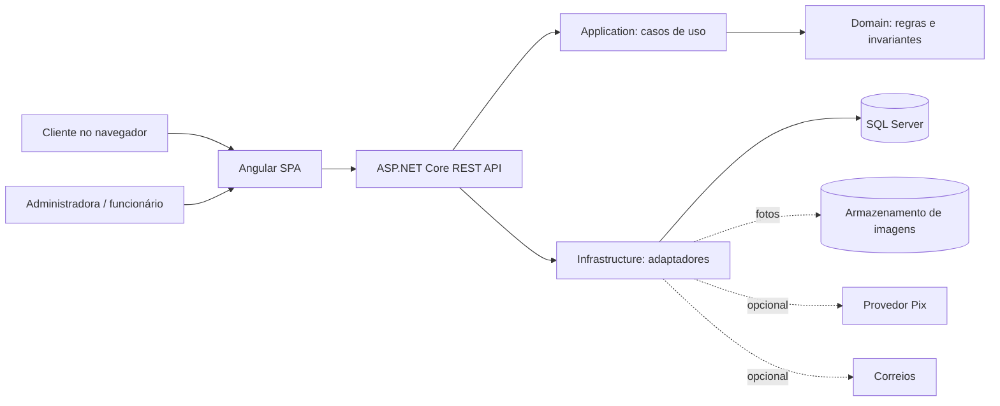
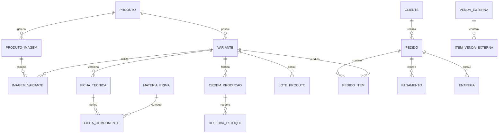
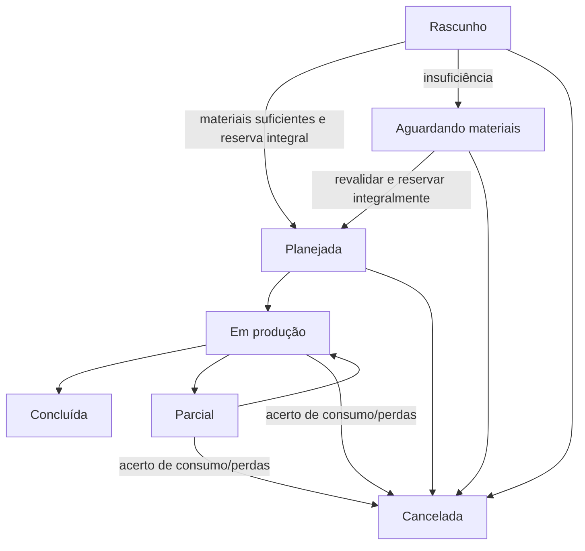

# TDD — Xaquiamuni Produtos Naturais

**Desenho técnico da plataforma de e-commerce e gestão de produção artesanal**

| Campo                 | Informação                                                                                                                                                                               |
| --------------------- | ---------------------------------------------------------------------------------------------------------------------------------------------------------------------------------------- |
| Projeto               | Xaquiamuni — E-commerce e Gestão Artesanal                                                                                                                                               |
| Versão                | 1.7 — fotos na listagem administrativa do catálogo                                                                                                                                       |
| Data                  | 16/11/2026                                                                                                                                                                               |
| Status                | **F2, F3.1–F3.3.6.3, F3.4.1–F3.4.4.1 e F3.5.1 implementadas; vitrine pública permanece futura**                                                                                         |
| Documento-base        | `docs/prd.md`, versão 0.10                                                                                                                                                               |
| Referência estrutural | Projeto NoteKeeper; reaproveitar princípios e organização, **não copiar código ou assumir detalhes não verificados**                                                                     |
| Decisão recente       | Solicitante concordou em seguir com as propostas iniciais de produção e pagamento, sujeitas a detalhamento                                                                               |

> **Convenções:** **Implementado** = comportamento verificado no código e coberto por testes; **Confirmado** = definido nas entrevistas ou pelo solicitante; **Proposto** = decisão de engenharia ainda sujeita a validação; **Pendente** = requer informação, validação ou integração. F2 e o acesso administrativo inicial estão concluídos; categorias, produtos e variantes têm backend e frontend administrativos. O gate de confirmação para login de `CLIENTE` é explícito e está ativo, embora `RequireConfirmedEmail` global permaneça `false`. Testes manuais anteriores validaram envio real com Resend em ambientes isolados; implantação e operação de produção não estão homologadas.

## 1. Resumo e objetivos técnicos

Construir uma aplicação web responsiva com vitrine e compra para clientes e painel administrativo mobile-first para produtos, matérias-primas, fichas técnicas, lotes, produção, pedidos e vendas externas. A prioridade operacional é **organizar a produção artesanal** e manter estoque confiável entre canais. Os fluxos críticos devem ser transacionais, auditáveis e seguros sob concorrência e repetição de requisições.

### 1.1 Restrições e premissas

- **Confirmado:** a loja vende somente unidades acabadas disponíveis; carrinho não reserva estoque; produção reserva insumos no planejamento.
- **Confirmado:** cliente possui conta, com nome, CPF, e-mail, telefone e endereço; administradora controla o sistema; funcionário terá permissões limitadas a detalhar.
- **Confirmado:** vendas externas são lançadas manualmente no novo sistema; Trienta será substituído após migração e conferência.
- **Confirmado:** lote de produto acabado registra fabricação e validade; vencidos não são vendáveis.
- **Confirmado:** Vacaria tem opção de retirada sem frete e entrega própria por R$ 10, sujeito a delimitação de área, horários e endereço; Correios para localidades atendidas em RS/SC.
- **Confirmado:** Sicredi é o banco PJ, **não** um provedor de API Pix já homologado.
- **Implementado na F2:** cadastro cria conta ainda não confirmada e enfileira a solicitação inicial; login de `CLIENTE` verifica as credenciais e então aplica gate explícito de confirmação (HTTP `403`, `EMAIL_NOT_CONFIRMED`); confirmação usa token Identity de 24 horas; reenvio aplica resposta genérica, cooldown, limite por conta e deduplicação.
- **Implementado e validado:** recuperação de senha com endpoint, Outbox, processor, token Identity de 1 hora, redefinição transacional, invalidação de sessões e telas Angular. Os fluxos de cadastro, confirmação, reenvio, login bloqueado/liberado e recuperação foram validados manualmente com Resend real em ambientes isolados.
- **Gate final da F2:** 638 testes backend e 139 frontend aprovados, sem falhas ou ignorados; builds backend e frontend aprovados. A integração SQL Server automatizada usou exclusivamente a fixture local descartável.
- **Limite atual:** worker e Resend são desabilitados por padrão; testes manuais reais ocorreram em ambientes isolados, não em produção. `RequireConfirmedEmail` global permanece `false`, sem desativar o gate explícito de login para `CLIENTE`. Domínio verificado, remetente, gestão de segredos, URL pública HTTPS, persistência/compartilhamento de Data Protection e proxies confiáveis permanecem pendentes para produção.
- **Proposto:** separar MVP operacional e módulos condicionados; nenhuma integração bancária ou logística deve ser simulada como confirmação real.
- **Prazo informado:** 30/11/2026; o solicitante conduzirá eventual replanejamento. Não usar a data para suprimir requisitos silenciosamente.

### 1.2 Limites

Não projetar marketplace, múltiplas lojas, personalização livre, venda online sem estoque, integração automática com Trienta, redes sociais ou WhatsApp, emissão fiscal ou comprovação de conformidade sanitária. Kits, cupons sofisticados, análise avançada, agenda, fornecedores, financeiro completo e notificações externas são condicionados ao escopo do PRD. **Não registrar recebimento Pix real sem provedor e conciliação confiáveis.**

## 2. Decisões técnicas centralizadas

| ID    | Tema         | Direção técnica e justificativa                                                                                                                                    | Situação                                                                    |
| ----- | ------------ | ------------------------------------------------------------------------------------------------------------------------------------------------------------------ | --------------------------------------------------------------------------- |
| DT-01 | Frontend     | Angular standalone, TypeScript, roteamento por funcionalidade e formulários reativos                                                                               | Implementado na F2                                                          |
| DT-02 | UI           | Tailwind CSS e componentes acessíveis, visual responsivo com identidade Xaquiamuni e foco em celular                                                               | Implementado na F2                                                          |
| DT-03 | Backend      | C# / ASP.NET Core .NET 10, API REST, monólito modular com Domain, Application, Infrastructure e Api                                                                | Implementado na F2; módulos restantes são futuros                           |
| DT-04 | Persistência | EF Core e SQL Server; Azure SQL como possibilidade futura, não requisito para desenvolvimento local                                                                | Implementado na F2; Azure SQL não configurado                               |
| DT-05 | Identidade   | ASP.NET Core Identity com cookie seguro e antifalsificação para as operações mutáveis; não há JWT no fluxo F2                                                      | Implementado na F2; armazenamento de Data Protection para produção pendente |
| DT-06 | Permissões   | Papéis de base `ADMIN`, `FUNCIONARIO` e `CLIENTE` são inicializados; autorização continua por operação. O gate de confirmação do login é específico para `CLIENTE` | Papéis implementados; matriz fina e permissões de negócio pendentes         |
| DT-07 | Valores      | Cálculos no servidor com `decimal`, armazenamento com precisão explícita; BRL e arredondamento definido por componente                                             | Proposto                                                                    |
| DT-08 | Quantidades  | Unidade física tipada, conversões explícitas g/kg e ml/L, nunca somar dimensões diferentes                                                                         | Proposto                                                                    |
| DT-09 | Concorrência | Transações SQL, controle otimista de versão e atualização atômica condicional de saldo/reserva; índices de integridade                                             | Proposto                                                                    |
| DT-10 | Histórico    | Movimentações imutáveis/auditáveis e snapshots de preço, composição e lotes usados nas operações                                                                   | Proposto                                                                    |
| DT-11 | Imagens      | Abstração independente de provedor; armazenamento local no desenvolvimento e Azure Blob privado em produção                                                     | Contratos, provedor local e processador implementados; Azure Blob permanece futuro |
| DT-12 | Pagamentos   | Interface de provedor, webhooks verificados, idempotência e conciliação; Sicredi ou intermediador apenas após avaliação                                            | Pendente                                                                    |
| DT-13 | Frete        | Estratégias por modalidade: retirada, entrega local, Correios; cotação externa desacoplada                                                                         | Proposto; integração pendente                                               |
| DT-14 | Testes       | Testes unitários .NET, testes HTTP com `WebApplicationFactory` e doubles, specs Angular e integração opt-in com SQL Server isolado; validação manual local         | Implementado para o fluxo F2; E2E amplo permanece pendente                  |
| DT-15 | Deploy       | Desenvolvimento local primeiro; configuração por ambiente, CI e hospedagem definidos após verificação de custos e limites                                          | Pendente                                                                    |

**Controle de versões:** conferir SDK, Angular, TypeScript, EF Core, bibliotecas e lockfiles antes de adicionar ou atualizar projetos/dependências. Não fixar versões menores/patch arbitrariamente nem contornar conflitos com `--force`.

## 3. Arquitetura e organização

### 3.1 Visão de componentes



Dependências de compilação propostas: `Application → Domain`; `Infrastructure → Application/Domain`; `Api → Application + Infrastructure` somente na composição. Domain não conhece HTTP, EF Core, Identity, provedores ou Angular. Evitar regras de negócio nos controllers e componentes visuais.

No fluxo F2, o cadastro chama o caso de uso de aplicação e, na mesma transação SQL, persiste usuário Identity ainda não confirmado, perfil/endereço e uma mensagem inicial `Pending` na Outbox. O worker, quando habilitado, gera o token Identity de 24 horas, compõe o link e solicita o envio ao adaptador `IEmailSender`. O reenvio passa pelo endpoint anônimo protegido por antifalsificação e pelo caso de uso; a persistência SQL decide elegibilidade, cooldown, limite e deduplicação sem revelar o resultado interno.

Na recuperação implementada, o endpoint valida o e-mail e retorna resposta genérica. O caso de uso encontra somente contas com e-mail confirmado; a Outbox `PasswordReset` aplica deduplicação, cooldown e limite sob transação SQL e lock exclusivo por usuário. A mensagem contém fingerprint SHA-256 com separação de propósito do `SecurityStamp` vigente, nunca o stamp bruto, token, senha, e-mail ou link. O processor valida a geração de credenciais antes de gerar o token Identity de 1 hora e encaminhar o e-mail pelo sender configurado. A redefinição usa Identity e coordenação transacional para alterar credenciais e cancelar mensagens obsoletas atomicamente. A entrega real foi validada manualmente com Resend em ambiente isolado; habilitação operacional e requisitos de produção permanecem pendentes.

O acesso administrativo inicial também reutiliza o Identity e o cookie existentes, sem criar um banco de usuários ou mecanismo de autenticação paralelo. O login administrativo tem endpoint próprio e só emite sessão após validar o papel `ADMIN`; as rotas administrativas aplicam a política `Administracao`. O painel Angular usa uma guarda para navegação, sem substituir a autorização efetiva da API. O provisionador interativo existente ganhou o modo `--provision-admin`, restrito ao destino local `.\SQLEXPRESS` / `XaquiamuniDev`; esse fluxo não é mecanismo de provisionamento de produção.

### 3.2 Estrutura atual do repositório e módulos futuros

```text
Xaquiamuni/
├── client/src/app/
│   ├── core/auth/                # sessão, cadastro, login e confirmação
│   ├── core/admin-auth/          # sessão, login e logout administrativos
│   ├── core/security/            # obtenção do token antifalsificação
│   ├── admin/                    # login, guarda e painel inicial
│   ├── cadastro/
│   ├── confirm-email/
│   ├── forgot-password/
│   ├── login/
│   ├── reset-password/
│   └── app.routes.ts
├── server/
│   ├── Xaquiamuni.slnx
│   ├── src/
│   │   ├── Api/                  # endpoints HTTP e composição; Catalogo/AdminCategoriaEndpoints
│   │   ├── Aplicacao/            # casos de uso e contratos; Catalogo
│   │   ├── Dominio/              # regras e entidades; Categoria
│   │   ├── Infraestrutura/       # Identity, SQL Server, Outbox, Resend e repositório de categorias
│   │   └── Admin/
│   └── tests/Xaquiamuni.Tests/
│       └── Integration/          # integração SQL opt-in com bancos temporários
├── docs/
│   ├── prd.md
│   └── tdd.md
├── .github/
├── .gitignore
└── README.md
```

A estrutura acima reflete os projetos existentes usados pelo fluxo F2; módulos de negócio restantes continuam como trabalho futuro. Migrations pertencem a Infrastructure; testes integrados usam bancos temporários isolados, nunca banco de desenvolvimento.

### 3.3 Módulos

| Módulo               | Responsabilidade                                                                                                                                                                                                                      | PRD                                        |
| -------------------- | ------------------------------------------------------------------------------------------------------------------------------------------------------------------------------------------------------------------------------------- | ------------------------------------------ |
| Identidade           | ASP.NET Core Identity, cookie compartilhado, antifalsificação, cadastro/login de clientes, confirmação/reenvio, recuperação/redefinição e login inicial exclusivo para `ADMIN`; permissões finas para funcionários permanecem futuras | RF-01–03, RF-27–31, RN-13, RN-16, RN-21–33 |
| Catálogo             | Categorias administrativas e CRUD/API de produtos e variantes com gerenciamento Angular implementados; fotos e vitrine pública continuam futuras                                                                                      | RF-04–05                                   |
| Estoque              | Insumos, lotes acabados, saldos, reservas, movimentos e mínimos                                                                                                                                                                       | RF-06–08, RN-01–04, RN-17                  |
| Produção             | Fichas versionadas, planejamento, reservas, execução e conclusão                                                                                                                                                                      | RF-09–14, RN-03–06, RN-18                  |
| Comércio             | Carrinho, pedidos, acompanhamento e venda externa                                                                                                                                                                                     | RF-15–19, RF-26, RN-07–09                  |
| Entrega e pagamentos | Modalidades, cobranças, conciliação e rastreamento                                                                                                                                                                                    | RF-20–21 (condicionados)                   |
| Gestão               | Financeiro, análise, agenda e fornecedores                                                                                                                                                                                            | RF-22–25 (condicionados)                   |
| Transversal          | Auditoria, relógio, transações, idempotência e erros                                                                                                                                                                                  | RNF-01–10                                  |

### 3.4 Frontend e experiência

- Implementadas: rotas de cliente para cadastro, login, confirmação e recuperação; `/admin/login`, `/admin`, `/admin/categorias` e `/admin/produtos` protegidas conforme o fluxo administrativo. O painel permite gerenciar categorias, produtos, publicação e variantes. A guarda melhora a navegação; a autorização permanece no backend.
- Futuras: vitrine pública, carrinho, checkout, perfil, pedidos e os módulos administrativos de estoque, fichas, produção, vendas e configurações.
- Carregar módulos por rota quando apropriado; serviços de API tipados e estados explícitos de `carregando`, `vazio`, `erro` e `sucesso`.
- Layout mobile-first: navegação simplificada, formulários com rótulos, toque confortável, tabelas adaptadas a cartões no celular e confirmação para ações irreversíveis.
- Cadastro de produtos oferece `Produto simples` (uma versão e um preço) ou `Produto com variantes`; no modo simples a API recebe internamente a variante ativa padrão chamada `Padrão`, sem exigir que o cliente informe essa identificação e sem campo de tipo no modelo persistido. No modo com variantes, a principal é obrigatória e variantes adicionais podem ser removidas antes do cadastro.
- Alternar de variantes para simples é bloqueado enquanto houver variantes adicionais cadastradas no formulário, evitando descarte implícito. A identificação da variante principal permanece no formulário ao alternar modos.
- Unidades de venda do catálogo são seletores `UN` (Unidade) e `KIT` (Kit), com orientação curta. `KIT` é somente um código comercial nesta etapa; composição, estoque de componentes e ficha técnica de kits não foram implementados.
- Formulários de produto e variante usam um controle reutilizável de entrada BRL com duas casas decimais, separadores brasileiros e Reactive Forms. O modelo mantém número decimal compatível com a API; valores que não podem ser representados sem perda de centavos são rejeitados.
- Exibir quantidade **vendável**, não saldo bruto; informar indisponibilidade sem permitir compra de lote vencido.
- UI não calcula valores finais autoritativos, não decide permissões e não confirma pagamento por conta própria.
- Identidade visual baseada nos arquivos da proprietária: fundo claro, dourado discreto e contraste legível; evitar afirmações clínicas não validadas.
- `/confirm-email` lê `email` e `token` do fragmento do link e remove o fragmento com `history.replaceState` antes da requisição; envia os dados no corpo HTTP e não mantém o token após confirmação ou falha não recuperável. O parser valida os parâmetros sem dupla decodificação e preserva `+`, `/` e `=`; os testes de regressão passam pela navegação e canonicalização real do Angular.
- A página oferece formulário reativo de reenvio sem fragmento ou quando o link falha. O cadastro bem-sucedido substitui o formulário por um estado de sucesso com ações para login e confirmação, sem login, confirmação ou reenvio automáticos. O login mostra um estado específico de confirmação pendente após `403/EMAIL_NOT_CONFIRMED`, com ação de reenvio; a sessão ativa tem estado próprio. Links para `/confirm-email` não transportam dados sensíveis.
- `/forgot-password` aceita o e-mail sem sessão e sempre apresenta a resposta genérica definida pela API para entradas válidas, sem indicar existência ou elegibilidade da conta.
- `/reset-password` lê `email` e `token` do fragmento, remove imediatamente fragmento e parâmetros sensíveis da URL antes de prosseguir e envia as credenciais somente no corpo da requisição; descarta-as após sucesso ou link inválido.
- Os campos de senha e confirmação em login, cadastro e redefinição começam como `password`; controles de olho independentes e acessíveis não alteram valor, validação ou payload e retornam a oculto ao limpar ou concluir o fluxo.

## 4. Dados e persistência

### 4.1 Convenções

- Identificadores opacos (GUID sugerido); datas de eventos em UTC, apresentação no fuso do negócio; datas de fabricação/validade como datas civis.
- Valores monetários em `decimal` com precisão definida no mapeamento; total do servidor prevalece. Arredondamento consistente e snapshots de preço no pedido.
- Preços de venda em `decimal` com duas casas decimais. Unidades comerciais do catálogo são `UN`, `KIT`, `PAR`, `PCT`, `CX` e `CJ`; unidades físicas de estoque/ficha técnica podem incluir `UN`, `G` e `ML`, sem confundir os conceitos nem converter massa em volume.
- Produtos/variantes com identidade própria de estoque e ficha técnica quando necessário; **não** misturar saldos de variantes.
- Exclusão lógica/despublicação quando houver histórico; sem cascata física de registros que compõem pedidos, lotes e ordens.
- Movimentação com origem, tipo, quantidade, unidade, instante, autor e motivo. Ajustes físicos não reescrevem movimentos anteriores.

### 4.2 Modelo lógico preliminar

| Entidade                        | Campos e vínculos essenciais                                                                                                                                                                                                                                                                                                                                                                                                                                          |
| ------------------------------- | --------------------------------------------------------------------------------------------------------------------------------------------------------------------------------------------------------------------------------------------------------------------------------------------------------------------------------------------------------------------------------------------------------------------------------------------------------------------- |
| Usuario / Perfil / Permissao    | IdentityId, papel, status, políticas autorizadas                                                                                                                                                                                                                                                                                                                                                                                                                      |
| Cliente / Endereco              | usuário, nome, CPF normalizado e protegido, e-mail, telefone, CEP, endereço                                                                                                                                                                                                                                                                                                                                                                                           |
| Categoria                       | `Id`, nome e chave normalizada únicos, descrição opcional, status ativo/inativo e ordem de exibição; persistida na F3.2.1                                                                                                                                                                                                                                                                                                                                             |
| Produto / Variante              | nome, descrição, categoria, publicação e variantes com identidade, identificação, unidade comercial `UN`/`KIT`/`PAR`/`PCT`/`CX`/`CJ`, preço, estado, variante padrão e medidas físicas líquidas opcionais; produto simples persiste uma variante `Padrão`. Características customizadas, valores, associações explícitas e assinatura canônica das combinações pertencem ao modelo da F3.3.6.1. |
| ProdutoImagem / ProdutoImagemVariante | imagem: `Id`, `ProdutoId`, chave de armazenamento única, nome original não confiável, tipo de conteúdo, bytes, largura/altura, ordem, principal e criação UTC; vínculo opcional a uma ou mais variantes do mesmo produto. SQL guarda somente metadados/referência, nunca conteúdo ou URL. Implementado na F3.4.1. |
| MateriaPrima                    | nome, unidade-base, mínimo, ativo; movimentações e reservas                                                                                                                                                                                                                                                                                                                                                                                                           |
| LoteMateriaPrima (opcional)     | origem, validade e custo de aquisição se rastreabilidade por lote de insumo for aprovada                                                                                                                                                                                                                                                                                                                                                                              |
| FichaTecnica / FichaComponente  | produto/variante, versão, material, quantidade por unidade, custo de referência                                                                                                                                                                                                                                                                                                                                                                                       |
| OrdemProducao / OrdemMaterial   | quantidade prevista, ficha snapshot, prazo, estado, reservas, consumo real                                                                                                                                                                                                                                                                                                                                                                                            |
| LoteProduto                     | produto/variante, fabricação, validade, saldo físico, saldo reservado, origem da produção                                                                                                                                                                                                                                                                                                                                                                             |
| EmailOutbox                     | UserId, tipo, estado, tentativas, criação/próxima tentativa/conclusão, chave ativa de deduplicação, lease, `rowversion` e `CredentialGenerationFingerprint` (nulo para `EmailConfirmation`, obrigatório para `PasswordReset`); não persiste e-mail, token, senha, `SecurityStamp` bruto nem conteúdo da mensagem                                                                                                                                                      |
| MovimentoEstoque                | item/lote, tipo, quantidade, origem, autor, instante, motivo                                                                                                                                                                                                                                                                                                                                                                                                          |
| ReservaEstoque                  | origem (ordem/pedido), item/lote, quantidade, estado, expiração quando aplicável                                                                                                                                                                                                                                                                                                                                                                                      |
| Carrinho / CarrinhoItem         | cliente, produto/variante e quantidade; não garante reserva                                                                                                                                                                                                                                                                                                                                                                                                           |
| Pedido / PedidoItem             | cliente, status, endereço snapshot, preços, descontos, frete, totais e itens snapshot                                                                                                                                                                                                                                                                                                                                                                                 |
| Pagamento / EventoPagamento     | pedido, método, referência externa, estado, eventos e deduplicação                                                                                                                                                                                                                                                                                                                                                                                                    |
| Entrega                         | modalidade, valor, endereço snapshot, rastreio, status                                                                                                                                                                                                                                                                                                                                                                                                                |
| VendaExterna / ItemVendaExterna | canal, produtos, lote(s), quantidade, preço, recebimento e origem da baixa                                                                                                                                                                                                                                                                                                                                                                                            |
| Receita / Despesa               | lançamento financeiro com origem única, se módulo aprovado                                                                                                                                                                                                                                                                                                                                                                                                            |
| Auditoria / ComandoIdempotente  | ator, ação, referência, instante, chave de idempotência e resultado                                                                                                                                                                                                                                                                                                                                                                                                   |

### 4.3 Relacionamentos centrais



### 4.4 Invariantes e índices

- CPF normalizado único para contas de clientes segundo política de cadastro; e-mail de login normalizado único no contexto da aplicação. Não registrar CPF completo em logs.
- Saldo livre = saldo físico utilizável − reservas ativas; nunca negativo. Lotes vencidos, bloqueados ou descartados não entram na disponibilidade.
- Reserva de produção não pode ultrapassar saldo livre de cada matéria-prima; reserva de pedido não pode ultrapassar saldo vendável dos lotes elegíveis.
- Restrições e índices por origem de movimento/lançamento para impedir duplicação de consumo, venda, conclusão e receita.
- A versão da ficha usada pela ordem fica congelada; atualização de preço/ficha não altera histórico.
- Pedido guarda preço, desconto, frete e endereço de entrega do momento de confirmação; mudanças cadastrais posteriores não reescrevem o pedido.
- Não permitir duas conclusões da mesma ordem, nem dois processamentos do mesmo evento externo.
- Outbox usa chave ativa única filtrada, `RowVersion` do SQL Server e updates condicionais por estado/lease/versão; preservar mensagens históricas ao liberar a chave. O fingerprint de geração é nulo para `EmailConfirmation` e obrigatório para `PasswordReset`.
- Recuperação só cria mensagem para conta confirmada. A chave de deduplicação impede mensagem ativa duplicada; a persistência aplica cooldown de 2 minutos e máximo de 5 solicitações aceitas por conta em janela móvel de 1 hora.
- O fingerprint de recuperação é SHA-256 com propósito/versionamento explícitos sobre o `SecurityStamp`; comparar em tempo constante e não armazenar nem expor o stamp bruto ou token.
- Categorias: o nome é obrigatório (até 100 caracteres), a descrição é opcional (até 500), espaços consecutivos são reduzidos e espaços externos removidos; a ordem é inteira e não negativa. `NomeNormalizado` usa `ToUpperInvariant()` e collation `Latin1_General_100_BIN2`, com índice único SQL Server. A aplicação pré-consulta conflitos e o repositório traduz violações concorrentes desse índice para conflito de domínio. A listagem inclui ativos e inativos e ordena por `OrdemExibicao`, com `Id` como desempate determinístico. Não há exclusão física, hierarquia ou seed automático.
- Catálogo F3.3.6.1: nomes de características e valores são reduzidos quanto a espaços e normalizados com `ToUpperInvariant()`; índices únicos por produto impedem duplicatas. Valores de peso/volume são positivos, limitados a `decimal(12,3)` e normalizados em gramas/mililitros. Quando a variante possui associação à característica física correspondente, o valor canônico do atributo fornece a medida efetiva e a coluna de medida direta fica nula; divergência ao definir a medida é rejeitada.
- Cada associação variante–valor contém também o `ProdutoId`. FKs compostas vinculam variante, característica e valor ao mesmo produto; a chave primária `(ProdutoVarianteId, ProdutoCaracteristicaId)` limita uma associação por característica. A combinação é assinada com SHA-256 sobre IDs de característica/valor ordenados de modo canônico. Um índice único filtrado por produto e assinatura não nula impede combinações duplicadas, inclusive em concorrência; variantes legadas sem atributos mantêm assinatura nula. Não há geração nem exigência de produto cartesiano.
- O domínio aceita novas unidades comerciais somente `UN`, `KIT`, `PAR`, `PCT`, `CX` e `CJ`; a migration não adiciona check SQL restritivo sobre `UnidadeVenda`, pois a versão anterior aceitava valores como `G`. Valores persistidos legados são preservados sem conversão, enquanto novas alterações pela regra de domínio usam a lista atual.
- As regras de domínio mantêm exatamente uma variante padrão ativa e a troca de padrão é persistida em transação serializável, com rebaixamento ordenado antes da promoção para respeitar o índice único filtrado. Dados de produtos/variantes anteriores são preservados na migration; não são inferidas medidas ou características a partir dos textos legados.
- F3.4.1: `ProdutoImagens` persiste chave de armazenamento globalmente única, nome original não confiável, tipo de conteúdo reportado, tamanho, dimensões, ordem, vaga técnica de galeria, foto principal e instante UTC. Não há coluna para bytes, Base64, caminho local absoluto ou URL assinada.
- O limite concorrente de cinco imagens é imposto por `SlotGaleria` entre 1 e 5, constraint `CK_ProdutoImagens_SlotGaleria_Valid` e índice único `(ProdutoId, SlotGaleria)`. A ordem exibida é independente da vaga técnica e o agregado valida permutações sem IDs repetidos.
- A principal única é protegida pelo índice filtrado `UX_ProdutoImagens_PrincipalPorProduto`; operações do agregado mantêm exatamente uma principal quando há imagens e a primeira é promovida automaticamente. O repositório, em transação serializável, rebaixa a principal persistida antes de promover outra ou remover a atual, evitando colisão transitória do índice.
- `ProdutoImagemVariante` usa FKs compostas `(ProdutoId, ProdutoImagemId)` e `(ProdutoId, ProdutoVarianteId)`, além de chave primária `(ProdutoImagemId, ProdutoVarianteId)`. Isso impede vínculos entre produtos diferentes e duplicidade do mesmo vínculo. A mesma imagem pode ser vinculada a várias variantes sem consumir nova vaga; imagens sem vínculos representam a galeria geral.
- Produtos não publicados podem não ter imagens. Nova publicação exige ao menos uma imagem e exatamente uma principal; a última imagem não pode ser removida enquanto publicado. Produtos publicados legados sem imagens são preservados sem imagens fictícias ou despublicação; uma nova operação de publicação exige imagens, e a vitrine futura deverá tratar o legado explicitamente sem migração corretiva automática. Imagens não representam estoque.

### 4.5 Transações e concorrência

Toda mutação crítica de estoque deve ocorrer numa transação SQL curta. Uma abordagem candidata é bloquear/atualizar condicionalmente os saldos afetados em ordem determinística, verificar que `disponível >= requerido`, registrar reservas e movimentos e confirmar tudo na mesma transação. O desenho concreto de locks, isolamento, `rowversion` e índices será validado com SQL Server real.

- **Reserva de ordem:** verificar todos os materiais, criar todas as reservas ou nenhuma; não permitir reserva parcial silenciosa.
- **Conclusão de produção:** converter reservas em consumo, registrar rendimento/lote e aumentar estoque acabado uma única vez; falha implica rollback.
- **Pedido:** criar pedido e reservar lotes elegíveis atomicamente; falha não cria pedido com reserva parcial.
- **Pagamento:** atualizar estado e aplicar baixa definitiva **uma única vez** após confirmação válida; eventos repetidos não duplicam estoque ou receita.
- **Venda externa:** criar venda, movimentar lotes e registrar origem financeira em uma operação consistente; repetição com mesma chave não duplica.
- **Expiração:** processador idempotente de pedidos pendentes verifica estado antes de liberar reserva; disputa com pagamento exige reconciliação segura.
- **Cadastro F2:** usuário, perfil/endereço e mensagem inicial da Outbox são salvos na mesma transação; rollback não deixa conta sem a solicitação inicial ou solicitação sem conta.
- **Reenvio F2:** persistência usa transação SQL curta `READ COMMITTED` e `sp_getapplock` exclusivo por usuário, com proprietário transacional; bloqueia corrida de chamadas, valida limites e cooldown, libera chave de `DeadLetter` e insere nova linha na mesma transação.
- **Outbox F2:** `RowVersion` e lease protegem claim, conclusão, retry, cancelamento e dead-letter contra gravações obsoletas; worker reprocessa leases expiradas.
- **Solicitação de recuperação:** a persistência revalida conta confirmada e serializa por usuário com transação SQL `READ COMMITTED` e `sp_getapplock` exclusivo (timeout de 5 segundos). Deduplicação, cooldown e limite por hora são decididos no servidor e não alteram a resposta genérica do endpoint.
- **Redefinição:** uma única transação SQL `READ COMMITTED` adquire lock exclusivo por usuário, revalida a conta/token, aplica a senha por `UserManager.ResetPasswordAsync`, cancela mensagens `Pending`/`Processing` obsoletas e confirma tudo. Falha antes do commit faz rollback de credenciais e Outbox; concorrência de reset/solicitação é serializada pelo mesmo usuário.
- **Galeria de produto:** mutações pelo repositório usam transação serializável. O índice de vagas impede excesso de imagens mesmo com inserções concorrentes; a troca de principal rebaixa a linha atual antes de promover a nova. A integridade exata de uma principal quando há imagens é regra do agregado; escrita SQL direta deve respeitar as mesmas regras.

### 4.6 Migrations e estado do schema

A cadeia de migrations existente no código contém, em ordem:

1. `20261111054514_InitialIdentitySchema`
2. `20261111060917_AddClientePerfilEEnderecos`
3. `20261111221631_AddEmailOutbox`
4. `20261112023420_AddPasswordResetEmailOutboxType`
5. `20261112033043_AddPasswordResetCredentialGenerationFingerprint`
6. `20261115000009_AddCategorias`
7. `20261115021210_AddProdutosEVariantes`
8. `20261115035906_AddProdutoCaracteristicasEMedidasFisicas`
9. `20261115184700_AddProdutoImagens`

O schema modelado inclui tabelas do ASP.NET Core Identity, `ClientePerfis`, `ClienteEnderecos`, `EmailOutbox`, `Categorias`, `Produtos`, `ProdutoVariantes`, `ProdutoCaracteristicas`, `ProdutoCaracteristicaValores`, `ProdutoVarianteCaracteristicaValores`, `ProdutoImagens` e `ProdutoImagemVariantes`. A migration de fingerprint adiciona `CredentialGenerationFingerprint binary(32) NULL` e uma constraint que exige `NULL` para `EmailConfirmation` e exatamente 32 bytes para `PasswordReset`. `EmailOutbox` também contém tipo/status, tentativas e timestamps UTC, chave ativa de deduplicação, lease e `RowVersion`; índices e constraints preservam deduplicação ativa e integridade por tipo. `AddCategorias` e `AddProdutosEVariantes` criam as respectivas tabelas e FKs. `AddProdutoCaracteristicasEMedidasFisicas` acrescenta medidas opcionais e estruturas de características sem reescrever registros legados. `AddProdutoImagens` é aditiva, cria apenas as duas tabelas e seus índices/FKs/checks, não cria imagens fictícias, não despublica nem modifica produtos e variantes existentes, inclusive produtos publicados legados sem imagens. A migration não foi aplicada a `XaquiamuniDev`, Azure ou outro banco persistente nesta etapa; os testes aplicam migrations somente a bancos descartáveis da fixture.

### 4.7 Armazenamento e processamento de imagens — F3.4.2

- A Aplicação define `IArmazenamentoImagemProduto` sem expor filesystem, Azure ou detalhes de ASP.NET Core. A chave é gerada pelo sistema (`product-images/{guid:N}.webp`); o nome original nunca participa do caminho. A abstração não toma posse do stream de entrada, devolve stream de leitura de propriedade do chamador, retorna `null` para objeto inexistente, torna a exclusão idempotente e propaga cancelamento/falhas de armazenamento.
- `ArmazenamentoLocalImagemProduto` é registrado por DI para desenvolvimento. `ProductImages:Storage:RootPath` aceita caminho absoluto; sem configuração, usa `%LOCALAPPDATA%/Xaquiamuni` no Windows (ou o diretório `LocalApplicationData` equivalente), com arquivos sob `product-images`. A inicialização rejeita raiz dentro ou envolvendo o diretório da aplicação ou a raiz do repositório, bem como segmentos `wwwroot`; os arquivos são mantidos fora dos arquivos versionados e do webroot. A implementação valida estritamente as chaves geradas, cria temporário na mesma raiz, promove sem sobrescrita e limpa temporários após falha/cancelamento. O provedor não é configurado para gravar imagens de produtos no ambiente local nesta etapa.
- O processador da Aplicação retorna conteúdo WebP e os metadados do arquivo realmente produzido; o chamador é responsável por descartar o objeto retornado e seu stream, enquanto o stream recebido permanece sob responsabilidade do chamador.
- A implementação usa **SkiaSharp 4.156.1**, compatível com .NET 10 e distribuído sob licença MIT. Os avisos/licenças dos componentes nativos Skia/SkiaSharp devem ser preservados na distribuição. A API inclui `SkiaSharp.NativeAssets.Linux.NoDependencies` para execução Linux/Azure sem Fontconfig; o pacote ainda depende das bibliotecas padrão do runtime Linux. No Windows, os ativos nativos Win32 são fornecidos pelo pacote SkiaSharp. Não há SDK Azure ou serviço externo nesta etapa.
- O processador lê no máximo 5 MiB do stream, sem confiar em `Length`, e reconhece o formato decodificado (JPEG, PNG ou WebP), rejeitando arquivo inválido, animação, dimensões acima de 8.000 px por lado ou mais de 25 megapixels antes da decodificação integral. Aplica orientação EXIF, remove metadados ao reencodar pixels, preserva transparência, não amplia imagens menores e redimensiona proporcionalmente até 1.600 px no maior lado. A saída é `image/webp`, qualidade 85; tamanho e dimensões retornados correspondem ao conteúdo codificado.
- SQL Server continua armazenando apenas metadados e chave de referência. A F3.4.2 não implementou upload HTTP, casos de uso de alteração do agregado persistido, endpoints, URLs de acesso, Azure Blob, processamento assíncrono, API ou interface Angular; os casos de uso de Aplicação foram adicionados na F3.4.3.1, sem endpoints.

#### Consistência SQL e armazenamento — plano para F3.4.3

1. Validar e processar o conteúdo recebido antes de persistir metadados; gerar uma nova chave opaca para cada arquivo e persistir na entidade o tipo, tamanho e dimensões da saída processada, não os valores declarados no upload.
2. Armazenar o arquivo processado antes de confirmar a referência no SQL Server. Se a persistência falhar, compensar removendo apenas o objeto recém-criado por essa operação; nunca excluir arquivo já referenciado por uma operação bem-sucedida.
3. Na exclusão, confirmar primeiro a remoção dos metadados; falhas posteriores de remoção do arquivo devem ser registradas e repetidas, sem restaurar silenciosamente metadados nem apagar objetos ainda referenciados.
4. Prever reconciliação futura de objetos órfãos e operações interrompidas, com janela de segurança e consulta às referências persistidas. A estratégia deve distinguir uploads concluídos de arquivos referenciados antes de excluir.
5. Concorrência do agregado e restrições do SQL Server continuam sendo a autoridade para limite da galeria, foto principal, ordem e vínculos. Não introduzir worker de limpeza, nova Outbox, transação distribuída ou mecanismo de consistência eventual nesta etapa.

#### Casos de uso e transações — F3.4.3.1

- `IGerenciarImagensProduto` oferece adição, listagem ordenada, consulta de metadados/conteúdo, troca da foto principal, reordenação, associação/desassociação a opções e remoção. Os DTOs contêm IDs, nome original, tipo, bytes, dimensões, ordem, principal, IDs das opções e data UTC; nunca incluem chave de armazenamento ou caminho. O resultado de conteúdo distingue metadados inexistentes, arquivo físico ausente e armazenamento indisponível. O stream retornado é propriedade do chamador e é fechado ao descartar o resultado de conteúdo.
- A adição valida o produto, o nome original e as opções, e verifica preliminarmente o limite antes do processamento. Processamento e gravação do arquivo ocorrem sem transação SQL aberta. A chave é sempre gerada pelo sistema; em seguida, a operação abre a mutação serializável do agregado, recarrega produto/opções, revalida o limite e os vínculos e cria metadados a partir do resultado processado. O agregado continua responsável por principal, ordem, limite e associações; a primeira imagem é principal.
- `ProdutoMutationExecutionResult` distingue commit confirmado, rollback confirmado e resultado incerto. Conflitos conhecidos de persistência (índice único, FK, concorrência/deadlock SQL) são retornados como conflito somente após rollback confirmado. Após rollback confirmado, a Aplicação tenta compensar removendo apenas a chave gerada pela operação; erros não classificados de persistência são repropagados depois da compensação, nunca convertidos em erro de validação.
- Em resultado de commit incerto, o arquivo é mantido e a operação retorna `CommitOutcomeUnknown` (ou propaga cancelamento), sem exclusão especulativa. Falha de gravação ou compensação registra etapa, IDs e chave opaca em log estruturado; não registra nome original nem conteúdo. Não foi adicionada tabela de pendências: o log é diagnóstico, não uma fila durável, portanto a reconciliação ainda exige inspeção operacional até uma etapa futura definir mecanismo persistente.
- A remoção valida o agregado e confirma primeiro a remoção dos metadados/vínculos na transação. Só depois de commit confirmado solicita exclusão física. A última imagem de produto publicado continua protegida e a remoção da principal promove outra conforme o agregado. Falha física retorna `CleanupPending`, mantém os metadados removidos e registra a chave para reconciliação; não há restauração automática. O resultado incerto da transação nunca dispara exclusão física.
- Todas as mutações de Produto usam o mesmo repositório serializável. A vaga única `(ProdutoId, SlotGaleria)` protege o limite concorrente; o índice filtrado e a atualização ordenada da principal protegem a foto principal; ordens são permutadas no agregado. Publicação concorrente com remoção respeita o carregamento/transação serializável e a regra de publicação existente. Conflitos de deadlock conhecidos são mapeados a conflito após rollback confirmado.
- Produtos publicados legados sem imagens não são alterados; a nova publicação continua exigindo imagem principal. A F3.4.3.1 não adicionou schema, migration, worker, Outbox ou integração Azure.

#### Endpoints administrativos HTTP — F3.4.3.2

- O grupo `AdminProdutoImagemEndpoints` usa a política `Administracao`, que exige sessão autenticada com papel `ADMIN`. Listagem, consulta e leitura de conteúdo também são exclusivamente administrativas. Todas as mutações exigem o antifalsificação já configurado (`X-XSRF-TOKEN` e cookie `XSRF-TOKEN`); multipart não desabilita nem contorna a validação.
- Contratos:
  - `GET /api/admin/produtos/{produtoId}/imagens` lista metadados em ordem.
  - `GET /api/admin/produtos/{produtoId}/imagens/{imagemId}` consulta metadados.
  - `GET /api/admin/produtos/{produtoId}/imagens/{imagemId}/conteudo` transmite o WebP.
  - `POST /api/admin/produtos/{produtoId}/imagens` recebe `multipart/form-data`: exatamente um arquivo no campo `arquivo` e zero ou mais campos repetidos `varianteIds`, cada qual contendo um GUID. Não há campos para ID da imagem, caminho, chave de armazenamento, nome de arquivo alternativo ou tipo efetivo.
  - `PUT /api/admin/produtos/{produtoId}/imagens/{imagemId}/principal` define a principal.
  - `PUT /api/admin/produtos/{produtoId}/imagens/ordem` recebe `{ "imagemIds": [...] }` com a lista completa, sem repetição ou lacunas.
  - A associação é individual e atômica: `PUT /api/admin/produtos/{produtoId}/imagens/{imagemId}/variantes/{varianteId}` associa; `DELETE` na mesma rota desassocia. Não há substituição de vínculos por uma sequência de transações independentes.
  - `DELETE /api/admin/produtos/{produtoId}/imagens/{imagemId}` remove a imagem conforme as regras de publicação e promoção da principal.
- Os limites são locais ao endpoint: arquivo de até 5 MiB, corpo multipart de até 5 MiB + 64 KiB e limites restritos para campos, valores, boundary e cabeçalhos. Tipo declarado, extensão, nome e tamanho fornecidos pelo cliente não substituem o processamento e validação reais. Campos desconhecidos, IDs inválidos/duplicados, ausência, vazio e múltiplos arquivos são rejeitados. O limite global de requisições da API não é alterado.
- A criação responde `201` com `Location` para o recurso de metadados; consultas e mutações com representação respondem `200`; remoção confirmada responde `204`. Entradas/formato de imagem inválidos respondem `400`, mídia de requisição não suportada `415`, limites excedidos `413`, recursos fora do escopo `404`, conflitos de domínio `409`, armazenamento indisponível e commit incerto `503`; autenticação/autorização produzem `401`/`403`.
- A remoção em `CleanupPending` responde `200` com `RemovidaDoCatalogo=true` e `LimpezaFisicaConcluida=false`: somente a remoção lógica está confirmada. Um commit incerto de upload responde `503`, instrui o cliente a não repetir automaticamente e não é representado como sucesso. Metadados existentes com arquivo físico ausente retornam `404` com detalhe distinto do caso de imagem inexistente; indisponibilidade de armazenamento retorna `503`.
- `ProdutoImagemResponse` expõe IDs, nome original, tipo efetivo, tamanho, dimensões, ordem, principal, vínculos, data UTC e URL relativa de conteúdo; não expõe chave ou caminho interno. A leitura resolve o objeto pelo produto e imagem persistidos, força `image/webp`, transmite em streaming e define `Cache-Control: private, no-store`, `X-Content-Type-Options: nosniff` e `Content-Disposition: inline`. O resultado e o stream são descartados ao término ou cancelamento da resposta.
- A criação/edição anterior de produtos permanece inalterada e independente do upload; não foi necessário alterar os DTOs de produto. Os endpoints são documentados no OpenAPI e em `server/product-images.http`. Não há interface Angular, acesso público, Azure Blob, worker, Outbox, migration ou alteração dos dados existentes nesta subetapa.
- A integração HTTP cobre criação do produto, upload real com processamento WebP e armazenamento local temporário, consulta/listagem, leitura, publicação, bloqueio da remoção da última imagem publicada, despublicação e remoção. Os testes usam SQL Server descartável e conteúdo sintético.

#### Galeria Angular administrativa — F3.4.4.1

- A galeria é um componente standalone dedicado em `/admin/produtos/{produtoId}/fotos`, protegido pelo mesmo `adminAuthGuard` das demais telas administrativas. A listagem de produtos adiciona a ação **Gerenciar fotos** e, após um cadastro bem-sucedido, oferece a mesma ação sem acoplar o cadastro ao upload. A falha de publicação causada pela ausência de foto principal exibe orientação e acesso à galeria. A listagem não consulta imagens por produto e não cria requisições N+1.
- `ImagensProdutoService` usa `HttpClient`, os DTOs da API e `CsrfService`. Listagem, consulta de metadados e conteúdo usam as rotas administrativas reais; mutations enviam o token `X-XSRF-TOKEN`. O upload cria `FormData` com exatamente um campo `arquivo` e campos `varianteIds` repetidos quando aplicável; o cliente não define `Content-Type`, permitindo ao navegador gerar o boundary. Não há upload Base64 nem persistência de fotos em storage do navegador.
- A interface usa a URL relativa `conteudoUrl` retornada pela API para exibir o WebP autenticado pelo mesmo host/proxy. Exibe produto, contagem até cinco, foto principal, miniaturas, espaços vazios e estados de galeria. Falhas de carregamento de imagem mostram fallback textual e não removem os metadados da galeria.
- Seleção múltipla e arrastar/soltar aceitam preliminarmente JPEG, PNG e WebP, rejeitam arquivos vazios ou acima de 5 MiB e limitam o total entre imagens existentes e selecionadas. O backend continua sendo a autoridade de validação. A seleção não envia automaticamente; a ação explícita **Enviar fotos** envia um arquivo por requisição, sequencialmente, sem barra ou porcentagem fictícia. Após cada sucesso, a galeria é atualizada; falhas definitivas ficam disponíveis para nova tentativa manual, sem perder sucessos anteriores.
- `503` com título `Resultado da operação desconhecido`, timeout, falha de rede ou outra resposta de servidor não confirmada não provocam retry automático nem botão de repetição cega. O usuário é orientado a conferir a galeria; indisponibilidade conhecida do armazenamento é apresentada separadamente. Previews usam Object URLs e as URLs são revogadas ao remover/enviar a seleção ou destruir o componente.
- A ordem pode ser reorganizada por arrastar/soltar e por controles acessíveis para mover para cima/baixo. O cliente envia a lista completa de IDs e só altera a ordem visual após resposta confirmada. Principal, vínculos e remoções também refletem somente resultados confirmados. Vínculos usam exclusivamente `PUT`/`DELETE` individuais por opção; não há ação de “salvar tudo”. Produtos simples não exigem vínculo à opção interna.
- Remover foto exige confirmação. A remoção da última foto de produto publicado fica desabilitada com orientação para despublicar ou adicionar outra; a regra do servidor permanece autoritativa. `204` remove a imagem da galeria e atualiza o estado; `200` com `LimpezaFisicaConcluida=false` informa que a remoção lógica foi concluída e a limpeza do arquivo físico ficou pendente, sem afirmar que o arquivo foi apagado.
- O upload não apresenta progresso percentual: o transporte/padrão atual não disponibiliza evento de progresso nesse serviço. Permanecem fora desta etapa a vitrine pública, testes manuais integrados com serviço/banco local, armazenamento Azure, estoque e novos contratos de backend.

#### Listagem administrativa com fotos — F3.5.1

- `EfProdutoRepository.ListarAsync` já carrega as imagens com o agregado em consulta EF com `AsSplitQuery`; a resposta de produto agora projeta somente `QuantidadeImagens` e `FotoPrincipalUrl`. A URL é relativa, usa o mesmo construtor do endpoint de conteúdo e não expõe chave ou caminho interno. Não há migration nem requisição de galeria por produto.
- Os cards exibem miniatura sem distorção, texto alternativo, contador e placeholder neutro quando não há principal ou o conteúdo falha. Nome, categoria, publicação, preço/faixa, medidas, unidade, resumo de opções e ações anteriores permanecem.
- Produtos não publicados recebem orientação para categoria ativa, opção padrão ativa e foto principal. A operação de publicação e suas regras continuam autoritativas no domínio/API; mensagens de falha mantêm instrução para resolver o impedimento. Publicação não indica estoque disponível.
- Ao abrir a galeria, busca e filtros atuais são enviados como query parameters; o retorno os preserva e a listagem consulta novamente o endpoint de produtos, refletindo principal, quantidade e estado atuais.
- Não foram alterados esquema, dados locais, contratos de publicação ou regras do domínio. Vitrine pública e estoque permanecem fora do escopo.

## 5. Regras de cálculo e estados

### 5.1 Capacidade produtiva

Para cada componente obrigatório `i` de consumo positivo por unidade:

`capacidade_i = piso(saldo_livre_i / consumo_por_unidade_i)`

`capacidade_total = mínimo(capacidade_i)`.

Exemplo do PRD: 100 g de base e 5 ml de essência por unidade, com 850 g e 30 ml livres, permitem `mínimo(8, 6) = 6` unidades. Ficha incompleta, consumo zero inválido e unidades incompatíveis não geram capacidade fictícia. Reservas de outras ordens reduzem saldo livre.

### 5.2 Estados de produção — proposta aceita como direção



**Detalhamento ainda pendente:** produção parcial poderá gerar lotes parciais e consumo proporcional/real; cancelar ordem iniciada não devolve insumo já consumido. A escolha entre consumir por etapa ou na conclusão exige confirmação da proprietária. Não implementar transições irreversíveis antes de validar exemplos reais.

### 5.3 Estados de pedido e pagamento — proposta aceita como direção

- Pedido: `AGUARDANDO_PAGAMENTO → PAGO → EM_SEPARACAO → ENVIADO / PRONTO_RETIRADA → ENTREGUE / RETIRADO`; `CANCELADO` somente quando regras permitirem.
- Pagamento: `PENDENTE`, `CONFIRMADO`, `EXPIRADO`, `FALHOU`, `REEMBOLSO_PENDENTE`, `REEMBOLSADO` (nomes sujeitos ao provedor).
- Estoque: carrinho **não** reserva; pedido aguardando pagamento reserva por prazo configurável; confirmação válida converte reserva em baixa; expiração/cancelamento libera **apenas** reserva existente.
- Pagamento tardio depois de expiração: **não** recriar reserva ou confirmar venda automaticamente sem estoque; registrar exceção para conciliação/reembolso conforme provedor e regra aprovada.
- Pedido pago cancelado: não recolocar automaticamente no estoque produto já expedido ou entregue; reentrada depende de retorno físico conferido.
- Prazo de expiração, cancelamento por cliente e política de reembolso permanecem pendentes; não inventar minutos nem prometer estorno automático.

### 5.4 Lotes e validade

**Proposto:** selecionar primeiro lotes elegíveis de menor validade (FEFO), sem incluir vencidos; bloquear lotes danificados. O operador registra fabricação, validade e quantidade efetiva. Se lote expirar enquanto reservado, exigir revalidação antes da separação e tratamento explícito da reserva; não entregar produto vencido. Política de vencimento no dia, descarte e reentrada exige validação.

### 5.5 Precificação

Custo unitário estimado = materiais consumidos + embalagem + mão de obra alocada + taxas/custos atribuíveis + rateio de despesas **quando definido**. Margem bruta-alvo de 70% implica `preço = custo / 0,30`; 60% implica `preço = custo / 0,40`, se o custo usado na fórmula representar a base completa pretendida. Isso **não** equivale automaticamente a lucro líquido. Frete cobrado do cliente e frete absorvido pela loja devem ser distinguidos. Rateio e impostos são pendentes.

### 5.6 Outbox de e-mail — confirmação e recuperação implementadas

`EmailOutbox` guarda somente referência ao usuário e metadados de processamento; e-mail, token e conteúdo não são persistidos nessa tabela. Os estados são `Pending`, `Processing`, `Completed`, `DeadLetter` e `Cancelled`. A chave ativa única permite uma solicitação não concluída por conta; a conclusão/cancelamento libera a chave, enquanto `DeadLetter` mantém o histórico e sua chave até a recuperação.

- O claim muda a mensagem para `Processing`, incrementa tentativas e cria lease de 2 minutos. Leases expiradas podem ser reivindicadas novamente.
- Updates de conclusão, retry, cancelamento e dead-letter são condicionados ao estado, lease vigente e `RowVersion`; gravações obsoletas não devem sobrescrever estado novo.
- Falhas transitórias usam atraso exponencial com jitter: base de 2 minutos, crescimento exponencial limitado a 15 minutos e fator aleatório entre 0,8 e 1,0. São permitidas no máximo 5 tentativas; falha permanente ou esgotamento leva a `DeadLetter`.
- Cada `IEmailOutboxProcessor` declara o tipo de mensagem suportado. `EmailOutboxDispatcher` encaminha claims pelo tipo e rejeita tipos sem processor ou com registros duplicados.
- O worker percorre somente tipos expostos pelo dispatcher, com distribuição round-robin entre tipos e processamento sequencial de uma mensagem por vez. `BatchSize` é o total de mensagens por ciclo; as reivindicações não são antecipadas. O intervalo padrão é 15 segundos.
- `EmailConfirmationOutboxProcessor` gera o token de confirmação (24 horas); `PasswordResetOutboxProcessor` valida o fingerprint de geração antes de gerar o token de recuperação (1 hora). Ambos usam `IEmailSender`; o remetente simulado em memória foi usado na validação manual do reset.
- Para recuperação, a solicitação exige conta com e-mail confirmado; cooldown de 2 minutos, máximo de 5 solicitações aceitas por conta em janela móvel de 1 hora e deduplicação de mensagem ativa são aplicados pela persistência. O processor confere a geração atual de credenciais antes de gerar um token; mensagem obsoleta é cancelada sem enviar.
- A redefinição bem-sucedida cancela, na mesma transação da alteração de senha, mensagens `Pending` ou `Processing` de recuperação obsoletas; as mensagens concluídas permanecem no histórico.
- `EmailOutboxWorker.Enabled` e `ResendEmail.Enabled` têm padrão `false`. O sender HTTP é registrado somente quando Resend está habilitado; o worker exige sender válido.
- A entrega é **at-least-once**, não exactly-once: se o provedor aceitar o e-mail e o processo falhar antes de gravar `Completed`, uma nova tentativa após a expiração do lease pode causar entrega duplicada.

## 6. API e contratos preliminares

### 6.1 Convenções

- As rotas HTTP de autenticação de clientes implementadas na F2 usam `/api/auth`; as rotas de autenticação administrativa adicionadas na F3.1 usam `/api/admin/auth` (sem segmento `/v1`). Categorias e produtos administrativos usam `/api/admin/categorias` e `/api/admin/produtos`. JSON e DTOs são separados das entidades. Prefixos de recursos de negócio ainda não implementados serão definidos junto a seus contratos.
- Erros padronizados (`ProblemDetails`), validação por campo, códigos HTTP coerentes: `400` entrada inválida, `401` não autenticado, `403` proibido, `404` ausente, `409` conflito de estado/saldo.
- Identidade e autorização derivadas da sessão autenticada, nunca do `userId` arbitrário enviado pelo navegador.
- `Idempotency-Key` para comandos críticos de criação/conclusão/pagamento/venda externa; mesmo comando retorna resultado anterior, chave reutilizada com payload distinto retorna conflito.
- Valores monetários e datas em formatos canônicos; servidor recalcula totais, frete validado e disponibilidade.
- Endpoints mutáveis de autenticação são anônimos ou autenticados conforme a operação e protegidos por antifalsificação; o token é obtido em `GET /api/auth/csrf` e enviado no cabeçalho `X-XSRF-TOKEN`.
- Respostas de autenticação usam `Cache-Control: no-store`; políticas de rate limiting fixas e independentes protegem reenvio de confirmação, solicitação de recuperação e redefinição.

### 6.2 Endpoints implementados e catálogo de negócio futuro

| Recurso                           | Exemplos de rotas                                                                                                                                                   | Acesso                                                                                                                                                                                                                                                                                                 |
| --------------------------------- | ------------------------------------------------------------------------------------------------------------------------------------------------------------------- | ------------------------------------------------------------------------------------------------------------------------------------------------------------------------------------------------------------------------------------------------------------------------------------------------------ |
| Antifalsificação                  | `GET /api/auth/csrf`                                                                                                                                                | Público; `200`, token no corpo, cookie XSRF e `no-store`                                                                                                                                                                                                                                               |
| Cadastro                          | `POST /api/auth/register`                                                                                                                                           | Anônimo + antifalsificação; `201`, `400`, `409` ou `500`; cria conta sem abrir sessão e enfileira confirmação                                                                                                                                                                                          |
| Login                             | `POST /api/auth/login`                                                                                                                                              | Anônimo + antifalsificação; `204`, `400`, `401` ou `403`; credenciais corretas de `CLIENTE` não confirmado retornam `403` com código `EMAIL_NOT_CONFIRMED` e não criam sessão; `RequireConfirmedEmail` global permanece `false`                                                                        |
| Sessão                            | `GET /api/auth/me`                                                                                                                                                  | Cliente autenticado; `200`, `401` ou `403`; retorna o identificador da sessão                                                                                                                                                                                                                          |
| Logout                            | `POST /api/auth/logout`                                                                                                                                             | Cliente autenticado + antifalsificação; `204`, `400`, `401` ou `403`; remove o cookie                                                                                                                                                                                                                  |
| Login administrativo              | `POST /api/admin/auth/login`                                                                                                                                        | Anônimo + antifalsificação; `204`, `400` ou `401`; somente conta com papel `ADMIN` pode autenticar; credenciais inválidas e papéis não autorizados recebem resposta genérica sem sessão                                                                                                                |
| Sessão administrativa             | `GET /api/admin/auth/me`                                                                                                                                            | Política `Administracao` (usuário autenticado com papel `ADMIN`); `200`, `401` ou `403`; retorna somente o identificador                                                                                                                                                                               |
| Logout administrativo             | `POST /api/admin/auth/logout`                                                                                                                                       | Política `Administracao` + antifalsificação; `204`, `400`, `401` ou `403`; encerra o mesmo cookie seguro compartilhado                                                                                                                                                                                 |
| Listar categorias administrativas | `GET /api/admin/categorias`                                                                                                                                         | Política `Administracao`; `200`, `401` ou `403`; inclui categorias ativas e inativas, ordenadas por exibição e `Id`                                                                                                                                                                                    |
| Consultar categoria               | `GET /api/admin/categorias/{id}`                                                                                                                                    | Política `Administracao`; `200`, `401`, `403` ou `404`                                                                                                                                                                                                                                                 |
| Cadastrar categoria               | `POST /api/admin/categorias`                                                                                                                                        | Política `Administracao` + antifalsificação; `201` com `Location`, `400`, `401`, `403` ou `409`                                                                                                                                                                                                        |
| Editar categoria                  | `PUT /api/admin/categorias/{id}`                                                                                                                                    | Política `Administracao` + antifalsificação; `200`, `400`, `401`, `403`, `404` ou `409`                                                                                                                                                                                                                |
| Ativar/desativar categoria        | `PATCH /api/admin/categorias/{id}/status`                                                                                                                           | Política `Administracao` + antifalsificação; `200`, `400`, `401`, `403` ou `404`                                                                                                                                                                                                                       |
| Confirmação                       | `POST /api/auth/confirm-email`                                                                                                                                      | Anônimo + antifalsificação; recebe e-mail/token no corpo; `204`, `400` ou `500`                                                                                                                                                                                                                        |
| Reenvio                           | `POST /api/auth/resend-confirmation-email`                                                                                                                          | Anônimo + antifalsificação + política exclusiva; `202` genérico, `400`, `429` com `Retry-After` quando disponível ou erro inesperado                                                                                                                                                                   |
| Solicitar recuperação             | `POST /api/auth/forgot-password`                                                                                                                                    | Anônimo + antifalsificação + política exclusiva; JSON `{ "email": ... }`; `202` com `{ "message": ... }` genérico para e-mail válido, mesmo sem conta elegível; `400` para entrada inválida e `429` ao exceder limite                                                                                  |
| Redefinir senha                   | `POST /api/auth/reset-password`                                                                                                                                     | Anônimo + antifalsificação + política exclusiva; JSON `{ "email": ..., "token": ..., "newPassword": ... }`; token obrigatório de até 4096 caracteres e nova senha obrigatória de até 256, validada pelo Identity; `204` em sucesso, `400` para entrada/token/senha inválidos e `429` ao exceder limite |
| Produtos administrativos          | `GET/POST /api/admin/produtos`, `GET/PUT /api/admin/produtos/{id}`, rotas de variantes e `PATCH` de status/publicação                                               | Política `Administracao`; escritas com antifalsificação                                                                                                                                                                                                                                                |
| Matérias-primas                   | `GET /admin/materiais`, `POST /admin/materiais`, `POST /admin/materiais/{id}/movimentos`                                                                            | Administrativo                                                                                                                                                                                                                                                                                         |
| Fichas                            | `GET /admin/variantes/{id}/fichas`, `POST /admin/variantes/{id}/fichas`                                                                                             | Administrativo                                                                                                                                                                                                                                                                                         |
| Produção                          | `POST /admin/ordens`, `POST /admin/ordens/{id}/planejar`, `POST /admin/ordens/{id}/iniciar`, `POST /admin/ordens/{id}/concluir`, `POST /admin/ordens/{id}/cancelar` | Administrativo autorizado                                                                                                                                                                                                                                                                              |
| Estoque acabado                   | `GET /admin/lotes`, `POST /admin/lotes/{id}/ajustes`                                                                                                                | Administrativo                                                                                                                                                                                                                                                                                         |
| Pedidos                           | `POST /pedidos`, `GET /me/pedidos`, `GET /admin/pedidos`, `POST /admin/pedidos/{id}/transicoes`                                                                     | Cliente próprio/admin                                                                                                                                                                                                                                                                                  |
| Vendas externas                   | `POST /admin/vendas-externas`, `GET /admin/vendas-externas`                                                                                                         | Administrativo                                                                                                                                                                                                                                                                                         |
| Entrega                           | `POST /checkout/cotacoes`, `GET /admin/entregas`                                                                                                                    | Conforme operação; condicionado                                                                                                                                                                                                                                                                        |
| Pagamento                         | `POST /pedidos/{id}/cobrancas`, `POST /webhooks/pagamentos/{provedor}`                                                                                              | Autenticado / webhook autenticado pelo provedor; condicionado                                                                                                                                                                                                                                          |
| Gestão                            | `GET /admin/dashboard`, demais consultas                                                                                                                            | Administrativo; condicionado                                                                                                                                                                                                                                                                           |

Os endpoints de autenticação, login administrativo, categorias e produtos estão implementados; fotos e consulta pública do catálogo continuam sem endpoint nesta etapa. A F3.4.1 adiciona somente domínio e persistência de metadados; não altera contratos, rotas ou interface. As rotas `/api/admin/produtos` preservam cadastro, edição, listagem e detalhes existentes e recebem/devolvem medidas, características, valores e associações de variantes. Os detalhes e a listagem incluem IDs persistidos, valores canônicos e combinações necessárias para reconstruir o formulário. Reenvio e recuperação retornam `202 Accepted` com a mesma mensagem genérica para resultados normais elegíveis e não elegíveis, `400` para entrada inválida e `429` ao exceder a política independente da rota, com `Retry-After` quando disponível. As três políticas de reenvio, recuperação e redefinição são fixed-window, cada uma com 10 requisições por minuto por IP e fila zero; a identificação usa `RemoteIpAddress`, sem confiar diretamente em headers de forwarding. Regras adicionais de cooldown/deduplicação/limite de recuperação são aplicadas por conta na Outbox. As rotas administrativas atuais aceitam exclusivamente `ADMIN`; funcionários permanecem sem acesso até haver matriz e política específicas.

#### Categorias administrativas (F3.2.1)

Os endpoints `/api/admin/categorias` aplicam a política `Administracao` em todo o grupo; operações mutáveis também exigem o token antifalsificação obtido em `GET /api/auth/csrf`, enviado no cabeçalho `X-XSRF-TOKEN` junto ao cookie XSRF. Os DTOs não expõem entidades EF. O nome é normalizado no domínio, com conflito reportado como `409`; a restrição de unicidade no SQL Server cobre também gravações concorrentes. Novas categorias começam ativas. O `PATCH` recebe o novo booleano `ativa`. Não existem endpoint público, exclusão definitiva, subcategorias ou seed nesta etapa.

#### Cadastro e variantes de produtos (F3.3.5)

O formulário novo oferece dois modos visuais: simples, selecionado por padrão, e com variantes. O primeiro não expõe o nome técnico da variante e envia uma variante ativa `Padrão`; o segundo exige nome para a variante principal, mantém uma principal ativa e permite adicionar/remover variantes ainda não cadastradas. A modalidade não é persistida como um tipo distinto de produto. A troca para simples é impedida enquanto houver variantes adicionais no formulário, para não descartar dados silenciosamente.

Na F3.3.5, a interface usa seletores `UN` e `KIT` e o controle monetário BRL mascara somente a apresentação. A F3.3.6.1 amplia o catálogo persistente para `UN`, `KIT`, `PAR`, `PCT`, `CX` e `CJ`; a F3.3.6.2 evolui os endpoints e contratos administrativos, sem alterar a interface nesta etapa. A troca/desativação da variante padrão continua sendo uma operação única da API. `KIT` não implementa composição, estoque ou ficha técnica.

#### Características e medidas do catálogo (F3.3.6.1)

O domínio permite características customizadas por produto e valores textuais ou medidas numéricas de peso/volume. Variantes recebem associações explícitas, aceitando combinações parciais e somente opções realmente comercializadas. Peso e volume diretos são opcionais e armazenados canonicamente em gramas e mililitros, com precisão `decimal(12,3)`; quando associados a características físicas, o valor numérico da característica é a fonte efetiva e não pode divergir da medida direta. IDs compostos e índices SQL garantem escopo de produto, normalização, uma associação por característica e exclusividade da assinatura de combinação. Variantes legadas sem característica mantêm assinatura nula e nenhum dado físico é inferido de seus nomes.

#### API e contratos do catálogo (F3.3.6.2)

Os endpoints existentes são mantidos em `/api/admin/produtos`: `GET` lista, `GET /{id}` devolve detalhes, `POST` cadastra, `PUT /{id}` edita o agregado e as rotas atuais de variantes, estado e publicação continuam disponíveis. O grupo permanece protegido pela política `ADMIN`; mutações continuam exigindo antifalsificação. Respostas usam DTOs próprios, sem expor entidades EF.

No `POST`, `simples: true` aceita preço/unidade e medidas na `variantePadrao`; a API cria a variante ativa e padrão com identificação interna `Padrão`. Para produtos configuráveis, `caracteristicas` e `valores` são enviados junto com variantes na mesma requisição. `referencia` e `referenciaValor` resolvem vínculos temporários; em edição, IDs persistidos são preferidos. `TipoMedidaFisica` aceita `PesoLiquido` ou `VolumeLiquido`; valores físicos usam `valorMedidaCanonico` em gramas ou mililitros, e não são extraídos de texto.

```json
{
  "nome": "Sabonete de argila",
  "categoriaId": "11111111-1111-1111-1111-111111111111",
  "simples": true,
  "variantePadrao": {
    "unidadeVenda": "UN",
    "precoVenda": 24.5,
    "pesoLiquidoGramas": 120
  }
}
```

```json
{
  "nome": "Vela artesanal",
  "categoriaId": "11111111-1111-1111-1111-111111111111",
  "simples": false,
  "variantePadrao": {
    "identificacao": "100 g branca",
    "unidadeVenda": "UN",
    "precoVenda": 35,
    "caracteristicas": [
      { "referenciaCaracteristica": "peso", "referenciaValor": "peso-100" },
      { "referenciaCaracteristica": "cor", "referenciaValor": "branca" },
      { "referenciaCaracteristica": "fragrancia", "referenciaValor": "lavanda" }
    ]
  },
  "variantes": [
    {
      "identificacao": "200 g preta",
      "unidadeVenda": "KIT",
      "precoVenda": 55,
      "caracteristicas": [
        { "referenciaCaracteristica": "peso", "referenciaValor": "peso-200" },
        { "referenciaCaracteristica": "cor", "referenciaValor": "preta" },
        {
          "referenciaCaracteristica": "fragrancia",
          "referenciaValor": "baunilha"
        }
      ]
    }
  ],
  "caracteristicas": [
    {
      "referencia": "peso",
      "nome": "Peso",
      "tipoMedidaFisica": "PesoLiquido",
      "valores": [
        { "referencia": "peso-100", "valorMedidaCanonico": 100 },
        { "referencia": "peso-200", "valorMedidaCanonico": 200 }
      ]
    },
    {
      "referencia": "cor",
      "nome": "Cor",
      "valores": [
        { "referencia": "branca", "nome": "Branca" },
        { "referencia": "preta", "nome": "Preta" }
      ]
    },
    {
      "referencia": "fragrancia",
      "nome": "Fragrância",
      "valores": [
        { "referencia": "lavanda", "nome": "Lavanda" },
        { "referencia": "baunilha", "nome": "Baunilha" }
      ]
    }
  ]
}
```

No `PUT /{id}`, característica ou valor com `id` é atualizado mantendo sua identidade; referências temporárias podem criar novos recursos e ser usadas na mesma edição. Uma variante com `id` é atualizada, sem `id` é adicionada; omitir a lista `variantes` preserva todas as variantes. Não existe exclusão física de variantes. O campo `remover` em característica/valor só remove recurso sem vínculos ativos. Omitir `caracteristicas` ou os vínculos de uma variante preserva-os; enviar lista vazia de vínculos substitui a combinação por nenhuma associação. `atualizarMedidas: true` permite limpar medidas diretas enviando os valores como `null`; medidas derivadas continuam sob a fonte de verdade da característica física.

As alterações do agregado são persistidas na transação serializável existente. Referências inválidas ou incompatíveis retornam validação `400`; duplicidade de identidade/combinação e conflito de persistência retornam `409`; recurso inexistente retorna `404`. As seis unidades comerciais são validadas para novas operações. Uma unidade legada como `G` continua retornada e é preservada quando a edição não troca a unidade; não há conversão automática. A edição pode preservar IDs existentes e adicionar apenas combinações efetivamente comercializadas. Composição de kits, estoque, fotos, produção e medidas logísticas permanecem fora deste escopo.

#### Interface administrativa do catálogo (F3.3.6.3)

O formulário Angular atualiza o cadastro simples sem solicitar o nome interno da variante padrão. Unidade comercial oferece `UN`, `KIT`, `PAR`, `PCT`, `CX` e `CJ`; peso aceita g/kg e volume ml/L. A conversão é feita com aritmética decimal inteira, rejeitando entradas que não possam ser representadas em gramas ou mililitros com até três casas decimais. Os controles monetários BRL existentes continuam sendo usados.

No modo com opções, atalhos adicionam peso, volume, cor, fragrância e tamanho; outra característica recebe nome editável. Valores físicos são numéricos e canônicos, sem interpretação de texto. As variantes são montadas explicitamente a partir de valores selecionados, com preço, unidade, estado, opção principal e identidade legível editável. Não há geração do produto cartesiano. Combinações e valores duplicados são barrados antes do envio e também permanecem sujeitos às validações do servidor.

O cadastro envia características, valores e variantes em uma única requisição, com referências temporárias estáveis. A edição carrega os detalhes do produto, preserva IDs de características, valores e variantes, envia medidas para atualização explícita quando necessário e não remove variantes existentes. Recursos ligados a variantes não podem ser removidos pelo formulário. Produtos legados sem características e unidades desconhecidas, como `G`, permanecem editáveis sem conversão automática. A escolha de modo existe somente no cadastro; na edição, o formato do agregado é mantido. Como o backend não persiste um marcador de modo, um produto com uma variante e sem características é apresentado como simples; um produto antigo sem características e com várias variantes permanece no modo com opções. A gestão independente de variantes não oferece adição de combinações para produtos com características; nesses casos, a nova combinação é incluída pela edição do produto. Uma variante nova não pode ser marcada como padrão na edição do agregado; após salvar, pode ser promovida pela operação de gerenciamento já existente.

Pesquisa, filtros, preço/faixa, publicação, ativação, desativação e troca atômica do padrão permanecem disponíveis. A lista e o gerenciamento exibem valores da combinação em linguagem de catálogo, sem expor referências ou hashes. Requisições de escrita continuam usando o `CsrfService` e o cabeçalho `X-XSRF-TOKEN`; autorização `ADMIN` permanece no backend.

### 6.3 Fluxos de integração

#### Acesso administrativo inicial (F3.1)

`POST /api/admin/auth/login` usa Identity e antifalsificação, verifica a senha com lockout e emite o cookie somente se a conta pertencer a `ADMIN`. `401` não distingue senha inválida de papel ausente; a resposta não expõe a conta nem emite cookie. O gate específico de e-mail confirmado continua aplicável ao login de `CLIENTE`; a autenticação administrativa não altera esse fluxo. `/api/admin/auth/me` e `/api/admin/auth/logout` aplicam a política `Administracao`. O painel Angular consulta a sessão pela API; `401`/`403` redirecionam para `/admin/login`, enquanto erros de rede continuam explícitos. A guarda não é controle de segurança do servidor.

O provisionamento não é público: o utilitário `Xaquiamuni.Admin --provision-admin` solicita confirmação explícita, e-mail e senha digitada sem eco, valida a senha via Identity e atribui `ADMIN` sem exibir credenciais. O comando continua restrito ao alvo local `.\SQLEXPRESS` / `XaquiamuniDev`; não há procedimento de provisionamento de produção implementado ou validado.

#### Confirmação de e-mail (F2)

Cadastro transacional → mensagem inicial `Pending` → claim do worker → geração do token Identity (24 horas) → composição do link `https://<frontend>/confirm-email#email=...&token=...` → envio pelo `IEmailSender` configurado com `HttpClient` para Resend. Os valores do link ficam no fragmento, não na query string; a página Angular remove o fragmento antes de chamar a API. O template HTML apresenta a identidade Xaquiamuni, botão de confirmação e validade de 24 horas. Resend e worker são desabilitados por padrão; confirmação, reenvio e recuperação foram enviados e validados manualmente com Resend real em ambientes isolados, sem validar produção.

O reenvio HTTP delega ao caso de uso, que consulta a conta não confirmada e a Outbox; cooldown de 2 minutos, máximo de 5 solicitações por conta em janela móvel de 1 hora (incluindo cadastro inicial), deduplicação de `Pending`/`Processing` e recuperação de `DeadLetter` são aplicados na transação SQL por usuário. A rota usa fixed window de 10 requisições por minuto por IP, sem confiar em `X-Forwarded-For`.

**Pix:** pedido pendente → criar cobrança com referência única → exibir QR Code/copia-e-cola → receber evento assinado/autenticado ou consultar API → verificar identificador, valor, recebedor e estado → confirmar idempotentemente → liberar separação. Webhook não confiável ou falha de consulta não marca pagamento como confirmado. Credenciais somente no servidor. Testar em sandbox antes de produção.

#### Recuperação de senha — implementada

`POST /api/auth/forgot-password` valida o e-mail e localiza somente uma conta confirmada. Para e-mail válido, conta inexistente/não confirmada, solicitação deduplicada, cooldown ou limite atingido produzem a mesma resposta pública `202`; dados inválidos retornam `400`. A mensagem `PasswordReset` contém um fingerprint SHA-256 com separação de propósito do `SecurityStamp` vigente. O processor só gera token Identity se o fingerprint ainda corresponder à geração atual e envia pelo `IEmailSender`; tokens, senhas, SecurityStamp bruto e link não são persistidos na Outbox.

O provider dedicado `XaquiamuniPasswordReset` tem validade de 1 hora, separada do provider de confirmação de 24 horas. O e-mail monta uma URL `/reset-password` com `email` e `token` no fragmento (`#`), evitando que esses valores sigam na requisição HTTP inicial à página. O Angular remove fragmento e parâmetros sensíveis da barra de endereço antes de prosseguir e envia as credenciais apenas no corpo do POST.

`POST /api/auth/reset-password` usa o serviço Identity dentro da coordenação SQL: lock por usuário, revalidação da conta/token, alteração da senha, cancelamento de mensagens obsoletas e commit atômico; erros fazem rollback. A mudança do `SecurityStamp` invalida cookies anteriores; a validação do stamp ocorre em cada requisição (`ValidationInterval = 0`). O sucesso é `204`; token reutilizado/inválido, conta não elegível ou senha inválida são recusados sem alterar credenciais. Após redefinir, a pessoa deve autenticar-se novamente com a nova senha.

**Entrega:** CEP de destino → verificar área de entrega própria ou retirada elegível → para demais endereços atendidos, cotar Correios com peso/dimensões/origem → registrar opção, custo e prazo aceitos no pedido. Cotação indisponível não deve gerar frete fictício; fallback manual somente após aprovação.

**Fotos:** upload autenticado e validado, limites de tamanho/tipo, geração de identificador interno, remoção segura de metadados quando aplicável; armazenar chave e metadados no SQL, bytes fora do banco se possível. Definir política de visibilidade: fotos publicadas podem ser públicas; arquivos administrativos não.

## 7. Segurança, privacidade e operação

- ASP.NET Core Identity com hashing de senhas e lockout configurado; provider dedicado gera token de recuperação de 1 hora; endpoint e redefinição coordenada já estão implementados. Nunca armazenar senha reversível.
- Autenticação de cliente e ADMIN reutiliza o cookie `HttpOnly`, `Secure`, `SameSite=Lax`, path `/` e expiração de 8 horas, sem sliding expiration. Operações mutáveis de login/logout/cadastro/confirmação/reenvio/recuperação/redefinição administrativas e de cliente usam antifalsificação; `/api/auth/me` exige papel `CLIENTE`, e `/api/admin/auth/me` exige a política `Administracao` (papel `ADMIN`). `RequireConfirmedEmail` global permanece `false`; o serviço de login valida credenciais e aplica depois o gate específico para `CLIENTE`, retornando `403/EMAIL_NOT_CONFIRMED` sem emitir cookie de sessão.
- Não há configuração explícita no repositório para persistir e compartilhar chaves de ASP.NET Data Protection; armazenamento persistente e compartilhado entre instâncias deve ser configurado e validado antes da produção.
- O rate limiter nativo é em memória por processo. Reenvio, solicitação de recuperação e redefinição usam políticas independentes: fixed window de 1 minuto, 10 permissões e fila zero cada. Particiona por `RemoteIpAddress`, normaliza IPv4 mapeado em IPv6 e usa fallback compartilhado quando ausente; não lê headers de forwarding. No deploy atrás de proxy, configurar somente proxies confiáveis e validar o IP remoto efetivo.
- Chave Resend e remetente são configurações exclusivas do servidor; o sender `HttpClient` tem timeout de 30 segundos, não segue redirects e só é registrado com `ResendEmail.Enabled=true`. Worker e Resend têm padrão desabilitado. Envio real foi validado manualmente somente em ambientes isolados.
- Link de recuperação contém e-mail e token somente no fragmento `/reset-password#...`; o Angular remove esses valores da URL antes de prosseguir e não os grava em armazenamento local. Respostas de autenticação usam `no-store`.
- Validar CPF no servidor; proteger dados pessoais em logs, respostas e telas; definir finalidade, retenção e procedimentos de exclusão/correção com a proprietária antes do uso real.
- Autorização por endpoint e caso de uso. A política `Administracao` exige autenticação e papel `ADMIN`; funcionário e cliente não acessam os endpoints administrativos iniciais, inclusive o gerenciamento de categorias. Escritas de categoria exigem antifalsificação. Permissões administrativas de funcionário e a matriz fina permanecem pendentes; cliente acessa apenas seus próprios recursos.
- Para o cliente navegador da F2, cookie é o modelo selecionado; não há JWT implementado. Outro tipo de cliente exigiria decisão própria antes de adotar mecanismo diferente.
- Configurações por ambiente e segredos fora do Git; logs estruturados sem tokens, CPF integral ou payload sensível de pagamento.
- HTTPS em produção, CORS restrito às origens autorizadas, validação de uploads e limites de requisição.
- Auditoria para estoque, preço, produção, pedidos, vendas externas, permissões e estornos; distinguir auditoria de logs de aplicação.
- Backups, restauração testada, retenção, observabilidade, custos de infraestrutura e recuperação de incidentes serão gates para uso real; não presumir Azure gratuito suficiente para toda a solução.

## 8. Qualidade e verificação

| Camada                     | Estratégia                                                                                                                                                                                                                           | Evidência esperada                                                                                                              |
| -------------------------- | ------------------------------------------------------------------------------------------------------------------------------------------------------------------------------------------------------------------------------------ | ------------------------------------------------------------------------------------------------------------------------------- |
| Domain                     | Testes unitários de capacidade, unidades, margens, validade e transições                                                                                                                                                             | Casos determinísticos                                                                                                           |
| Application                | Testes de casos de uso com portas falsas, incluindo rollback lógico e autorização                                                                                                                                                    | Regras sem dependência HTTP                                                                                                     |
| Infrastructure             | Integração com SQL Server real, transações, índices e concorrência                                                                                                                                                                   | Sem reservas/vendas duplicadas                                                                                                  |
| API                        | Testes de endpoints, identidade, validação, conflito e acesso indevido                                                                                                                                                               | Contratos verificáveis                                                                                                          |
| Acesso administrativo F3.1 | Testes de caso de uso, integração HTTP/SQL descartável e specs Angular para login, papéis, antifalsificação, cookie, SecurityStamp, guarda, sessão, erros e logout; regressão do gate de cliente                                     | Apenas `ADMIN` cria sessão administrativa; fluxos de cliente permanecem inalterados                                             |
| Categorias F3.2.1          | Testes de domínio/aplicação, API HTTP para autorização e antifalsificação e SQL Server descartável para migration, índice único concorrente e ordenação                                                                              | Normalização/validação, CRUD sem exclusão, conflito `409`, status ativo/inativo e ordenação determinística                      |
| Confirmação/reenvio F2     | Testes unitários de caso de uso/Outbox, testes HTTP com doubles, specs Angular e integração de endpoint/Outbox com SQL Server real isolado                                                                                           | Elegibilidade, resposta genérica, antifalsificação, rate limit, cooldown, limites, deduplicação, concorrência e histórico       |
| Recuperação/redefinição    | Testes unitários, HTTP/API e SQL Server isolado para elegibilidade, resposta genérica, limites, fingerprint, processor, tokens, transação, concorrência, rollback, cancelamento e sessão; specs Angular para fragmento e formulários | Token temporário e de uso único, Outbox consistente, sessão anterior invalidada, nenhum segredo persistido ou exposto           |
| Visibilidade de senha      | Specs focadas para os cinco campos de login/cadastro/redefinição                                                                                                                                                                     | Campos ocultos inicialmente, alternância independente, valor/validação preservados, sem submit e ocultação após limpeza/sucesso |
| Angular                    | Testes de formulários, guards, estados de tela e componentes                                                                                                                                                                         | UI responsiva e erros claros                                                                                                    |
| E2E                        | Cliente compra; admin produz; registra venda externa; cancela/expira pedido                                                                                                                                                          | Jornada completa em ambiente de teste                                                                                           |
| Integrações opcionais      | Webhooks duplicados/fora de ordem, falha de Correios, timeout de provedor                                                                                                                                                            | Sem cobrança ou estoque indevido                                                                                                |

### 8.1 Cenários críticos de aceite

1. Dois pedidos concorrentes disputam a última unidade; no máximo um reserva/compra.
2. Duas ordens concorrentes disputam o mesmo material; a soma das reservas não supera o saldo livre.
3. Falha na conclusão de ordem não consome material sem registrar o produto acabado.
4. Conclusão ou venda externa repetida não duplica movimentos/receitas.
5. Produto vencido ou despublicado não pode ser comprado; lote elegível é rastreável.
6. Cliente A não acessa CPF, endereço ou pedido do cliente B; funcionário não contorna política chamando API.
7. Expiração e confirmação de pagamento concorrentes não geram reserva negativa nem confirmação de venda sem estoque.
8. Pedido preserva preços, endereço e frete históricos após alteração de cadastros.
9. Vendas externas movimentam estoque sem criar pedido online fictício.
10. Simulação de frete para Vacaria oferece retirada gratuita e entrega própria R$ 10 somente em área elegível.
11. Categorias administrativas aceitam nomes normalizados únicos, listam ativos e inativos em ordem determinística e bloqueiam anônimos, `CLIENTE` e `FUNCIONARIO`; escritas sem antifalsificação são rejeitadas.

**Rastreabilidade:** CA-01 a CA-20 do PRD v0.5.

**Integração SQL F2:** testes opt-in via `XAQUIAMUNI_RUN_SQLSERVER_INTEGRATION=1`; a fixture valida `.\SQLEXPRESS`, cria bancos temporários `Xaquiamuni_IntegrationTest_*`, aplica migrations somente neles e remove apenas os bancos criados pela própria fixture. O fluxo de Resend integrado usa handler HTTP simulado; o teste do endpoint usa Identity e SQL reais no banco temporário, com worker e Resend desabilitados. A suíte não deve apontar para `XaquiamuniDev` nem para Azure SQL.

**Validação focada F3.1:** 12 testes backend aprovados (incluindo integração SQL pela fixture descartável local) e 60 testes frontend aprovados; build da solução backend sem avisos/erros e build Angular aprovados. Nenhum serviço de API/Angular foi iniciado e nenhum e-mail foi enviado nesta etapa.

**Validação focada F3.2.1:** 19 testes de categoria aprovados, sem falhas ou ignorados, mais 5 testes da política de autorização existente; os três testes de integração SQL usaram exclusivamente bancos temporários da fixture em `.\SQLEXPRESS`, incluindo aplicação da migration e inserções concorrentes contra o índice único. O build da solução backend passou sem avisos ou erros. A variável `XAQUIAMUNI_RUN_SQLSERVER_INTEGRATION` foi limitada ao processo de teste e não restaram bancos temporários da fixture.

**Validação manual F2:** em ambientes locais isolados, foram validados cadastro de cliente, recebimento do primeiro e-mail via Resend real, bloqueio do login antes da confirmação, reenvio pela interface, recebimento do segundo e-mail, confirmação pelo novo link e login após confirmação. A recuperação e redefinição também foram validadas com Resend real, senha antiga rejeitada e novo login aprovado. Consultas somente leitura a bancos descartáveis confirmaram os estados esperados da conta e Outbox. Essas validações não comprovam entrega, disponibilidade ou implantação em produção.

**Validação manual de recuperação (R10.5.3, registro histórico):** a solicitação pelo navegador foi atendida com HTTP `202` e persistida para a conta sintética em banco SQL Server isolado; aquela etapa inicial usou remetente simulado em memória e não enviou e-mail real. O processamento concluiu uma única mensagem `PasswordReset` (`Completed`, `Attempts=1`, fingerprint preservado e lease/deduplicação liberados), preservando a mensagem `EmailConfirmation/Pending`. O link apontava para `/reset-password` e carregava `email`/`token` no fragmento, sem registrar conteúdo sensível. No Chrome isolado, reset válido retornou HTTP `204`, reutilização do token `400`, login com senha antiga `401`, novo login `204` e `/api/auth/me` autenticado `200`. A validação posterior com Resend real está registrada no resultado final da F2 acima.

**Gates globais R11.1–R11.2 (registro histórico):** no HEAD `4bedcdbf09f79e5f91c128b96541157e04a8eed`, restore/build do backend passaram sem warnings ou errors; a suíte aprovou **633 testes**, sem falhas ou ignorados. No frontend, `npm test -- --watch=false` aprovou **121 testes em 9 arquivos**, sem falhas ou ignorados; `npm run build` passou sem warnings ou avisos de bundle. Total histórico: **754 testes aprovados**. Esses resultados foram sucedidos pelo gate final abaixo.

**Gate final F2.1/F2.1.1:** build backend aprovado; suíte backend completa com integração SQL Server opt-in aprovou **638 testes**, sem falhas ou ignorados. O build frontend foi aprovado e a suíte executada na F2.1 aprovou **139 testes**, sem falhas ou ignorados. Total final: **777 testes aprovados**. A F2.1.1 corrigiu somente assertions desatualizadas do template HTML nos testes backend; não repetiu o gate frontend. Os ajustes visuais da E4.4 foram validados por testes automatizados e a repetição manual da E4.5 foi dispensada. Os builds e a integração SQL foram executados sem apontar para banco de desenvolvimento ou Azure.

### 8.2 Metas não definidas

Não existem metas aprovadas de latência, concorrência, disponibilidade, cobertura percentual, RPO/RTO ou volume de dados. Coletar medidas em ambiente de teste e registrar resultados; não declarar metas arbitrárias como compromissos do produto.

## 9. Plano de implementação e gates

| Etapa       | Entrega incremental                                                                                                                                                                                    | Gate de conclusão                                                                                                                                      |
| ----------- | ------------------------------------------------------------------------------------------------------------------------------------------------------------------------------------------------------ | ------------------------------------------------------------------------------------------------------------------------------------------------------ |
| F0          | Conferir referência NoteKeeper, versões, estrutura, PRD/TDD e repositório limpo                                                                                                                        | Stack compatível e decisões registradas                                                                                                                |
| F1          | Criar solução backend, Angular, infraestrutura local, CI inicial e health check                                                                                                                        | Build e testes básicos aprovados                                                                                                                       |
| F2          | **Concluída:** Identity, cadastro/login/logout/sessão por cookie, gate de confirmação para `CLIENTE`, confirmação/reenvio, recuperação/redefinição, invalidação de sessões, Outbox e interface Angular | Gate final F2.1/F2.1.1: 638 testes backend + 139 frontend aprovados; builds aprovados; fluxos anteriores com Resend real validados em ambiente isolado |
| R7–R10.6    | Recuperação e redefinição de senha, processors/Outbox, controles de visibilidade nos cinco campos e validação manual isolada                                                                           | Entregas incorporadas à F2; requisitos de produção permanecem pendentes                                                                                |
| R11.1–R11.2 | Gates globais anteriores (registro histórico)                                                                                                                                                          | 633 testes backend e 121 frontend; sucedidos pelo gate final F2.1/F2.1.1                                                                               |
| F2.1/F2.1.1 | Gate global final e correção das assertions de integração SQL do template de confirmação                                                                                                               | 777 testes aprovados, sem falhas ou ignorados; builds aprovados; integração SQL somente pela fixture isolada                                           |
| F2.2        | Encerramento documental e transição de fase                                                                                                                                                            | PRD/TDD atualizados; F2 concluída; F3 é a próxima fase                                                                                                 |
| F3.1        | **Concluída:** login ADMIN reutilizando Identity/cookie, endpoints de sessão e logout protegidos, rotas `/admin/login` e `/admin`, painel inicial e provisionamento local interativo                   | Testes focados: 12 backend e 60 frontend aprovados; builds backend e frontend aprovados; sem CRUD ou catálogo                                          |
| F3.2.1      | **Concluída nesta entrega:** entidade, casos de uso, persistência, migration e API administrativa para categorias dinâmicas                                                                            | 18 testes focados aprovados; migration e unicidade concorrente verificadas na fixture SQL descartável; build backend aprovado                          |
| F3.2.2      | **Concluída:** interface administrativa de categorias                                                                                                                                                  | Aprovada; testes focados e build Angular validados                                                                                                     |
| F3.3.1      | **Concluída:** domínio e persistência de produtos e variantes                                                                                                                                          | Migration validada em fixture descartável; não aplicada ao banco de desenvolvimento                                                                    |
| F3.3.2      | **Concluída:** casos de uso e API administrativa de produtos e variantes                                                                                                                               | Testes focados, integração SQL descartável e build aprovados                                                                                           |
| F3.3.3      | **Concluída nesta entrega:** frontend administrativo de produtos e variantes                                                                                                                           | Testes focados, proteção da rota e build Angular aprovados                                                                                             |
| F3.3.4      | **Concluída:** preparação do ambiente local e validação integrada do módulo                                                                                                                            | Migration aplicada somente a `.\SQLEXPRESS` / `XaquiamuniDev`; API e Angular iniciados para validação manual                                           |
| F3.3.5      | **Concluída:** refinamento de UX do cadastro, variantes, unidades de venda e preço BRL                                                                                                                 | 26 testes frontend e 36 backend aprovados (inclui fixture SQL descartável); builds Angular/backend aprovados; `git diff --check` aprovado              |
| F3.3.6.1    | **Concluída:** domínio e persistência de características, combinações comerciais, seis unidades e medidas físicas opcionais                                                                            | Testes de domínio/casos de uso, integração SQL descartável, build backend, consistência EF/migration e `git diff --check`                              |
| F3.3.6.2    | **Concluída nesta subetapa:** casos de uso, contratos, DTOs e endpoints administrativos para medidas, características, valores e combinações                                                           | Testes focados de domínio, aplicação, API e integração SQL descartável; build backend e `git diff --check`; interface Angular permanece fora do escopo |
| F3.3.6.3    | **Concluída nesta subetapa:** formulários Angular para produtos simples, características físicas/personalizadas e combinações explícitas                                                               | 36 testes focados frontend aprovados; build Angular e `git diff --check` aprovados; sem alterações no backend ou banco de desenvolvimento              |
| F3.4.1      | **Concluída:** modelagem de domínio/persistência de metadados de imagens, galeria, principal, ordem e vínculos com variantes                                                                               | 61 testes focados aprovados, incluindo 3 testes SQL descartáveis; migration aditiva, snapshot coerente, build backend e `git diff --check`; nenhum banco persistente alterado |
| F3.4.2      | **Concluída:** contratos de armazenamento, filesystem local, processamento seguro JPEG/PNG/WebP e estratégia para consistência SQL/storage                                                                       | 22 testes focados aprovados, build backend e `git diff --check`; sem upload HTTP, Azure, API de imagens, interface ou alteração em banco persistente    |
| F3.4.3.1    | **Concluída:** casos de uso de imagens integrados ao agregado, repositório transacional, processador e armazenamento; DTOs sem chaves e resultados de consistência explícitos                                   | 115 testes focados aprovados, sem falhas/ignorados; teste EF sem alterações pendentes, build backend e `git diff --check`; SQL descartável removido; sem endpoints/migrations |
| F3.4.3.2    | **Concluída:** endpoints HTTP administrativos para upload, leitura, ordenação, foto principal, vínculos e remoção de imagens; limites, autorização e antifalsificação mantidos | 128 testes focados aprovados, sem falhas/ignorados; integração SQL descartável, processamento real, build backend sem avisos e `git diff --check`; sem alteração de schema ou contratos anteriores |
| F3.4.4.1    | **Concluída:** galeria Angular administrativa, upload sequencial e gestão de principal, ordem, vínculos e remoção | 30 testes Angular focados aprovados; build Angular isolado, formatação Angular e `git diff --check` aprovados; sem alterações no backend, banco ou contratos HTTP |
| F3.5.1      | **Concluída:** cards administrativos com foto principal, contagem, fallback e orientação de publicação | 32 testes Angular e 79 testes backend focados aprovados; builds Angular e backend Release aprovados; sem migration ou alteração de dados locais |
| F3+         | Vitrine pública do catálogo                                                                                                                                                                            | Futura; deve tratar produtos publicados legados sem imagens sem correção automática                                                                   |
| F4          | Matérias-primas, estoque acabado, lotes, validade e movimentos                                                                                                                                         | Integridade e auditoria testadas                                                                                                                       |
| F5          | Fichas técnicas, capacidade e ordens com reserva                                                                                                                                                       | Concorrência e cálculo aprovados                                                                                                                       |
| F6          | Execução, conclusão parcial/cancelamento e entrada de lotes                                                                                                                                            | Consumo e rendimento consistentes                                                                                                                      |
| F7          | Carrinho, pedidos, reserva de acabados e histórico                                                                                                                                                     | Sem overselling ou duplicação                                                                                                                          |
| F8          | Registro de vendas externas e painel operacional                                                                                                                                                       | Estoque e origem financeira consistentes                                                                                                               |
| F9          | Entrega local/retirada e Correios, se viável; pagamento Pix, se homologado                                                                                                                             | Testes sandbox e reconciliação antes de ativar                                                                                                         |
| F10         | Financeiro, análise, agenda, fornecedores, permissões finas e polimento, conforme priorização                                                                                                          | Critérios específicos aprovados                                                                                                                        |
| F11         | Teste integrado com proprietária, correções, documentação e demonstração                                                                                                                               | Evidências e pendências registradas                                                                                                                    |

**Método de trabalho:** prompts curtos ao Copilot; uma etapa por vez; revisar retorno e diffs; testes focados durante implementação e suíte completa em gates; nunca solicitar commit/push automático nem apagar testes que falhem. Etapas podem ser reorganizadas por dependência e feedback, mas mudanças de escopo devem ser registradas.

**Decisão de reutilização:** após o commit documental, preservar a branch `base/identidade-autenticacao` como referência reutilizável para projetos futuros. A branch não será criada nesta etapa.

## 10. Riscos, alternativas e pendências

| ID    | Tema                         | Risco/decisão necessária                                                                                                                                                                   | Ação antes de implementar                                                                                                                                            |
| ----- | ---------------------------- | ------------------------------------------------------------------------------------------------------------------------------------------------------------------------------------------ | -------------------------------------------------------------------------------------------------------------------------------------------------------------------- |
| PT-01 | Fonte de arquitetura         | NoteKeeper foi citado, mas estrutura exata e dependências não foram auditadas nesta entrega                                                                                                | Conferir repositório e versões em F0                                                                                                                                 |
| PT-02 | Autenticação e recuperação   | Fluxos implementados; envio real foi validado manualmente com Resend em ambientes isolados, mas isso não homologa a implantação de produção                                                | Manter o cookie; atender os requisitos de produção antes da ativação                                                                                                 |
| PT-03 | Funcionários                 | Matriz de permissões ainda não definida                                                                                                                                                    | Implementar barreira mínima e revisar após admin                                                                                                                     |
| PT-04 | Produção parcial             | Quando consumir insumos, tratar perdas e cancelamento iniciado                                                                                                                             | Validar exemplos com proprietária antes de F6                                                                                                                        |
| PT-05 | Pedido                       | Prazo de reserva, cancelamento, pagamento tardio e reembolso                                                                                                                               | Aprovar política antes de F7/F9                                                                                                                                      |
| PT-06 | Pix Sicredi                  | API, contrato, webhook, custos e homologação desconhecidos                                                                                                                                 | Verificar viabilidade; considerar intermediador                                                                                                                      |
| PT-07 | Correios                     | CEP de origem, peso, dimensões, API e fallback ausentes                                                                                                                                    | Coletar dados antes da integração                                                                                                                                    |
| PT-08 | Entrega local                | Área, horários e endereço de retirada não confirmados                                                                                                                                      | Validar antes do checkout real                                                                                                                                       |
| PT-09 | Lotes                        | FEFO, vencimento no dia, perdas, descarte e devoluções                                                                                                                                     | Validar antes da seleção automática de lotes                                                                                                                         |
| PT-10 | Precificação                 | Rateio de custos fixos, impostos e margens                                                                                                                                                 | Definir com a proprietária antes de sugestão automática                                                                                                              |
| PT-11 | Migração                     | Trienta não tem exportação confirmada                                                                                                                                                      | Preparar cadastro inicial e conferência manual                                                                                                                       |
| PT-12 | Infraestrutura               | Imagens, banco, backup e custos de produção                                                                                                                                                | Escolher serviço e verificar limites antes do deploy                                                                                                                 |
| PT-13 | Escopo                       | Módulos condicionados não foram todos aprovados                                                                                                                                            | Repriorizar com base em testes e decisões do solicitante                                                                                                             |
| PT-14 | Dados sensíveis              | CPF, endereços, pagamento e retenção                                                                                                                                                       | Revisar privacidade antes de operação real                                                                                                                           |
| PT-15 | Resend e worker              | Resend real foi validado manualmente em ambiente isolado; sender e worker continuam desabilitados por padrão e produção não foi homologada                                                 | Verificar domínio no Resend; configurar remetente, gestão segura de segredos e URL pública HTTPS; habilitar explicitamente sender/worker apenas no ambiente adequado |
| PT-16 | Garantia de entrega          | Processamento é at-least-once; falha após aceitação pelo provedor e antes do `Completed` pode gerar entrega duplicada                                                                      | Não prometer exactly-once; monitorar e definir tratamento operacional para duplicidades                                                                              |
| PT-17 | Rate limiting                | Limites são locais a cada processo e não agregam instâncias; forwarded headers não são confiáveis/configurados                                                                             | No deploy, documentar proxies confiáveis e avaliar limitador distribuído se houver múltiplas instâncias                                                              |
| PT-18 | Data Protection              | Não há chave persistente compartilhada configurada no repositório                                                                                                                          | Configurar armazenamento protegido e compartilhado, validar rotação, reinício e múltiplas instâncias                                                                 |
| PT-19 | Gate de confirmação no login | Gate específico para `CLIENTE` implementado e validado; `RequireConfirmedEmail` global permanece `false`                                                                                   | Preservar o gate específico; não habilitar a exigência global sem decisão explícita e validação de impacto                                                           |
| PT-20 | Prontidão da recuperação     | Endpoint, processor, Outbox, redefinição transacional, invalidação de sessões e UI implementados e validados, inclusive manualmente com Resend real em ambiente isolado; produção pendente | Configurar URL pública HTTPS, Data Protection persistente/compartilhada, proxies confiáveis e segredos; validar operação no ambiente de produção antes de ativar     |
| PT-21 | Provisionamento ADMIN        | Provisionador interativo atual está restrito a `.\SQLEXPRESS` / `XaquiamuniDev`                                                                                                            | Definir e validar mecanismo controlado e apropriado ao ambiente antes de provisionar administradores fora do desenvolvimento local                                   |

### 10.1 Mapa de rastreabilidade resumido

| Requisitos do PRD         | Módulos / desenho                                                                   | Gates          |
| ------------------------- | ----------------------------------------------------------------------------------- | -------------- |
| RF-01–03; RN-13, RN-16    | Identidade e autorização, seções 3, 6, 7                                            | F2             |
| RF-27–31; RN-21–33        | Confirmação/reenvio, recuperação/redefinição e visibilidade de senha, seções 3, 5–8 | F2, R7–R10.6   |
| RF-04–08; RN-01–02, RN-17 | Catálogo, lotes, estoque, seções 4–5                                                | F3–F4          |
| RF-09–14; RN-03–06, RN-18 | Produção, reservas e cálculo, seções 4–5                                            | F5–F6          |
| RF-15–19; RN-07, RN-09    | Carrinho, pedidos, pagamentos, seções 5–6                                           | F7, F9         |
| RF-26; RN-08, RN-19       | Venda externa e substituição Trienta                                                | F8, F11        |
| RF-20–25; RN-14–15, RN-20 | Integrações e módulos condicionados                                                 | F9–F10         |
| RNF-01–10                 | Segurança, qualidade, UX, histórico e operação                                      | Todos os gates |

## 11. Referências e validação documental

- `docs/prd.md` — Xaquiamuni, versão 0.5; fonte das decisões de produto e da numeração RF/RN/RNF/CA.
- `tdd.md` do professor — exemplo de estrutura e profundidade de um Technical Design Document para locadora; **não** fonte de requisitos da Xaquiamuni.
- Repositório NoteKeeper informado pelo solicitante — referência de organização e stack, **a conferir** em F0.
- Entrevistas com a proprietária e esclarecimentos registrados na conversa — decisões de negócio e propostas aceitas como direção inicial.

### 11.1 Condições de handoff

Antes de novas funcionalidades críticas ou uso em produção: (1) revisar pendências aplicáveis do PRD/TDD; (2) validar as decisões específicas da etapa; (3) definir e executar testes de aceite; (4) configurar Data Protection persistente e compartilhada quando houver múltiplas instâncias; (5) configurar proxies e forwarded headers somente para proxies confiáveis; (6) definir provisionamento de administradores adequado ao ambiente — o comando atual é somente local — e proteger segredos, verificar o domínio e remetente no Resend, configurar URL pública HTTPS e habilitar explicitamente sender e worker no ambiente adequado; (7) avaliar limitador distribuído se houver múltiplas instâncias, pois os rate limiters atuais são por processo. O gate específico de login de `CLIENTE` já está ativo; `RequireConfirmedEmail` global permanece `false`. **Os testes manuais com Resend real ocorreram em ambientes isolados e não homologam produção, Azure, Pix ou Correios.**

## 12. Histórico de versões

| Versão | Data       | Alterações                                                                                                                                                                                                                                                                                                 |
| ------ | ---------- | ---------------------------------------------------------------------------------------------------------------------------------------------------------------------------------------------------------------------------------------------------------------------------------------------------------- |
| 0.2    | 12/11/2026 | Outbox multi-tipo e preparação técnica da geração de credenciais para recuperação.                                                                                                                                                                                                                         |
| 0.3    | 12/11/2026 | Fluxo de recuperação/redefinição concluído; migrations e schema registrados; validação manual isolada e gates globais documentados; limitações de produção explicitadas.                                                                                                                                   |
| 0.4    | 14/11/2026 | F2 encerrada; contratos atualizados para gate específico de confirmação de `CLIENTE`; validações manuais com Resend real em ambientes isolados e gate final de 777 testes/builds registrados; F3 definida como próxima fase; requisitos de produção e decisão sobre branch reutilizável documentados.      |
| 0.5    | 14/11/2026 | F3.1 concluída com autenticação administrativa exclusiva para `ADMIN`, painel inicial, endpoints protegidos e provisionador local interativo; testes focados e limitações de provisionamento de produção registrados; F3.2 — Catálogo de Produtos definida como próxima etapa, sem implementação iniciada. |
| 0.6    | 15/11/2026 | F3.2.1 implementa backend de categorias dinâmicas, unicidade SQL Server, endpoints ADMIN com antifalsificação, migration e testes focados; frontend e demais módulos do catálogo permanecem pendentes.                                                                                                     |
| 0.7    | 15/11/2026 | Catálogo de produtos/variantes implementado; registrados migration local, UX de produto simples/variantes, unidades `UN`/`KIT`, controle monetário BRL e limites da composição de kits.                                                                                                                    |
| 0.8    | 15/11/2026 | F3.3.6.1: modelo e migration para características personalizáveis, combinações explícitas, medidas canônicas e seis unidades comerciais; integridade, compatibilidade legada e limites de API/interface documentados.                                                                                      |
| 0.9    | 15/11/2026 | F3.3.6.2: contratos e endpoints administrativos para cadastro, consulta e edição do agregado do catálogo; IDs estáveis, referências temporárias, compatibilidade legada e limites de UI/estoque documentados.                                                                                              |
| 1.0    | 15/11/2026 | F3.3.6.3: formulários Angular para produto simples e com opções, conversão exata de medidas, IDs preservados na edição, compatibilidade legada e limites do gerenciamento documentados.                                                                                                                    |
| 1.1    | 15/11/2026 | F3.4.1 concluída: metadados de imagens e vínculos restritos ao produto, migration aditiva, limites de galeria e preservação do legado documentados e validados. |
| 1.2    | 15/11/2026 | F3.4.2 concluída: contratos de armazenamento, provedor local, processamento WebP seguro, limites e estratégia de consistência para F3.4.3 documentados e validados. |
| 1.3    | 15/11/2026 | F3.4.3.1 concluída: casos de uso, transações, compensações, resultados de commit incerto, leitura e concorrência de imagens documentados. |
| 1.4    | 16/11/2026 | Validação final F3.4.3.1: teste de publicação legado atualizado para fornecer metadados de imagem; testes focados, integração SQL, snapshot e build aprovados. |
| 1.5    | 16/11/2026 | F3.4.3.2: contratos HTTP administrativos, multipart limitado, antifalsificação, streaming privado e mapeamento de estados de consistência documentados. |
| 1.6    | 16/11/2026 | F3.4.4.1: organização da galeria Angular, upload sequencial, antifalsificação, vínculos individuais, segurança de resultados incertos e limites documentados. |
| 1.7    | 16/11/2026 | F3.5.1: projeção de contagem e URL da foto principal na listagem, cards com fallback e orientação de publicação; filtros preservados no retorno da galeria, sem N+1 ou alteração de schema. |
