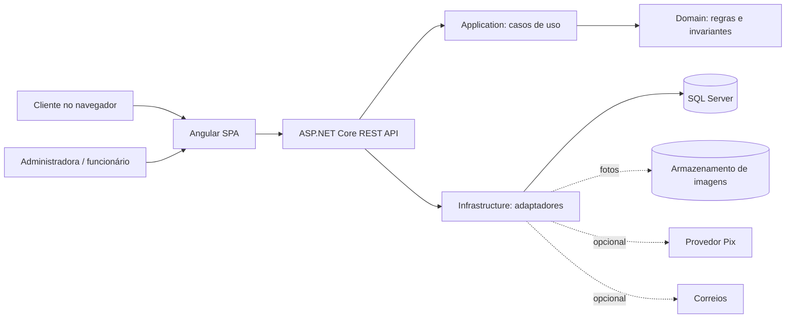
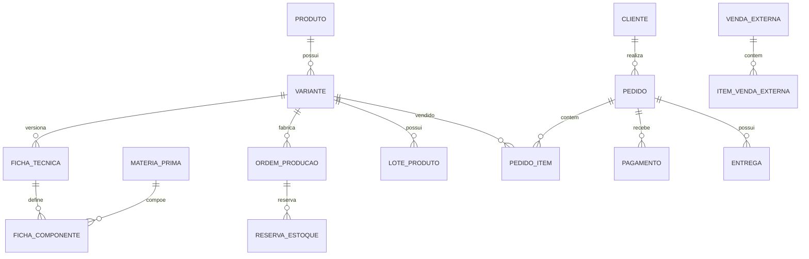
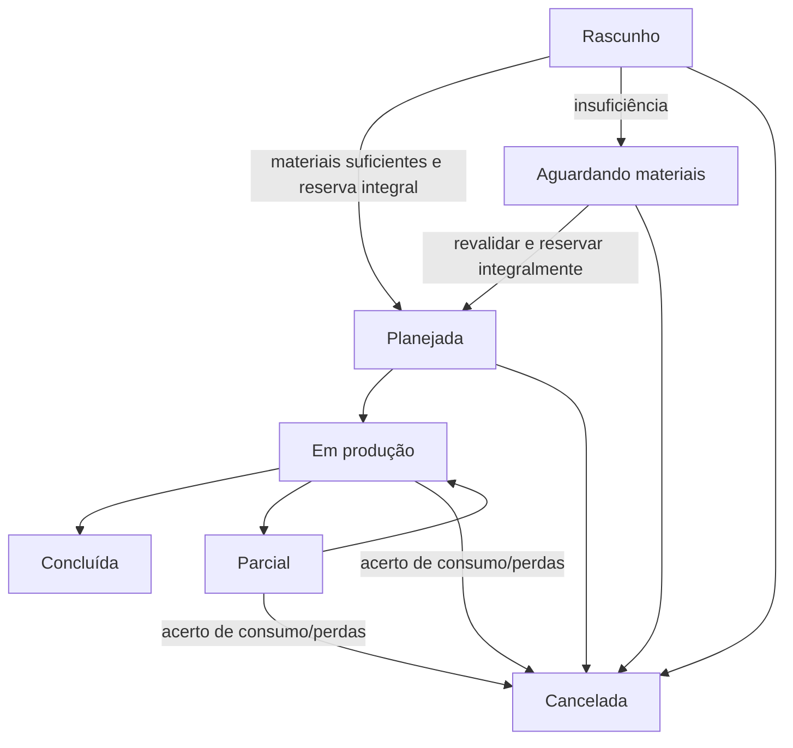

# TDD — Xaquiamuni Produtos Naturais

**Desenho técnico da plataforma de e-commerce e gestão de produção artesanal**

| Campo | Informação |
| --- | --- |
| Projeto | Xaquiamuni — E-commerce e Gestão Artesanal |
| Versão | 0.2 — arquitetura implementada da confirmação/reenvio de e-mail F2 |
| Data | 11/11/2026 |
| Status | **Revisão técnica do fluxo F2 implementado; envio real e recursos restantes ainda pendentes** |
| Documento-base | `docs/prd.md`, versão 0.3 |
| Referência estrutural | Projeto NoteKeeper; reaproveitar princípios e organização, **não copiar código ou assumir detalhes não verificados** |
| Decisão recente | Solicitante concordou em seguir com as propostas iniciais de produção e pagamento, sujeitas a detalhamento |

> **Convenções:** **Implementado** = comportamento verificado no código e coberto por testes; **Confirmado** = definido nas entrevistas ou pelo solicitante; **Proposto** = decisão de engenharia ainda sujeita a validação; **Pendente** = requer informação, validação ou integração. A confirmação/reenvio de e-mail é um fluxo F2 implementado; a entrega real, a confirmação obrigatória para login e os módulos condicionados não estão homologados.

## 1. Resumo e objetivos técnicos

Construir uma aplicação web responsiva com vitrine e compra para clientes e painel administrativo mobile-first para produtos, matérias-primas, fichas técnicas, lotes, produção, pedidos e vendas externas. A prioridade operacional é **organizar a produção artesanal** e manter estoque confiável entre canais. Os fluxos críticos devem ser transacionais, auditáveis e seguros sob concorrência e repetição de requisições.

### 1.1 Restrições e premissas

- **Confirmado:** a loja vende somente unidades acabadas disponíveis; carrinho não reserva estoque; produção reserva insumos no planejamento.
- **Confirmado:** cliente possui conta, com nome, CPF, e-mail, telefone e endereço; administradora controla o sistema; funcionário terá permissões limitadas a detalhar.
- **Confirmado:** vendas externas são lançadas manualmente no novo sistema; Trienta será substituído após migração e conferência.
- **Confirmado:** lote de produto acabado registra fabricação e validade; vencidos não são vendáveis.
- **Confirmado:** Vacaria tem opção de retirada sem frete e entrega própria por R$ 10, sujeito a delimitação de área, horários e endereço; Correios para localidades atendidas em RS/SC.
- **Confirmado:** Sicredi é o banco PJ, **não** um provedor de API Pix já homologado.
- **Implementado na F2:** cadastro cria conta ainda não confirmada e enfileira a solicitação inicial; confirmação usa token Identity com validade de 24 horas; reenvio aplica resposta genérica, cooldown, limite por conta e deduplicação.
- **Limite atual:** worker e Resend são desabilitados por padrão; não houve envio real de e-mail; `RequireConfirmedEmail` permanece `false`; recuperação de senha ainda não foi implementada.
- **Proposto:** separar MVP operacional e módulos condicionados; nenhuma integração bancária ou logística deve ser simulada como confirmação real.
- **Prazo informado:** 30/11/2026; o solicitante conduzirá eventual replanejamento. Não usar a data para suprimir requisitos silenciosamente.

### 1.2 Limites

Não projetar marketplace, múltiplas lojas, personalização livre, venda online sem estoque, integração automática com Trienta, redes sociais ou WhatsApp, emissão fiscal ou comprovação de conformidade sanitária. Kits, cupons sofisticados, análise avançada, agenda, fornecedores, financeiro completo e notificações externas são condicionados ao escopo do PRD. **Não registrar recebimento Pix real sem provedor e conciliação confiáveis.**

## 2. Decisões técnicas centralizadas

| ID | Tema | Direção técnica e justificativa | Situação |
| --- | --- | --- | --- |
| DT-01 | Frontend | Angular standalone, TypeScript, roteamento por funcionalidade e formulários reativos | Implementado na F2 |
| DT-02 | UI | Tailwind CSS e componentes acessíveis, visual responsivo com identidade Xaquiamuni e foco em celular | Implementado na F2 |
| DT-03 | Backend | C# / ASP.NET Core .NET 10, API REST, monólito modular com Domain, Application, Infrastructure e Api | Implementado na F2; módulos restantes são futuros |
| DT-04 | Persistência | EF Core e SQL Server; Azure SQL como possibilidade futura, não requisito para desenvolvimento local | Implementado na F2; Azure SQL não configurado |
| DT-05 | Identidade | ASP.NET Core Identity com cookie seguro e antifalsificação para as operações mutáveis; não há JWT no fluxo F2 | Implementado na F2; armazenamento de Data Protection para produção pendente |
| DT-06 | Permissões | Roles de base (`ADMIN`, `FUNCIONARIO`, `CLIENTE`) + políticas por operação; funcionário inicialmente com acesso mínimo | Proposto; matriz fina pendente |
| DT-07 | Valores | Cálculos no servidor com `decimal`, armazenamento com precisão explícita; BRL e arredondamento definido por componente | Proposto |
| DT-08 | Quantidades | Unidade física tipada, conversões explícitas g/kg e ml/L, nunca somar dimensões diferentes | Proposto |
| DT-09 | Concorrência | Transações SQL, controle otimista de versão e atualização atômica condicional de saldo/reserva; índices de integridade | Proposto |
| DT-10 | Histórico | Movimentações imutáveis/auditáveis e snapshots de preço, composição e lotes usados nas operações | Proposto |
| DT-11 | Imagens | Abstração de armazenamento, adaptador local em desenvolvimento e armazenamento privado/gerenciado em produção | Proposto; serviço pendente |
| DT-12 | Pagamentos | Interface de provedor, webhooks verificados, idempotência e conciliação; Sicredi ou intermediador apenas após avaliação | Pendente |
| DT-13 | Frete | Estratégias por modalidade: retirada, entrega local, Correios; cotação externa desacoplada | Proposto; integração pendente |
| DT-14 | Testes | Testes unitários .NET, testes HTTP com `WebApplicationFactory` e doubles, specs Angular e integração opt-in com SQL Server isolado; validação manual local | Implementado para o fluxo F2; E2E amplo permanece pendente |
| DT-15 | Deploy | Desenvolvimento local primeiro; configuração por ambiente, CI e hospedagem definidos após verificação de custos e limites | Pendente |

**Controle de versões:** conferir SDK, Angular, TypeScript, EF Core, bibliotecas e lockfiles antes de adicionar ou atualizar projetos/dependências. Não fixar versões menores/patch arbitrariamente nem contornar conflitos com `--force`.

## 3. Arquitetura e organização

### 3.1 Visão de componentes



Dependências de compilação propostas: `Application → Domain`; `Infrastructure → Application/Domain`; `Api → Application + Infrastructure` somente na composição. Domain não conhece HTTP, EF Core, Identity, provedores ou Angular. Evitar regras de negócio nos controllers e componentes visuais.

No fluxo F2, o cadastro chama o caso de uso de aplicação e, na mesma transação SQL, persiste usuário Identity ainda não confirmado, perfil/endereço e uma mensagem inicial `Pending` na Outbox. O worker, quando habilitado, gera o token Identity de 24 horas, compõe o link e solicita o envio ao adaptador `IEmailSender`. O reenvio passa pelo endpoint anônimo protegido por antifalsificação e pelo caso de uso; a persistência SQL decide elegibilidade, cooldown, limite e deduplicação sem revelar o resultado interno.

### 3.2 Estrutura atual do repositório e módulos futuros

```text
Xaquiamuni/
├── client/src/app/
│   ├── core/auth/                # sessão, cadastro, login e confirmação
│   ├── core/security/            # obtenção do token antifalsificação
│   ├── cadastro/
│   ├── confirm-email/
│   ├── login/
│   └── app.routes.ts
├── server/
│   ├── Xaquiamuni.slnx
│   ├── src/
│   │   ├── Api/                  # endpoints HTTP e composição
│   │   ├── Aplicacao/            # casos de uso e contratos
│   │   ├── Dominio/              # regras e entidades
│   │   ├── Infraestrutura/       # Identity, SQL Server, Outbox e Resend
│   │   └── Admin/
│   └── tests/Xaquiamuni.Tests/
│       └── Integration/          # integração SQL opt-in com bancos temporários
├── docs/
│   ├── prd.md
│   └── tdd.md
├── .github/
├── .gitignore
└── README.md
```

A estrutura acima reflete os projetos existentes usados pelo fluxo F2; módulos de negócio restantes continuam como trabalho futuro. Migrations pertencem a Infrastructure; testes integrados usam bancos temporários isolados, nunca banco de desenvolvimento.

### 3.3 Módulos

| Módulo | Responsabilidade | PRD |
| --- | --- | --- |
| Identidade | ASP.NET Core Identity, sessão por cookie, antifalsificação, cadastro, login, confirmação de e-mail e reenvio; autorização administrativa mais ampla permanece futura | RF-01–03, RF-27–28, RN-13, RN-16, RN-21–29 |
| Catálogo | Categorias, produtos, variantes/SKUs, fotos, publicação e preços | RF-04–05 |
| Estoque | Insumos, lotes acabados, saldos, reservas, movimentos e mínimos | RF-06–08, RN-01–04, RN-17 |
| Produção | Fichas versionadas, planejamento, reservas, execução e conclusão | RF-09–14, RN-03–06, RN-18 |
| Comércio | Carrinho, pedidos, acompanhamento e venda externa | RF-15–19, RF-26, RN-07–09 |
| Entrega e pagamentos | Modalidades, cobranças, conciliação e rastreamento | RF-20–21 (condicionados) |
| Gestão | Financeiro, análise, agenda e fornecedores | RF-22–25 (condicionados) |
| Transversal | Auditoria, relógio, transações, idempotência e erros | RNF-01–10 |

### 3.4 Frontend e experiência

- Rotas públicas para vitrine, produto e autenticação; rotas de cliente para carrinho, checkout, perfil e pedidos; rotas administrativas para painel, produtos, estoque, fichas, produção, vendas e configurações.
- Carregar módulos por rota quando apropriado; serviços de API tipados e estados explícitos de `carregando`, `vazio`, `erro` e `sucesso`.
- Layout mobile-first: navegação simplificada, formulários com rótulos, toque confortável, tabelas adaptadas a cartões no celular e confirmação para ações irreversíveis.
- Exibir quantidade **vendável**, não saldo bruto; informar indisponibilidade sem permitir compra de lote vencido.
- UI não calcula valores finais autoritativos, não decide permissões e não confirma pagamento por conta própria.
- Identidade visual baseada nos arquivos da proprietária: fundo claro, dourado discreto e contraste legível; evitar afirmações clínicas não validadas.
- `/confirm-email` lê `email` e `token` do fragmento do link, remove o fragmento com `history.replaceState` antes da requisição e envia os dados no corpo HTTP; a página não mantém o token após a confirmação ou falha não recuperável.
- A página oferece formulário reativo de reenvio sem fragmento ou quando o link falha; cadastro (no sucesso) e login possuem links para `/confirm-email`, sem transportar e-mail pela URL.

## 4. Dados e persistência

### 4.1 Convenções

- Identificadores opacos (GUID sugerido); datas de eventos em UTC, apresentação no fuso do negócio; datas de fabricação/validade como datas civis.
- Valores monetários em `decimal` com precisão definida no mapeamento; total do servidor prevalece. Arredondamento consistente e snapshots de preço no pedido.
- Quantidades com `decimal` e escala por unidade; distinguir `UN`, `G`, `ML` e conversões compatíveis; não converter massa em volume.
- Produtos/variantes com identidade própria de estoque e ficha técnica quando necessário; **não** misturar saldos de variantes.
- Exclusão lógica/despublicação quando houver histórico; sem cascata física de registros que compõem pedidos, lotes e ordens.
- Movimentação com origem, tipo, quantidade, unidade, instante, autor e motivo. Ajustes físicos não reescrevem movimentos anteriores.

### 4.2 Modelo lógico preliminar

| Entidade | Campos e vínculos essenciais |
| --- | --- |
| Usuario / Perfil / Permissao | IdentityId, papel, status, políticas autorizadas |
| Cliente / Endereco | usuário, nome, CPF normalizado e protegido, e-mail, telefone, CEP, endereço |
| Categoria / Produto / Variante | descrição, preço, publicação, unidade de venda, imagens, ficha técnica aplicável |
| MateriaPrima | nome, unidade-base, mínimo, ativo; movimentações e reservas |
| LoteMateriaPrima (opcional) | origem, validade e custo de aquisição se rastreabilidade por lote de insumo for aprovada |
| FichaTecnica / FichaComponente | produto/variante, versão, material, quantidade por unidade, custo de referência |
| OrdemProducao / OrdemMaterial | quantidade prevista, ficha snapshot, prazo, estado, reservas, consumo real |
| LoteProduto | produto/variante, fabricação, validade, saldo físico, saldo reservado, origem da produção |
| EmailOutbox | UserId, tipo, estado, tentativas, criação/próxima tentativa/conclusão, chave ativa de deduplicação, lease e `rowversion`; não persiste e-mail, token nem conteúdo da mensagem |
| MovimentoEstoque | item/lote, tipo, quantidade, origem, autor, instante, motivo |
| ReservaEstoque | origem (ordem/pedido), item/lote, quantidade, estado, expiração quando aplicável |
| Carrinho / CarrinhoItem | cliente, produto/variante e quantidade; não garante reserva |
| Pedido / PedidoItem | cliente, status, endereço snapshot, preços, descontos, frete, totais e itens snapshot |
| Pagamento / EventoPagamento | pedido, método, referência externa, estado, eventos e deduplicação |
| Entrega | modalidade, valor, endereço snapshot, rastreio, status |
| VendaExterna / ItemVendaExterna | canal, produtos, lote(s), quantidade, preço, recebimento e origem da baixa |
| Receita / Despesa | lançamento financeiro com origem única, se módulo aprovado |
| Auditoria / ComandoIdempotente | ator, ação, referência, instante, chave de idempotência e resultado |

### 4.3 Relacionamentos centrais



### 4.4 Invariantes e índices

- CPF normalizado único para contas de clientes segundo política de cadastro; e-mail de login normalizado único no contexto da aplicação. Não registrar CPF completo em logs.
- Saldo livre = saldo físico utilizável − reservas ativas; nunca negativo. Lotes vencidos, bloqueados ou descartados não entram na disponibilidade.
- Reserva de produção não pode ultrapassar saldo livre de cada matéria-prima; reserva de pedido não pode ultrapassar saldo vendável dos lotes elegíveis.
- Restrições e índices por origem de movimento/lançamento para impedir duplicação de consumo, venda, conclusão e receita.
- A versão da ficha usada pela ordem fica congelada; atualização de preço/ficha não altera histórico.
- Pedido guarda preço, desconto, frete e endereço de entrega do momento de confirmação; mudanças cadastrais posteriores não reescrevem o pedido.
- Não permitir duas conclusões da mesma ordem, nem dois processamentos do mesmo evento externo.
- Outbox de confirmação usa chave ativa única filtrada, `RowVersion` do SQL Server e updates condicionais por estado/lease/versão; preservar mensagens históricas ao liberar a chave.

### 4.5 Transações e concorrência

Toda mutação crítica de estoque deve ocorrer numa transação SQL curta. Uma abordagem candidata é bloquear/atualizar condicionalmente os saldos afetados em ordem determinística, verificar que `disponível >= requerido`, registrar reservas e movimentos e confirmar tudo na mesma transação. O desenho concreto de locks, isolamento, `rowversion` e índices será validado com SQL Server real.

- **Reserva de ordem:** verificar todos os materiais, criar todas as reservas ou nenhuma; não permitir reserva parcial silenciosa.
- **Conclusão de produção:** converter reservas em consumo, registrar rendimento/lote e aumentar estoque acabado uma única vez; falha implica rollback.
- **Pedido:** criar pedido e reservar lotes elegíveis atomicamente; falha não cria pedido com reserva parcial.
- **Pagamento:** atualizar estado e aplicar baixa definitiva **uma única vez** após confirmação válida; eventos repetidos não duplicam estoque ou receita.
- **Venda externa:** criar venda, movimentar lotes e registrar origem financeira em uma operação consistente; repetição com mesma chave não duplica.
- **Expiração:** processador idempotente de pedidos pendentes verifica estado antes de liberar reserva; disputa com pagamento exige reconciliação segura.
- **Cadastro F2:** usuário, perfil/endereço e mensagem inicial da Outbox são salvos na mesma transação; rollback não deixa conta sem a solicitação inicial ou solicitação sem conta.
- **Reenvio F2:** persistência usa transação SQL curta `READ COMMITTED` e `sp_getapplock` exclusivo por usuário, com proprietário transacional; bloqueia corrida de chamadas, valida limites e cooldown, libera chave de `DeadLetter` e insere nova linha na mesma transação.
- **Outbox F2:** `RowVersion` e lease protegem claim, conclusão, retry, cancelamento e dead-letter contra gravações obsoletas; worker reprocessa leases expiradas.

## 5. Regras de cálculo e estados

### 5.1 Capacidade produtiva

Para cada componente obrigatório `i` de consumo positivo por unidade:

`capacidade_i = piso(saldo_livre_i / consumo_por_unidade_i)`

`capacidade_total = mínimo(capacidade_i)`.

Exemplo do PRD: 100 g de base e 5 ml de essência por unidade, com 850 g e 30 ml livres, permitem `mínimo(8, 6) = 6` unidades. Ficha incompleta, consumo zero inválido e unidades incompatíveis não geram capacidade fictícia. Reservas de outras ordens reduzem saldo livre.

### 5.2 Estados de produção — proposta aceita como direção



**Detalhamento ainda pendente:** produção parcial poderá gerar lotes parciais e consumo proporcional/real; cancelar ordem iniciada não devolve insumo já consumido. A escolha entre consumir por etapa ou na conclusão exige confirmação da proprietária. Não implementar transições irreversíveis antes de validar exemplos reais.

### 5.3 Estados de pedido e pagamento — proposta aceita como direção

- Pedido: `AGUARDANDO_PAGAMENTO → PAGO → EM_SEPARACAO → ENVIADO / PRONTO_RETIRADA → ENTREGUE / RETIRADO`; `CANCELADO` somente quando regras permitirem.
- Pagamento: `PENDENTE`, `CONFIRMADO`, `EXPIRADO`, `FALHOU`, `REEMBOLSO_PENDENTE`, `REEMBOLSADO` (nomes sujeitos ao provedor).
- Estoque: carrinho **não** reserva; pedido aguardando pagamento reserva por prazo configurável; confirmação válida converte reserva em baixa; expiração/cancelamento libera **apenas** reserva existente.
- Pagamento tardio depois de expiração: **não** recriar reserva ou confirmar venda automaticamente sem estoque; registrar exceção para conciliação/reembolso conforme provedor e regra aprovada.
- Pedido pago cancelado: não recolocar automaticamente no estoque produto já expedido ou entregue; reentrada depende de retorno físico conferido.
- Prazo de expiração, cancelamento por cliente e política de reembolso permanecem pendentes; não inventar minutos nem prometer estorno automático.

### 5.4 Lotes e validade

**Proposto:** selecionar primeiro lotes elegíveis de menor validade (FEFO), sem incluir vencidos; bloquear lotes danificados. O operador registra fabricação, validade e quantidade efetiva. Se lote expirar enquanto reservado, exigir revalidação antes da separação e tratamento explícito da reserva; não entregar produto vencido. Política de vencimento no dia, descarte e reentrada exige validação.

### 5.5 Precificação

Custo unitário estimado = materiais consumidos + embalagem + mão de obra alocada + taxas/custos atribuíveis + rateio de despesas **quando definido**. Margem bruta-alvo de 70% implica `preço = custo / 0,30`; 60% implica `preço = custo / 0,40`, se o custo usado na fórmula representar a base completa pretendida. Isso **não** equivale automaticamente a lucro líquido. Frete cobrado do cliente e frete absorvido pela loja devem ser distinguidos. Rateio e impostos são pendentes.

### 5.6 Outbox de confirmação de e-mail — F2 implementada

`EmailOutbox` guarda somente referência ao usuário e metadados de processamento; e-mail, token e conteúdo não são persistidos nessa tabela. Os estados são `Pending`, `Processing`, `Completed`, `DeadLetter` e `Cancelled`. A chave ativa única permite uma solicitação não concluída por conta; a conclusão/cancelamento libera a chave, enquanto `DeadLetter` mantém o histórico e sua chave até a recuperação.

- O claim muda a mensagem para `Processing`, incrementa tentativas e cria lease de 2 minutos. Leases expiradas podem ser reivindicadas novamente.
- Updates de conclusão, retry, cancelamento e dead-letter são condicionados ao estado, lease vigente e `RowVersion`; gravações obsoletas não devem sobrescrever estado novo.
- Falhas transitórias usam atraso exponencial com jitter: base de 2 minutos, crescimento exponencial limitado a 15 minutos e fator aleatório entre 0,8 e 1,0. São permitidas no máximo 5 tentativas; falha permanente ou esgotamento leva a `DeadLetter`.
- O worker percorre mensagens sequencialmente, reivindicando uma por vez; o intervalo padrão é 15 segundos e o lote configurável não implica processamento paralelo.
- `EmailOutboxWorker.Enabled` e `ResendEmail.Enabled` têm padrão `false`. O sender HTTP é registrado somente quando Resend está habilitado; o worker exige sender válido. `EmailConfirmationOutboxProcessor` é registrado somente quando o worker está habilitado.
- A entrega é **at-least-once**, não exactly-once: se o provedor aceitar o e-mail e o processo falhar antes de gravar `Completed`, uma nova tentativa após a expiração do lease pode causar entrega duplicada.

## 6. API e contratos preliminares

### 6.1 Convenções

- As rotas HTTP implementadas na F2 usam `/api/auth` (sem segmento `/v1`); JSON e DTOs separados das entidades. Prefixos de recursos de negócio ainda não implementados serão definidos junto a seus contratos.
- Erros padronizados (`ProblemDetails`), validação por campo, códigos HTTP coerentes: `400` entrada inválida, `401` não autenticado, `403` proibido, `404` ausente, `409` conflito de estado/saldo.
- Identidade e autorização derivadas da sessão autenticada, nunca do `userId` arbitrário enviado pelo navegador.
- `Idempotency-Key` para comandos críticos de criação/conclusão/pagamento/venda externa; mesmo comando retorna resultado anterior, chave reutilizada com payload distinto retorna conflito.
- Valores monetários e datas em formatos canônicos; servidor recalcula totais, frete validado e disponibilidade.
- Endpoints mutáveis de autenticação são anônimos ou autenticados conforme a operação e protegidos por antifalsificação; o token é obtido em `GET /api/auth/csrf` e enviado no cabeçalho `X-XSRF-TOKEN`.

### 6.2 Endpoints F2 implementados e catálogo de negócio proposto

| Recurso | Exemplos de rotas | Acesso |
| --- | --- | --- |
| Antifalsificação | `GET /api/auth/csrf` | Público; `200`, token no corpo, cookie XSRF e `no-store` |
| Cadastro | `POST /api/auth/register` | Anônimo + antifalsificação; `201`, `400`, `409` ou `500`; cria conta sem abrir sessão e enfileira confirmação |
| Login | `POST /api/auth/login` | Anônimo + antifalsificação; `204`, `400` ou `401`; cookie de autenticação, confirmação ainda não exigida |
| Sessão | `GET /api/auth/me` | Cliente autenticado; `200`, `401` ou `403`; retorna o identificador da sessão |
| Logout | `POST /api/auth/logout` | Cliente autenticado + antifalsificação; `204`, `400`, `401` ou `403`; remove o cookie |
| Confirmação | `POST /api/auth/confirm-email` | Anônimo + antifalsificação; recebe e-mail/token no corpo; `204`, `400` ou `500` |
| Reenvio | `POST /api/auth/resend-confirmation-email` | Anônimo + antifalsificação + política exclusiva; `202` genérico, `400`, `429` com `Retry-After` quando disponível ou erro inesperado |
| Produtos | `GET /produtos`, `GET /produtos/{id}`, `POST /admin/produtos`, `PATCH /admin/produtos/{id}` | Leitura pública, escrita autorizada |
| Matérias-primas | `GET /admin/materiais`, `POST /admin/materiais`, `POST /admin/materiais/{id}/movimentos` | Administrativo |
| Fichas | `GET /admin/variantes/{id}/fichas`, `POST /admin/variantes/{id}/fichas` | Administrativo |
| Produção | `POST /admin/ordens`, `POST /admin/ordens/{id}/planejar`, `POST /admin/ordens/{id}/iniciar`, `POST /admin/ordens/{id}/concluir`, `POST /admin/ordens/{id}/cancelar` | Administrativo autorizado |
| Estoque acabado | `GET /admin/lotes`, `POST /admin/lotes/{id}/ajustes` | Administrativo |
| Pedidos | `POST /pedidos`, `GET /me/pedidos`, `GET /admin/pedidos`, `POST /admin/pedidos/{id}/transicoes` | Cliente próprio/admin |
| Vendas externas | `POST /admin/vendas-externas`, `GET /admin/vendas-externas` | Administrativo |
| Entrega | `POST /checkout/cotacoes`, `GET /admin/entregas` | Conforme operação; condicionado |
| Pagamento | `POST /pedidos/{id}/cobrancas`, `POST /webhooks/pagamentos/{provedor}` | Autenticado / webhook autenticado pelo provedor; condicionado |
| Gestão | `GET /admin/dashboard`, demais consultas | Administrativo; condicionado |

Apenas as rotas de autenticação listadas acima estão implementadas; os demais exemplos continuam propostos, sem prefixo ou contrato final definido. O reenvio retorna `202 Accepted` com a mesma mensagem genérica para resultados normais elegíveis e não elegíveis, `400` para entrada inválida e `429` ao exceder a política exclusiva da rota, com `Retry-After` quando disponível. Não expor rotas administrativas a funcionário sem política específica.

### 6.3 Fluxos de integração

#### Confirmação de e-mail (F2)

Cadastro transacional → mensagem inicial `Pending` → claim do worker → geração do token Identity (24 horas) → composição do link `https://<frontend>/confirm-email#email=...&token=...` → envio pelo `IEmailSender` configurado com `HttpClient` para Resend. Os valores do link ficam no fragmento, não na query string; a página Angular remove o fragmento antes de chamar a API. Resend está desabilitado por padrão e nenhum envio real foi validado.

O reenvio HTTP delega ao caso de uso, que consulta a conta não confirmada e a Outbox; cooldown de 2 minutos, máximo de 5 solicitações por conta em janela móvel de 1 hora (incluindo cadastro inicial), deduplicação de `Pending`/`Processing` e recuperação de `DeadLetter` são aplicados na transação SQL por usuário. A rota usa fixed window de 10 requisições por minuto por IP, sem confiar em `X-Forwarded-For`.

**Pix:** pedido pendente → criar cobrança com referência única → exibir QR Code/copia-e-cola → receber evento assinado/autenticado ou consultar API → verificar identificador, valor, recebedor e estado → confirmar idempotentemente → liberar separação. Webhook não confiável ou falha de consulta não marca pagamento como confirmado. Credenciais somente no servidor. Testar em sandbox antes de produção.

**Entrega:** CEP de destino → verificar área de entrega própria ou retirada elegível → para demais endereços atendidos, cotar Correios com peso/dimensões/origem → registrar opção, custo e prazo aceitos no pedido. Cotação indisponível não deve gerar frete fictício; fallback manual somente após aprovação.

**Fotos:** upload autenticado e validado, limites de tamanho/tipo, geração de identificador interno, remoção segura de metadados quando aplicável; armazenar chave e metadados no SQL, bytes fora do banco se possível. Definir política de visibilidade: fotos publicadas podem ser públicas; arquivos administrativos não.

## 7. Segurança, privacidade e operação

- ASP.NET Core Identity com hashing de senhas e lockout configurado; recuperação de senha ainda não implementada e permanece como próxima funcionalidade. Nunca armazenar senha reversível.
- Autenticação F2 usa um cookie `HttpOnly`, `Secure`, `SameSite=Lax`, path `/` e expiração de 8 horas, sem sliding expiration. Login/logout/cadastro/confirmação/reenvio usam antifalsificação; `/me` exige a política de cliente autenticado. `RequireConfirmedEmail` continua `false`.
- Não há configuração explícita no repositório para persistir e compartilhar chaves de ASP.NET Data Protection; armazenamento persistente e compartilhado entre instâncias deve ser configurado e validado antes da produção.
- O rate limiter nativo é em memória por processo, aplicado somente ao reenvio: fixed window de 1 minuto, 10 permissões, fila zero. Particiona por `RemoteIpAddress`, normaliza IPv4 mapeado em IPv6 e usa fallback compartilhado quando ausente; não lê headers de forwarding. No deploy atrás de proxy, configurar somente proxies confiáveis e validar o IP remoto efetivo.
- Chave Resend e remetente são configurações exclusivas do servidor; o sender `HttpClient` tem timeout de 30 segundos, não segue redirects e só é registrado com `ResendEmail.Enabled=true`. Worker desabilitado não processa nem envia mensagens.
- Validar CPF no servidor; proteger dados pessoais em logs, respostas e telas; definir finalidade, retenção e procedimentos de exclusão/correção com a proprietária antes do uso real.
- Autorização por endpoint e caso de uso. Administrador recebe permissões plenas de negócio; funcionário inicia com acesso mínimo até a matriz ser aprovada; cliente acessa apenas seus próprios recursos.
- Para o cliente navegador da F2, cookie é o modelo selecionado; não há JWT implementado. Outro tipo de cliente exigiria decisão própria antes de adotar mecanismo diferente.
- Configurações por ambiente e segredos fora do Git; logs estruturados sem tokens, CPF integral ou payload sensível de pagamento.
- HTTPS em produção, CORS restrito às origens autorizadas, validação de uploads e limites de requisição.
- Auditoria para estoque, preço, produção, pedidos, vendas externas, permissões e estornos; distinguir auditoria de logs de aplicação.
- Backups, restauração testada, retenção, observabilidade, custos de infraestrutura e recuperação de incidentes serão gates para uso real; não presumir Azure gratuito suficiente para toda a solução.

## 8. Qualidade e verificação

| Camada | Estratégia | Evidência esperada |
| --- | --- | --- |
| Domain | Testes unitários de capacidade, unidades, margens, validade e transições | Casos determinísticos |
| Application | Testes de casos de uso com portas falsas, incluindo rollback lógico e autorização | Regras sem dependência HTTP |
| Infrastructure | Integração com SQL Server real, transações, índices e concorrência | Sem reservas/vendas duplicadas |
| API | Testes de endpoints, identidade, validação, conflito e acesso indevido | Contratos verificáveis |
| Confirmação/reenvio F2 | Testes unitários de caso de uso/Outbox, testes HTTP com doubles, specs Angular e integração de endpoint/Outbox com SQL Server real isolado | Elegibilidade, resposta genérica, antifalsificação, rate limit, cooldown, limites, deduplicação, concorrência e histórico |
| Angular | Testes de formulários, guards, estados de tela e componentes | UI responsiva e erros claros |
| E2E | Cliente compra; admin produz; registra venda externa; cancela/expira pedido | Jornada completa em ambiente de teste |
| Integrações opcionais | Webhooks duplicados/fora de ordem, falha de Correios, timeout de provedor | Sem cobrança ou estoque indevido |

### 8.1 Cenários críticos de aceite

1. Dois pedidos concorrentes disputam a última unidade; no máximo um reserva/compra.
2. Duas ordens concorrentes disputam o mesmo material; a soma das reservas não supera o saldo livre.
3. Falha na conclusão de ordem não consome material sem registrar o produto acabado.
4. Conclusão ou venda externa repetida não duplica movimentos/receitas.
5. Produto vencido ou despublicado não pode ser comprado; lote elegível é rastreável.
6. Cliente A não acessa CPF, endereço ou pedido do cliente B; funcionário não contorna política chamando API.
7. Expiração e confirmação de pagamento concorrentes não geram reserva negativa nem confirmação de venda sem estoque.
8. Pedido preserva preços, endereço e frete históricos após alteração de cadastros.
9. Vendas externas movimentam estoque sem criar pedido online fictício.
10. Simulação de frete para Vacaria oferece retirada gratuita e entrega própria R$ 10 somente em área elegível.

**Rastreabilidade:** CA-01 a CA-18 do PRD v0.3 (CA-15 a CA-18 permanecem em uma tabela Markdown separada; consolidar a formatação em revisão futura do PRD, sem mudar conteúdo).

**Integração SQL F2:** testes opt-in via `XAQUIAMUNI_RUN_SQLSERVER_INTEGRATION=1`; a fixture valida `.\SQLEXPRESS`, cria bancos temporários `Xaquiamuni_IntegrationTest_*`, aplica migrations somente neles e remove apenas os bancos criados pela própria fixture. O fluxo de Resend integrado usa handler HTTP simulado; o teste do endpoint usa Identity e SQL reais no banco temporário, com worker e Resend desabilitados. A suíte não deve apontar para `XaquiamuniDev` nem para Azure SQL.

**Validação manual F2:** ambiente local HTTPS da API e Angular pelo proxy; verificação do token antifalsificação e do cadastro/reenvio no navegador, seguida de consulta SQL somente leitura à Outbox. O resultado observado foi uma única mensagem `Pending`, sem tentativas/conclusão e com deduplicação ativa. Isso valida o enfileiramento, não a entrega real.

### 8.2 Metas não definidas

Não existem metas aprovadas de latência, concorrência, disponibilidade, cobertura percentual, RPO/RTO ou volume de dados. Coletar medidas em ambiente de teste e registrar resultados; não declarar metas arbitrárias como compromissos do produto.

## 9. Plano de implementação e gates

| Etapa | Entrega incremental | Gate de conclusão |
| --- | --- | --- |
| F0 | Conferir referência NoteKeeper, versões, estrutura, PRD/TDD e repositório limpo | Stack compatível e decisões registradas |
| F1 | Criar solução backend, Angular, infraestrutura local, CI inicial e health check | Build e testes básicos aprovados |
| F2 | **Implementado parcialmente:** Identity, cadastro/login por cookie, `/me`, logout, confirmação e reenvio de e-mail, Outbox transacional e interface Angular; worker/Resend desligados por padrão | Testes unitários, HTTP e SQL isolado aprovados; entrega real de e-mail e confirmação obrigatória para login permanecem pendentes |
| F3 | Catálogo, variantes, imagens e vitrine mobile | CRUD e estados públicos corretos |
| F4 | Matérias-primas, estoque acabado, lotes, validade e movimentos | Integridade e auditoria testadas |
| F5 | Fichas técnicas, capacidade e ordens com reserva | Concorrência e cálculo aprovados |
| F6 | Execução, conclusão parcial/cancelamento e entrada de lotes | Consumo e rendimento consistentes |
| F7 | Carrinho, pedidos, reserva de acabados e histórico | Sem overselling ou duplicação |
| F8 | Registro de vendas externas e painel operacional | Estoque e origem financeira consistentes |
| F9 | Entrega local/retirada e Correios, se viável; pagamento Pix, se homologado | Testes sandbox e reconciliação antes de ativar |
| F10 | Financeiro, análise, agenda, fornecedores, permissões finas e polimento, conforme priorização | Critérios específicos aprovados |
| F11 | Teste integrado com proprietária, correções, documentação e demonstração | Evidências e pendências registradas |

**Método de trabalho:** prompts curtos ao Copilot; uma etapa por vez; revisar retorno e diffs; testes focados durante implementação e suíte completa em gates; nunca solicitar commit/push automático nem apagar testes que falhem. Etapas podem ser reorganizadas por dependência e feedback, mas mudanças de escopo devem ser registradas.

## 10. Riscos, alternativas e pendências

| ID | Tema | Risco/decisão necessária | Ação antes de implementar |
| --- | --- | --- | --- |
| PT-01 | Fonte de arquitetura | NoteKeeper foi citado, mas estrutura exata e dependências não foram auditadas nesta entrega | Conferir repositório e versões em F0 |
| PT-02 | Autenticação e recuperação | F2 usa Identity com cookie e antifalsificação; recuperação de senha ainda não implementada | Manter o cookie no fluxo web; tratar recuperação como próxima funcionalidade |
| PT-03 | Funcionários | Matriz de permissões ainda não definida | Implementar barreira mínima e revisar após admin |
| PT-04 | Produção parcial | Quando consumir insumos, tratar perdas e cancelamento iniciado | Validar exemplos com proprietária antes de F6 |
| PT-05 | Pedido | Prazo de reserva, cancelamento, pagamento tardio e reembolso | Aprovar política antes de F7/F9 |
| PT-06 | Pix Sicredi | API, contrato, webhook, custos e homologação desconhecidos | Verificar viabilidade; considerar intermediador |
| PT-07 | Correios | CEP de origem, peso, dimensões, API e fallback ausentes | Coletar dados antes da integração |
| PT-08 | Entrega local | Área, horários e endereço de retirada não confirmados | Validar antes do checkout real |
| PT-09 | Lotes | FEFO, vencimento no dia, perdas, descarte e devoluções | Validar antes da seleção automática de lotes |
| PT-10 | Precificação | Rateio de custos fixos, impostos e margens | Definir com a proprietária antes de sugestão automática |
| PT-11 | Migração | Trienta não tem exportação confirmada | Preparar cadastro inicial e conferência manual |
| PT-12 | Infraestrutura | Imagens, banco, backup e custos de produção | Escolher serviço e verificar limites antes do deploy |
| PT-13 | Escopo | Módulos condicionados não foram todos aprovados | Repriorizar com base em testes e decisões do solicitante |
| PT-14 | Dados sensíveis | CPF, endereços, pagamento e retenção | Revisar privacidade antes de operação real |
| PT-15 | Resend real | Configuração está desabilitada e nenhuma entrega real foi validada | Configurar remetente/chave em ambiente seguro, validar domínio, entrega, falhas e operação antes de ativar |
| PT-16 | Garantia de entrega | Processamento é at-least-once; falha após aceitação pelo provedor e antes do `Completed` pode gerar entrega duplicada | Não prometer exactly-once; monitorar e definir tratamento operacional para duplicidades |
| PT-17 | Rate limiting | Limites são locais a cada processo e não agregam instâncias; forwarded headers não são confiáveis/configurados | No deploy, documentar proxies confiáveis e avaliar limitador distribuído se houver múltiplas instâncias |
| PT-18 | Data Protection | Não há chave persistente compartilhada configurada no repositório | Configurar armazenamento protegido e compartilhado, validar rotação, reinício e múltiplas instâncias |
| PT-19 | Login confirmado | `RequireConfirmedEmail` permanece `false` porque envio real ainda não foi validado | Só avaliar exigência após validar entrega e experiência de recuperação/reenvio |
| PT-20 | Recuperação de senha | Fluxo ainda não implementado | Tratar como próxima funcionalidade após validação do serviço real de e-mail |

### 10.1 Mapa de rastreabilidade resumido

| Requisitos do PRD | Módulos / desenho | Gates |
| --- | --- | --- |
| RF-01–03; RN-13, RN-16 | Identidade e autorização, seções 3, 6, 7 | F2 |
| RF-04–08; RN-01–02, RN-17 | Catálogo, lotes, estoque, seções 4–5 | F3–F4 |
| RF-09–14; RN-03–06, RN-18 | Produção, reservas e cálculo, seções 4–5 | F5–F6 |
| RF-15–19; RN-07, RN-09 | Carrinho, pedidos, pagamentos, seções 5–6 | F7, F9 |
| RF-26; RN-08, RN-19 | Venda externa e substituição Trienta | F8, F11 |
| RF-20–25; RN-14–15, RN-20 | Integrações e módulos condicionados | F9–F10 |
| RNF-01–10 | Segurança, qualidade, UX, histórico e operação | Todos os gates |

## 11. Referências e validação documental

- `docs/prd.md` — Xaquiamuni, versão 0.3; fonte das decisões de produto e da numeração RF/RN/RNF/CA.
- `tdd.md` do professor — exemplo de estrutura e profundidade de um Technical Design Document para locadora; **não** fonte de requisitos da Xaquiamuni.
- Repositório NoteKeeper informado pelo solicitante — referência de organização e stack, **a conferir** em F0.
- Entrevistas com a proprietária e esclarecimentos registrados na conversa — decisões de negócio e propostas aceitas como direção inicial.

### 11.1 Condições de handoff

Antes de novas funcionalidades críticas ou uso em produção: (1) revisar pendências aplicáveis do PRD/TDD; (2) validar as decisões específicas da etapa; (3) definir e executar testes de aceite; (4) validar persistência compartilhada de Data Protection e configuração de proxies; (5) configurar e validar envio real antes de exigir confirmação no login. **A implementação F2 comprova o enfileiramento e o fluxo HTTP/UI, não homologação de Resend, entrega real, Pix, Correios ou prontidão de produção.**
