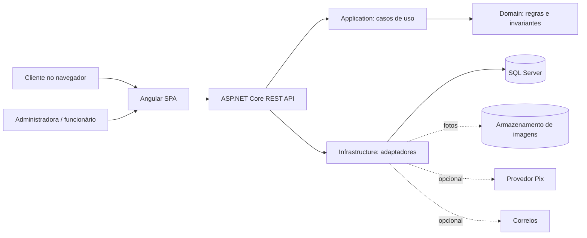
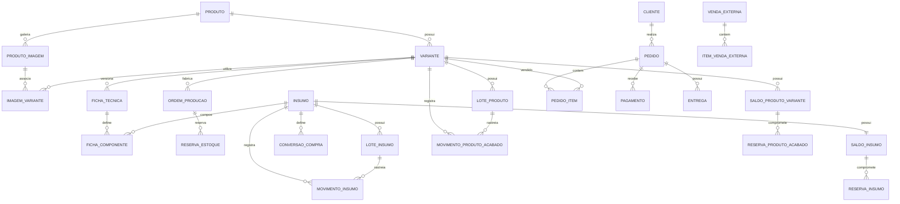
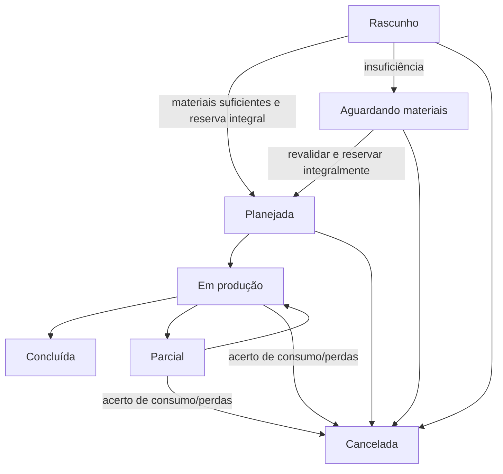

# TDD — Xaquiamuni Produtos Naturais

**Desenho técnico da plataforma de e-commerce e gestão de produção artesanal**

| Campo                 | Informação                                                                                                                                                                               |
| --------------------- | ---------------------------------------------------------------------------------------------------------------------------------------------------------------------------------------- |
| Projeto               | Xaquiamuni — E-commerce e Gestão Artesanal                                                                                                                                               |
| Versão                | 3.0 — F4.2.6, API administrativa de estoque de insumos                                                                                                                        |
| Data                  | 16/11/2026                                                                                                                                                                               |
| Status                | **F2 e F3.1–F3.6.4 implementadas; gate final F3.7 aprovado; F4.0/F4.1 e F4.2.1–F4.2.5 aprovadas; F4.2.6 implementada e aguardando revisão. Nenhuma migration aplicada a banco persistente.** |
| Documento-base        | `docs/prd.md`, versão 0.22                                                                                                                                                              |
| Referência estrutural | Projeto NoteKeeper; reaproveitar princípios e organização, **não copiar código ou assumir detalhes não verificados**                                                                     |
| Decisão recente       | F4.0 aprovou regras de estoque documentadas nas seções 4, 8 e 10; regras de produção, pedidos e pagamentos permanecem para detalhamento nas fases próprias                                 |

> **Convenções:** **Implementado** = comportamento verificado no código e coberto por testes; **Confirmado** = definido nas entrevistas ou pelo solicitante; **Proposto** = decisão de engenharia ainda sujeita a validação; **Pendente** = requer informação, validação ou integração. F2 e F3.1–F3.6.4 estão concluídas; o gate final F3.7 foi aprovado. F4.1 implementa unidades, quantidades, insumos e formas; F4.2.1–F4.2.4 persistem cadastros, lotes/saldos e movimentos; F4.2.5 adiciona consultas internas e F4.2.6 adiciona a API ADMIN. Testes SQL usam somente a fixture descartável; nenhuma migration foi aplicada a banco persistente, e F4.2.5/F4.2.6 não alteram schema. F4.2.3–F4.2.5 foram aprovadas; F4.2.6 aguarda revisão. Reservas, painel Angular de estoque e demais módulos posteriores continuam fora desta etapa. A proposta técnica de calendário operacional `America/Sao_Paulo` ainda depende da aprovação da proprietária. F2 e o acesso administrativo inicial estão concluídos; categorias, produtos e variantes têm backend e frontend administrativos. O gate de confirmação para login de `CLIENTE` é explícito e está ativo, embora `RequireConfirmedEmail` global permaneça `false`. Testes manuais anteriores validaram envio real com Resend em ambientes isolados; implantação e operação de produção não estão homologadas.

## 1. Resumo e objetivos técnicos

Construir uma aplicação web responsiva com vitrine e compra para clientes e painel administrativo mobile-first para produtos, matérias-primas, fichas técnicas, lotes, produção, pedidos e vendas externas. A prioridade operacional é **organizar a produção artesanal** e manter estoque confiável entre canais. Os fluxos críticos devem ser transacionais, auditáveis e seguros sob concorrência e repetição de requisições.

### 1.1 Restrições e premissas

- **Confirmado:** estoque de unidades acabadas é associado à variante existente; carrinho não reserva estoque; a reserva de pedido ocorre ao finalizar pedido, enquanto prazo/baixa física permanecem pendentes. Planejamento de produção reservará insumos na etapa de produção futura.
- **Confirmado:** cliente possui conta, com nome, CPF, e-mail, telefone e endereço; administradora controla o sistema; funcionário terá permissões limitadas a detalhar.
- **Confirmado:** vendas externas são lançadas manualmente no novo sistema; Trienta será substituído após migração e conferência.
- **Confirmado:** lotes acabados registram fabricação e validade, com FEFO; são elegíveis até o fim da data de validade no calendário da loja. Insumos podem configurar controle de lote e exigência de validade.
- **Confirmado para F4:** estoque físico não pode ficar negativo; operações de estoque exigem trilha append-only, idempotência e consistência transacional entre saldo e movimento. O cadastro de insumo ou variante existente não cria saldo inicial.
- **Confirmado:** Vacaria tem opção de retirada sem frete e entrega própria por R$ 10, sujeito a delimitação de área, horários e endereço; Correios para localidades atendidas em RS/SC.
- **Confirmado:** Sicredi é o banco PJ, **não** um provedor de API Pix já homologado.
- **Implementado na F2:** cadastro cria conta ainda não confirmada e enfileira a solicitação inicial; login de `CLIENTE` verifica as credenciais e então aplica gate explícito de confirmação (HTTP `403`, `EMAIL_NOT_CONFIRMED`); confirmação usa token Identity de 24 horas; reenvio aplica resposta genérica, cooldown, limite por conta e deduplicação.
- **Implementado e validado:** recuperação de senha com endpoint, Outbox, processor, token Identity de 1 hora, redefinição transacional, invalidação de sessões e telas Angular. Os fluxos de cadastro, confirmação, reenvio, login bloqueado/liberado e recuperação foram validados manualmente com Resend real em ambientes isolados.
- **Gate final da F2:** 638 testes backend e 139 frontend aprovados, sem falhas ou ignorados; builds backend e frontend aprovados. A integração SQL Server automatizada usou exclusivamente a fixture local descartável.
- **Limite atual:** worker e Resend são desabilitados por padrão; testes manuais reais ocorreram em ambientes isolados, não em produção. `RequireConfirmedEmail` global permanece `false`, sem desativar o gate explícito de login para `CLIENTE`. Domínio verificado, remetente, gestão de segredos, URL pública HTTPS, persistência/compartilhamento de Data Protection e proxies confiáveis permanecem pendentes para produção.
- **Proposto:** separar MVP operacional e módulos condicionados; nenhuma integração bancária ou logística deve ser simulada como confirmação real.
- **Prazo informado:** 30/11/2026; o solicitante conduzirá eventual replanejamento. Não usar a data para suprimir requisitos silenciosamente.

### 1.2 Limites

Não projetar marketplace, múltiplas lojas, personalização livre, venda online sem estoque, integração automática com Trienta, redes sociais ou WhatsApp, emissão fiscal ou comprovação de conformidade sanitária. Kits, cupons sofisticados, análise avançada, agenda, fornecedores, financeiro completo e notificações externas são condicionados ao escopo do PRD. **Não registrar recebimento Pix real sem provedor e conciliação confiáveis.**

## 2. Decisões técnicas centralizadas

| ID    | Tema         | Direção técnica e justificativa                                                                                                                                    | Situação                                                                    |
| ----- | ------------ | ------------------------------------------------------------------------------------------------------------------------------------------------------------------ | --------------------------------------------------------------------------- |
| DT-01 | Frontend     | Angular standalone, TypeScript, roteamento por funcionalidade e formulários reativos                                                                               | Implementado na F2                                                          |
| DT-02 | UI           | Tailwind CSS e componentes acessíveis, visual responsivo com identidade Xaquiamuni e foco em celular                                                               | Implementado na F2                                                          |
| DT-03 | Backend      | C# / ASP.NET Core .NET 10, API REST, monólito modular com Domain, Application, Infrastructure e Api                                                                | Implementado na F2; módulos restantes são futuros                           |
| DT-04 | Persistência | EF Core e SQL Server; Azure SQL como possibilidade futura, não requisito para desenvolvimento local                                                                | Implementado na F2; Azure SQL não configurado                               |
| DT-05 | Identidade   | ASP.NET Core Identity com cookie seguro e antifalsificação para as operações mutáveis; não há JWT no fluxo F2                                                      | Implementado na F2; armazenamento de Data Protection para produção pendente |
| DT-06 | Permissões   | Papéis de base `ADMIN`, `FUNCIONARIO` e `CLIENTE` são inicializados; autorização continua por operação. O gate de confirmação do login é específico para `CLIENTE` | Papéis implementados; matriz fina e permissões de negócio pendentes         |
| DT-07 | Valores      | Cálculos no servidor com `decimal`, armazenamento com precisão explícita; BRL e arredondamento definido por componente                                             | Proposto                                                                    |
| DT-08 | Quantidades  | Unidade-base: g, ml ou un inteira; conversões padrão exatas entre unidades da mesma dimensão; quantidade-base `decimal(18,6)` de zero a `999999999999.999999` | F4.1.1 implementada; F4.1.2 mantém fatores exatos por insumo e snapshots imutáveis da conversão |
| DT-09 | Concorrência | Transações SQL, controle de concorrência e atualização atômica condicional de saldo/reserva; índices de integridade                                             | F4.2 implementa locks por insumo, `rowversion`, idempotência e consistência saldo-ledger; reservas futuras |
| DT-10 | Histórico    | Movimentos append-only, idempotência e rastreabilidade; custo e snapshot de compra preservados em cada entrada                                                   | F4.2.3–F4.2.4 implementam entradas, saídas, perdas, descartes, ajustes e estornos |
| DT-11 | Imagens      | Abstração independente de provedor; armazenamento local no desenvolvimento e Azure Blob privado em produção                                                     | Contratos, provedor local e processador implementados; Azure Blob permanece futuro |
| DT-12 | Pagamentos   | Interface de provedor, webhooks verificados, idempotência e conciliação; Sicredi ou intermediador apenas após avaliação                                            | Pendente                                                                    |
| DT-13 | Frete        | Estratégias por modalidade: retirada, entrega local, Correios; cotação externa desacoplada                                                                         | Proposto; integração pendente                                               |
| DT-14 | Testes       | Testes unitários .NET, testes HTTP com `WebApplicationFactory` e doubles, specs Angular e integração opt-in com SQL Server isolado; validação manual local         | Implementado para o fluxo F2; E2E amplo permanece pendente                  |
| DT-15 | Deploy       | Desenvolvimento local primeiro; configuração por ambiente, CI e hospedagem definidos após verificação de custos e limites                                          | Pendente                                                                    |

**Controle de versões:** conferir SDK, Angular, TypeScript, EF Core, bibliotecas e lockfiles antes de adicionar ou atualizar projetos/dependências. Não fixar versões menores/patch arbitrariamente nem contornar conflitos com `--force`.

## 3. Arquitetura e organização

### 3.1 Visão de componentes



Dependências de compilação propostas: `Application → Domain`; `Infrastructure → Application/Domain`; `Api → Application + Infrastructure` somente na composição. Domain não conhece HTTP, EF Core, Identity, provedores ou Angular. Evitar regras de negócio nos controllers e componentes visuais.

No fluxo F2, o cadastro chama o caso de uso de aplicação e, na mesma transação SQL, persiste usuário Identity ainda não confirmado, perfil/endereço e uma mensagem inicial `Pending` na Outbox. O worker, quando habilitado, gera o token Identity de 24 horas, compõe o link e solicita o envio ao adaptador `IEmailSender`. O reenvio passa pelo endpoint anônimo protegido por antifalsificação e pelo caso de uso; a persistência SQL decide elegibilidade, cooldown, limite e deduplicação sem revelar o resultado interno.

Na recuperação implementada, o endpoint valida o e-mail e retorna resposta genérica. O caso de uso encontra somente contas com e-mail confirmado; a Outbox `PasswordReset` aplica deduplicação, cooldown e limite sob transação SQL e lock exclusivo por usuário. A mensagem contém fingerprint SHA-256 com separação de propósito do `SecurityStamp` vigente, nunca o stamp bruto, token, senha, e-mail ou link. O processor valida a geração de credenciais antes de gerar o token Identity de 1 hora e encaminhar o e-mail pelo sender configurado. A redefinição usa Identity e coordenação transacional para alterar credenciais e cancelar mensagens obsoletas atomicamente. A entrega real foi validada manualmente com Resend em ambiente isolado; habilitação operacional e requisitos de produção permanecem pendentes.

O acesso administrativo inicial também reutiliza o Identity e o cookie existentes, sem criar um banco de usuários ou mecanismo de autenticação paralelo. O login administrativo tem endpoint próprio e só emite sessão após validar o papel `ADMIN`; as rotas administrativas aplicam a política `Administracao`. O painel Angular usa uma guarda para navegação, sem substituir a autorização efetiva da API. O provisionador interativo existente ganhou o modo `--provision-admin`, restrito ao destino local `.\SQLEXPRESS` / `XaquiamuniDev`; esse fluxo não é mecanismo de provisionamento de produção.

### 3.2 Estrutura atual do repositório e módulos futuros

```text
Xaquiamuni/
├── client/src/app/
│   ├── core/auth/                # sessão, cadastro, login e confirmação
│   ├── core/admin-auth/          # sessão, login e logout administrativos
│   ├── core/security/            # obtenção do token antifalsificação
│   ├── admin/                    # login, guarda e painel inicial
│   ├── public-store/             # layout público, homepage, catálogo, cards e detalhes de produto
│   ├── cadastro/
│   ├── confirm-email/
│   ├── forgot-password/
│   ├── login/
│   ├── reset-password/
│   └── app.routes.ts
├── server/
│   ├── Xaquiamuni.slnx
│   ├── src/
│   │   ├── Api/                  # endpoints HTTP e composição; Catalogo/AdminCategoriaEndpoints
│   │   ├── Aplicacao/            # casos de uso e contratos; Catalogo
│   │   ├── Dominio/              # regras e entidades; Categoria
│   │   ├── Infraestrutura/       # Identity, SQL Server, Outbox, Resend e repositório de categorias
│   │   └── Admin/
│   └── tests/Xaquiamuni.Tests/
│       └── Integration/          # integração SQL opt-in com bancos temporários
├── docs/
│   ├── prd.md
│   └── tdd.md
├── .github/
├── .gitignore
└── README.md
```

A estrutura acima reflete os projetos existentes usados pelo fluxo F2; módulos de negócio restantes continuam como trabalho futuro. Migrations pertencem a Infrastructure; testes integrados usam bancos temporários isolados, nunca banco de desenvolvimento.

O módulo de estoque segue as mesmas camadas, com tipos em `Dominio/Estoque`, casos de uso em `Aplicacao/Estoque` e persistência em `Infraestrutura/Persistencia`. F4.2.5 oferece consultas internas e F4.2.6 expõe a API administrativa sem frontend. F4.5 adicionará o painel autorizado de estoque sem alterar os fluxos de categorias, produtos ou imagens; F4.6 integrará uma projeção pública sem tornar o catálogo dono dos saldos.

### 3.3 Módulos

| Módulo               | Responsabilidade                                                                                                                                                                                                                      | PRD                                        |
| -------------------- | ------------------------------------------------------------------------------------------------------------------------------------------------------------------------------------------------------------------------------------- | ------------------------------------------ |
| Identidade           | ASP.NET Core Identity, cookie compartilhado, antifalsificação, cadastro/login de clientes, confirmação/reenvio, recuperação/redefinição e login inicial exclusivo para `ADMIN`; permissões finas para funcionários permanecem futuras | RF-01–03, RF-27–31, RN-13, RN-16, RN-21–33 |
| Catálogo             | Categorias, produtos, variantes e fotos administrativos; API pública, homepage/listagem e página individual Angular implementadas; compra permanece futura                                                                             | RF-04–05                                   |
| Estoque              | **F4.1–F4.2.6 implementadas:** quantidades, insumos, lotes, saldos, ledger, consultas internas e API administrativa; reservas efetivas e UI Angular não implementadas | RF-06–08, RF-05, RN-01–04, RN-17, RN-38–45 |
| Produção             | Fichas versionadas, planejamento, reservas, execução e conclusão                                                                                                                                                                      | RF-09–14, RN-03–06, RN-18                  |
| Comércio             | Carrinho, pedidos, acompanhamento e venda externa                                                                                                                                                                                     | RF-15–19, RF-26, RN-07–09                  |
| Entrega e pagamentos | Modalidades, cobranças, conciliação e rastreamento                                                                                                                                                                                    | RF-20–21 (condicionados)                   |
| Gestão               | Financeiro, análise, agenda e fornecedores                                                                                                                                                                                            | RF-22–25 (condicionados)                   |
| Transversal          | Auditoria, relógio, transações, idempotência e erros                                                                                                                                                                                  | RNF-01–10                                  |

### 3.4 Frontend e experiência

- Implementadas: rotas de cliente para cadastro, login, confirmação e recuperação; homepage pública em `/`, catálogo pesquisável em `/produtos`, e `/admin/login`, `/admin`, `/admin/categorias` e `/admin/produtos` protegidas conforme o fluxo administrativo. A loja pública reutiliza o catálogo anônimo da F3.6.1; não altera contratos backend nem expõe componentes administrativos.
- Futuras: a F4.5 adicionará painel administrativo de estoque; F4.6 integrará disponibilidade na loja pública. Carrinho, checkout, perfil de cliente, pedidos, fichas, produção, vendas e configurações permanecem fora da F4.
- Carregar módulos por rota quando apropriado; serviços de API tipados e estados explícitos de `carregando`, `vazio`, `erro` e `sucesso`.
- Layout mobile-first: navegação simplificada, formulários com rótulos, toque confortável, tabelas adaptadas a cartões no celular e confirmação para ações irreversíveis.
- Cadastro de produtos oferece `Produto simples` (uma versão e um preço) ou `Produto com variantes`; no modo simples a API recebe internamente a variante ativa padrão chamada `Padrão`, sem exigir que o cliente informe essa identificação e sem campo de tipo no modelo persistido. No modo com variantes, a principal é obrigatória e variantes adicionais podem ser removidas antes do cadastro.
- Alternar de variantes para simples é bloqueado enquanto houver variantes adicionais cadastradas no formulário, evitando descarte implícito. A identificação da variante principal permanece no formulário ao alternar modos.
- Unidades de venda do catálogo são `UN`, `KIT`, `PAR`, `PCT`, `CX` e `CJ`, com orientação curta. `KIT` é somente um código comercial nesta etapa; composição, estoque de componentes e ficha técnica de kits não foram implementados. Valores legados desconhecidos devem ser preservados sem conversões inventadas.
- Formulários de produto e variante usam um controle reutilizável de entrada BRL com duas casas decimais, separadores brasileiros e Reactive Forms. O modelo mantém número decimal compatível com a API; valores que não podem ser representados sem perda de centavos são rejeitados.
- Na F4.6, exibir somente os estados de disponibilidade aprovados, derivados do backend e sem quantidades/custos/lotes/reservas nos DTOs públicos; não permitir compra de lote inelegível.
- UI não calcula valores finais autoritativos, não decide permissões e não confirma pagamento por conta própria.
- Identidade visual baseada nos arquivos da proprietária: fundo claro, dourado discreto e contraste legível; evitar afirmações clínicas não validadas.
- A F3.6.2 adiciona layout público independente do workspace ADMIN, com cabeçalho, busca, navegação, categorias dinâmicas, vitrine, apresentação institucional, benefícios e rodapé. A direção visual usa verde, creme, bege e dourado discreto; como não há assets institucionais autorizados no projeto, a arte do hero é uma composição botânica CSS/SVG sem imagens externas ou produtos fictícios.
- A homepage e `/produtos` são anônimas. O cabeçalho consulta a sessão de cliente e aponta visitantes para `/login` e `/cadastro`; para sessão ativa, oferece a rota real de sessão `/login` e logout existente. As proteções e rotas ADMIN não mudam.
- Categorias e produtos são lidos exclusivamente por `GET /api/catalogo/categorias` e `GET /api/catalogo/produtos`. Busca e categoria são refletidas na URL; `switchMap` cancela consultas anteriores, e “Carregar mais” usa a página seguinte real retornada pela API. Estados de carregamento, vazio, falha recuperável e imagem indisponível são explícitos. As categorias são carregadas uma vez por instância do serviço e compartilhadas entre os componentes da loja.
- Os cards apresentam foto pública, nome, categoria, preço, unidades e medidas, sem botões de compra. A disponibilidade pública será introduzida somente em F4.6, como estado não quantitativo; publicação e disponibilidade continuam independentes. Preço igual entre os extremos é apresentado como valor único; faixa diferente usa “A partir de”. O DTO resumido não informa quantidade de opções: o selo “Variações” só pode ser inferido quando preço, unidade comercial ou quantidade de medidas diverge; opções que diferem apenas por características não resumidas podem não receber esse selo. Não se consulta detalhe por card para evitar N+1.
- A F3.6.2 inicialmente não criava link para página individual; a F3.6.3.1 adiciona navegação acessível dos cards para `/produtos/:id`. Nenhuma subetapa da F3 cria carrinho, checkout, pedidos, estoque, disponibilidade ou reserva. Contatos/redes sociais, políticas, entregas e pagamentos não têm URL/dados confirmados no repositório e ficam como pendências, sem links fictícios.
- A página de detalhes F3.6.3.1 consome `GET /api/catalogo/produtos/{id}` e usa apenas o contrato público: dados do produto, categoria, galeria, medidas e opções ativas com combinações cadastradas. A API retorna 404 para produto não publicado ou fora das regras públicas. Fotos são servidas pela rota pública de conteúdo, sem expor chaves ou caminhos de armazenamento. O frontend não deriva medidas de identificadores/textos, não gera combinações cartesianas e não apresenta disponibilidade de estoque.
- A integração F3.6.4 validou navegação entre homepage, catálogo e detalhes, busca, fragmentos, sessão anônima e acessos de autenticação existentes; as rotas administrativas seguem protegidas. O gate F3.7 complementa essa validação com as suítes e builds completos abaixo. Não foram criados dados de produto ou imagens para validar.
- `/confirm-email` lê `email` e `token` do fragmento do link e remove o fragmento com `history.replaceState` antes da requisição; envia os dados no corpo HTTP e não mantém o token após confirmação ou falha não recuperável. O parser valida os parâmetros sem dupla decodificação e preserva `+`, `/` e `=`; os testes de regressão passam pela navegação e canonicalização real do Angular.
- A página oferece formulário reativo de reenvio sem fragmento ou quando o link falha. O cadastro bem-sucedido substitui o formulário por um estado de sucesso com ações para login e confirmação, sem login, confirmação ou reenvio automáticos. O login mostra um estado específico de confirmação pendente após `403/EMAIL_NOT_CONFIRMED`, com ação de reenvio; a sessão ativa tem estado próprio. Links para `/confirm-email` não transportam dados sensíveis.
- `/forgot-password` aceita o e-mail sem sessão e sempre apresenta a resposta genérica definida pela API para entradas válidas, sem indicar existência ou elegibilidade da conta.
- `/reset-password` lê `email` e `token` do fragmento, remove imediatamente fragmento e parâmetros sensíveis da URL antes de prosseguir e envia as credenciais somente no corpo da requisição; descarta-as após sucesso ou link inválido.
- Os campos de senha e confirmação em login, cadastro e redefinição começam como `password`; controles de olho independentes e acessíveis não alteram valor, validação ou payload e retornam a oculto ao limpar ou concluir o fluxo.

## 4. Dados e persistência

### 4.1 Convenções

- Identificadores opacos (GUID sugerido); datas de eventos em UTC, apresentação no fuso do negócio; datas de fabricação/validade como datas civis.
- Valores monetários em `decimal` com precisão definida no mapeamento; total do servidor prevalece. Arredondamento consistente e snapshots de preço no pedido.
- Preços de venda em `decimal` com duas casas decimais. Unidades comerciais do catálogo são `UN`, `KIT`, `PAR`, `PCT`, `CX` e `CJ`; unidade-base física de insumo será `g`, `ml` ou `un` inteira. A unidade comercial da variante nunca define sua unidade de estoque.
- Insumos e produtos acabados são estoques distintos. O saldo de acabado referencia exclusivamente `ProdutoVariante` já existente, sem duplicar produto/variante; nunca agregar saldos de variantes diferentes. Variantes F3 existentes começam sem saldo implícito.
- Quantidades físicas-base são representadas por `QuantidadeEstoque` em `decimal(18,6)`, intervalo de `0` a `999999999999.999999`; nunca usar `float`/`double`. A validação de escala e magnitude ocorre depois de normalizar para g, ml ou un e rejeita valores não exatos. Unidade `un` é inteira. F4.1.1 usa fatores fixos kg/g e L/ml; F4.1.2 associa fatores positivos e exatos a cada forma de compra pertencente ao insumo. Conversões configuráveis recebem somente quantidade inteira positiva de embalagens e retornam snapshot imutável do nome/ID da forma, quantidade original, fator aplicado e quantidade-base; F4.2.3 persiste esse snapshot na entrada.
- A escolha `decimal(18,6)` reserva 12 casas inteiras e até seis fracionárias, dá um limite técnico explícito (`999999999999.999999`) e mapeia diretamente ao tipo `decimal` do SQL Server e ao `decimal` do .NET. Confirmar que esse teto atende ao maior volume operacional previsto antes de adotar o mapeamento persistente; valores fora dele são rejeitados.
- Exclusão lógica/despublicação quando houver histórico; sem cascata física de registros que compõem pedidos, lotes e ordens.
- Movimentação com origem, tipo, quantidade, unidade, instante, autor e motivo. Ajustes físicos não reescrevem movimentos anteriores.

### 4.2 Modelo lógico preliminar

| Entidade                        | Campos e vínculos essenciais                                                                                                                                                                                                                                                                                                                                                                                                                                          |
| ------------------------------- | --------------------------------------------------------------------------------------------------------------------------------------------------------------------------------------------------------------------------------------------------------------------------------------------------------------------------------------------------------------------------------------------------------------------------------------------------------------------- |
| Usuario / Perfil / Permissao    | IdentityId, papel, status, políticas autorizadas                                                                                                                                                                                                                                                                                                                                                                                                                      |
| Cliente / Endereco              | usuário, nome, CPF normalizado e protegido, e-mail, telefone, CEP, endereço                                                                                                                                                                                                                                                                                                                                                                                           |
| Categoria                       | `Id`, nome e chave normalizada únicos, descrição opcional, status ativo/inativo e ordem de exibição; persistida na F3.2.1                                                                                                                                                                                                                                                                                                                                             |
| Produto / Variante              | nome, descrição, categoria, publicação e variantes com identidade, identificação, unidade comercial `UN`/`KIT`/`PAR`/`PCT`/`CX`/`CJ`, preço, estado, variante padrão e medidas físicas líquidas opcionais; produto simples persiste uma variante `Padrão`. Características customizadas, valores, associações explícitas e assinatura canônica das combinações pertencem ao modelo da F3.3.6.1. |
| ProdutoImagem / ProdutoImagemVariante | imagem: `Id`, `ProdutoId`, chave de armazenamento única, nome original não confiável, tipo de conteúdo, bytes, largura/altura, ordem, principal e criação UTC; vínculo opcional a uma ou mais variantes do mesmo produto. SQL guarda somente metadados/referência, nunca conteúdo ou URL. Implementado na F3.4.1. |
| InsumoEstoque (domínio F4.1.2; persistido F4.2.1) | nome normalizado (máximo 200 caracteres), tipo (matéria-prima/embalagem/outro), unidade-base imutável (`g`, `ml` ou `un`), mínimo opcional compatível, estado e configuração de lote/validade; não é produto de catálogo e sua criação não gera saldo |
| FormaCompraInsumo (domínio F4.1.2; persistida F4.2.1) | forma identificada (nome até 100 caracteres) pertencente a um único insumo, fator positivo normalizado na unidade-base e estado ativo/inativo; nomes normalizados únicos somente dentro do insumo |
| ResultadoConversaoCompraInsumo (F4.1.2) | snapshot imutável de insumo/forma, nome e ID da forma, quantidade inteira de embalagens, fator aplicado e quantidade-base; pode ser preservado em futura movimentação |
| ConversaoCompraInsumo (F4.2.3)  | snapshot de origem da forma de compra no movimento: ID, nome, fator aplicado, quantidade de embalagens e quantidade-base; alteração posterior do cadastro não reescreve o histórico                                                                                                                                                                                                                                                                                   |
| LoteInsumo (F4.2.2)             | ID interno próprio, insumo proprietário, identificação externa não única, data de entrada/validade civil, fornecedor opcional em texto e estado bloqueado; metadados somente, sem quantidade física                                                                                                                                                                                                                                                                        |
| Custo de aquisição (F4.2.3)     | custo total BRL opcional e custo por unidade-base derivado no movimento; desconhecido é distinto de zero; não calcula custo médio nem valoração do saldo                                                                                                                                                                                                                                                                                                                  |
| FichaTecnica / FichaComponente  | produto/variante, versão, material, quantidade por unidade, custo de referência                                                                                                                                                                                                                                                                                                                                                                                       |
| OrdemProducao / OrdemMaterial   | quantidade prevista, ficha snapshot, prazo, estado, reservas, consumo real                                                                                                                                                                                                                                                                                                                                                                                            |
| LoteProduto (F4.3)              | FK obrigatória para `ProdutoVariante` existente, ID de lote gerado de forma única, fabricação, validade e estado; prazo padrão do produto/variante é copiado ao criar lote e pode ser sobrescrito sem alterar lotes anteriores; quantidades vivem somente na projeção de saldo                                                                                                                                                                                       |
| EmailOutbox                     | UserId, tipo, estado, tentativas, criação/próxima tentativa/conclusão, chave ativa de deduplicação, lease, `rowversion` e `CredentialGenerationFingerprint` (nulo para `EmailConfirmation`, obrigatório para `PasswordReset`); não persiste e-mail, token, senha, `SecurityStamp` bruto nem conteúdo da mensagem                                                                                                                                                      |
| SaldoInsumo (F4.2.2/F4.2.5)      | posições físicas com `LoteId` nullable: `NULL` significa saldo agregado; com lote, uma posição por lote. Não duplica total controlado; posição e ledger são atualizados na mesma transação. F4.2.5 deriva utilizável/disponível somente em consulta, sem persistir projeções/reservas                                                                                                                                                                             |
| SaldoProdutoVariante / SaldoLoteProduto (F4.3) | projeção transacional por FK à `ProdutoVariante` e por lote, com quantidades inteiras; mantém produto acabado separado dos insumos e não substitui o ledger                                                                                                                                                                                                                                                                                                 |
| MovimentoInsumo (F4.2.3–F4.2.5)  | ledger append-only para estoque inicial, aquisição, saída manual, perda, descarte, ajuste de inventário e estorno; registra quantidade/direção, origem, saldo anterior/posterior, responsável, UTC e chave/fingerprint idempotente. F4.2.5 consulta históricos paginados; custo/snapshot são próprios da entrada e não se copiam ao estorno                                                                                                                                       |
| MovimentoProdutoAcabado (F4.3)    | ledger append-only para entradas/saídas/ajustes/perdas/descartes e reversões compensatórias por `ProdutoVariante`/lote, com unidade inteira, origem, autor, instante, motivo e chave idempotente                                                                                                                                                                                                                                                                          |
| ReservaInsumo / ReservaProdutoAcabado (F4.4) | reservas tipadas e referencialmente íntegras; origem e estado explícitos, item/lote, quantidade e expiração quando aplicável; reservar, liberar e consumir sem baixa física dupla                                                                                                                                                                                                                                                                                          |
| Carrinho / CarrinhoItem         | cliente, produto/variante e quantidade; não garante reserva                                                                                                                                                                                                                                                                                                                                                                                                           |
| Pedido / PedidoItem             | cliente, status, endereço snapshot, preços, descontos, frete, totais e itens snapshot                                                                                                                                                                                                                                                                                                                                                                                 |
| Pagamento / EventoPagamento     | pedido, método, referência externa, estado, eventos e deduplicação                                                                                                                                                                                                                                                                                                                                                                                                    |
| Entrega                         | modalidade, valor, endereço snapshot, rastreio, status                                                                                                                                                                                                                                                                                                                                                                                                                |
| VendaExterna / ItemVendaExterna | canal, produtos, lote(s), quantidade, preço, recebimento e origem da baixa                                                                                                                                                                                                                                                                                                                                                                                            |

#### Persistência F4.2.1

- Migration `20261116165809_PersistirInsumosEFormasCompra` cria somente `InsumosEstoque` e `FormasCompraInsumo`; `Down` remove primeiro as formas e depois os insumos. Não altera tabelas ou dados de identidade/catálogo, não inclui seeds e não cria tabelas de saldo/lote/movimento/custo/reserva.
- `InsumosEstoque`: `Id`, `Nome`, `NomeNormalizado`, `Tipo`, `UnidadeBase`, trio nullable `EstoqueMinimo_ValorBase`/`EstoqueMinimo_UnidadeBase`/`EstoqueMinimo_Dimensao`, `ControlaLote`, `ValidadeObrigatoria`, `Ativo` e `Versao rowversion`.
- `FormasCompraInsumo`: `Id`, `InsumoId`, `Nome`, `NomeNormalizado`, trio `Fator_ValorBase`/`Fator_UnidadeBase`/`Fator_Dimensao`, `Ativa` e `Versao rowversion`.
- `QuantidadeEstoque` é mapeada como owned type sem construtor mutável; valor decimal `decimal(18,6)` e unidades/dimensões `smallint`. As três colunas nullable do mínimo preservam nulo distinto de zero; constraint exige todas nulas ou todas consistentes com a unidade-base e dimensão.
- Constraints SQL limitam tipos e unidades-base a valores conhecidos, impedem validade obrigatória sem controle por lote, mínimo negativo ou fracionário em contagem, fator não positivo/fracionário em contagem, combinações unidade/dimensão inválidas e nomes vazios.
- `UX_FormasCompraInsumo_InsumoId_NomeNormalizado` impõe unicidade de nome normalizado apenas dentro do insumo, incluindo formas inativas; `NomeNormalizado` usa collation binária para que a chave normalizada do domínio determine a igualdade. Não há índice único para nome normalizado de insumo, pois PRD/TDD não definem essa unicidade.
- FK obrigatória `FormasCompraInsumo.InsumoId -> InsumosEstoque.Id` usa `Restrict`; não se oferecem exclusões físicas. `rowversion` shadow em ambas as entidades fornece detecção otimista de atualizações obsoletas; aplicação futura deve tratar `DbUpdateConcurrencyException` explicitamente.
- Consistência entre a unidade-base do insumo e a unidade/dimensão do fator da forma depende de mais de uma tabela: o domínio valida no cadastro/edição; operações de persistência futuras devem validar os dois registros na mesma unidade de trabalho/transação. O SQL valida cada fator internamente, mas não consulta outra tabela em `CHECK`. A normalização entre `Nome`/`NomeNormalizado` também permanece responsabilidade do domínio.
- Snapshot e migration revisados; teste de integração executa migration, `Down` e `Up` novamente exclusivamente em banco descartável da fixture.

#### Lotes e saldos F4.2.2

- Migration `20261116171157_PersistirLotesESaldosInsumo` cria somente `LotesInsumo` e `SaldosInsumo`, com `Down` na ordem inversa. Não cria movimentos, custos ou reservas, não adiciona dados artificiais nem modifica tabelas anteriores.
- `LotesInsumo`: `Id` GUID interno, `InsumoId`, `Identificacao` externa, `DataEntrada date`, `DataValidade date NULL`, `Fornecedor` textual opcional, `Bloqueado` e `Versao rowversion`. Identificação pode repetir inclusive entre fornecedores; índices de busca não impõem unicidade. O FK para o insumo usa `Restrict`.
- `SaldosInsumo`: `Id`, `InsumoId`, `LoteId NULL`, quantidade owned em `decimal(18,6)` mais unidade/dimensão e `Versao rowversion`. `LoteId NULL` representa a posição agregada; lote preenchido representa a posição daquele lote. Ausência de registro não é materializada como linha zero. O total físico de itens controlados é calculado pela soma das posições de lote; não é persistido como outra fonte.
- Índices únicos filtrados permitem no máximo uma linha agregada por insumo e uma posição por lote. FK composta `(InsumoId, LoteId) -> LotesInsumo(InsumoId, Id)` impede associar saldo a lote de outro insumo; FK separada garante proprietário existente. Ambos usam `Restrict`.
- Constraints de saldo protegem não negatividade, unidade/dimensão física canônica e contagem inteira; `decimal(18,6)` define limite e precisão. `rowversion` em lote e saldo protege atualizações concorrentes futuras. A quantidade do saldo não possui setter/método público positivo; `CriarZero` só cria posição explicitamente zerada. Valores positivos nos testes SQL são preparados por SQL parametrizado tipado em ambiente descartável.
- O domínio exige lote para insumo controlado, proíbe lote para insumo não controlado, exige validade quando configurada e verifica o mesmo insumo proprietário. Validade é avaliada com `DateOnly` explícito: o dia de vencimento ainda é elegível; a partir do dia seguinte, não. Lote sem validade é permitido se não obrigatória e, por ora, elegível salvo bloqueio; sua seleção/prioridade permanece pendente. Bloquear não altera quantidade física e vencimento não gera baixa automática.
- A composição `ControlaLote`/`ValidadeObrigatoria` com registros em outras tabelas não é imponível por `CHECK` simples. A operação transacional introduzida na F4.2.3 confirma ausência de lotes, saldos e movimentos sob lock do insumo antes de alterar a configuração; com histórico, rejeita edição cadastral comum. Nenhuma conversão automática entre modos é implementada. A constraint de validade obrigatória do lote e a unidade do saldo compatível com a unidade-base também requerem validação de domínio/aplicação transacional, pois dependem do insumo proprietário.

#### Entradas, movimentos e custos F4.2.3

- Migration `20261116173714_RegistrarEntradasInsumos` cria somente `MovimentosInsumo`, com FKs restritivas ao insumo e ao lote proprietário, índice de histórico por insumo/lote/instante, índice único por responsável/chave e constraints de tipo, quantidade positiva, unidades/dimensões, saldos anterior/posterior, custo não negativo e instante UTC. Não altera tabelas anteriores nem cria seeds, compras, fornecedores, custos separados, reservas ou novas posições.
- O movimento contém somente dois tipos executáveis: `EstoqueInicial` e `Aquisicao`. Armazena origem física ou snapshot da forma de compra (ID, nome, fator aplicado), quantidade original e quantidade-base, saldo anterior/posterior, motivo, observação opcional, responsável, instante UTC, chave de idempotência e fingerprint SHA-256. A chave é normalizada e a unicidade é escopada por responsável; repetir a mesma chave/conteúdo retorna o movimento original, conteúdo diferente conflita e outro responsável não obtém o resultado alheio.
- A coluna `FormaCompraId` é snapshot histórico sem FK à forma mutável; a FK do insumo/lote conserva o pertencimento físico. O `ResponsavelId` também é dado histórico, sem FK que torne a exclusão de usuários capaz de apagar ou bloquear movimentos.
- Estoque inicial só abre posição sem saldo positivo ou movimento anterior. Aquisição exige insumo e forma ativos, conversão exata e, quando controlado por lote, lote do próprio insumo elegível. Uma abertura inicial pode registrar lote vencido ou bloqueado: a quantidade física é preservada, sem descarte/baixa automática, e o lote segue inelegível; aquisição ordinária não pode usar essa exceção.
- Custo total conhecido é opcional, BRL `decimal(18,2)`, não negativo e rejeita escala acima de centavos. Custo ausente (`NULL`) difere de zero. Custo por unidade-base é derivado e persistido em `decimal(38,14)`, arredondamento midpoint away from zero a 14 casas. Total original e quantidade-base são fonte de verdade; o valor unitário não autoriza custo médio, FIFO financeiro ou valoração do saldo.
- Atomicidade usa uma transação SQL `ReadCommitted` e `sp_getapplock` exclusivo, proprietário da transação, timeout de 15 s. Ordem: lock `responsável/chave` → consulta de idempotência → lock do insumo → leitura/validação → lote/posição → movimento e saldo → commit. Configuração de lote/validade usa o mesmo lock do insumo e verifica lotes, saldos e movimentos antes de permitir alteração. Não há retry automático; deadlock/timeout/rowversion retorna conflito explícito, e o chamador pode repetir com a mesma chave.
- `rowversion` do saldo protege atualização obsoleta. A aplicação verifica que todo saldo físico alterado tem exatamente movimento correspondente, e que o movimento descreve a quantidade posterior; a FK, as constraints locais e o índice único protegem as invariantes representáveis no SQL. A consistência saldo-ledger atravessa tabelas e exige o caso de uso/transação; não é uma `CHECK` intertabela. Trigger `TR_MovimentosInsumo_AppendOnly` rejeita UPDATE/DELETE diretamente no SQL; a validação do DbContext também rejeita alteração/exclusão pelo EF.
- `InsumoEstoque.AtualizarDados` não pode alterar diretamente `ControlaLote`/`ValidadeObrigatoria`. A operação transacional dedicada só altera política estrutural quando não há lote, saldo nem movimento; não converte saldo agregado para posições por lote. O fluxo CRUD/endpoints administrativos ainda não existe.
- Na entrega inicial F4.2.3, a data de elegibilidade usava `TimeProvider` em UTC e `DateOnly`; F4.2.6 substituiu essa referência por um serviço centralizado de calendário operacional. A zona técnica padrão `America/Sao_Paulo` é configurável, validada no início da aplicação e ainda aguarda aprovação da proprietária (**PT-27**). A API obtém `ResponsavelId` da identidade autenticada; o campo não é aceito como dado confiável do cliente.
- Testes SQL Up/Down/Up, trigger append-only, rollback, idempotência sequencial/concorrente, primeira posição, atualizações concorrentes, configuração concorrente e constraints usam exclusivamente bancos temporários `Xaquiamuni_IntegrationTest_*` da fixture `.\\SQLEXPRESS`.

#### Saídas, contagens, perdas e estornos F4.2.4

- Migration aditiva `20261116182802_ImplementarSaidasAjustesEEstornosInsumo` estende `MovimentosInsumo` com direção, quantidade física contada e referência ao movimento original, atualiza constraints de tipos/origens/saldos e cria a tabela append-only `AjustesSemDiferencaInsumo`. Não cria novos saldos, custos ou reservas. O downgrade recusa descartar dados F4.2.4; Up/Down/Up foi exercitado apenas na fixture SQL descartável.
- Tipos executáveis no ledger: `EstoqueInicial`, `Aquisicao`, `SaidaManual`, `Perda`, `Descarte`, `AjusteInventario` e `Estorno`. A quantidade-base armazenada no movimento é positiva; `Direcao` (`Entrada`/`Saida`) determina seu efeito. Saldo anterior e posterior referem-se à posição afetada: agregado se o insumo não controla lote; lote explicitamente informado se controla. Não há seleção automática de lote nem consumo silencioso de outro lote.
- Saída manual exige motivo, quantidade positiva compatível e saldo suficiente; no modo por lote exige lote do próprio insumo elegível. Perda e descarte exigem motivo e lote explícito quando aplicável, mas podem baixar quantidade física vencida ou bloqueada. Ajuste recebe quantidade física encontrada: sem lote compara a posição agregada, com lote compara somente o lote identificado. O domínio/caso de uso calcula a diferença e preserva a posição física mesmo se inelegível; diferença zero não altera saldo nem cria movimento.
- Ajuste de posição existente exige o `rowversion` observado; posição inexistente exige token nulo. O repositório valida o token sob lock antes de calcular/salvar, rejeitando contagem obsoleta como conflito em vez de sobrescrever movimentação concorrente. Contagem sem diferença registra responsável, chave, fingerprint e UTC em `AjustesSemDiferencaInsumo` para idempotência, sem criar posição ou movimento fictício. O índice por responsável/chave e o fingerprint diferenciam replay idêntico de reutilização conflitante.
- Estorno é um novo movimento vinculado ao original, de direção oposta e quantidade-base correspondente. Nesta etapa pode estornar qualquer movimento que não seja outro estorno, uma única vez por original; saldo insuficiente, original já estornado ou conteúdo divergente da chave impedem a operação. O estorno não copia custo, fator, forma de compra, nem reescreve o original. O ledger continua append-only via trigger SQL e guarda no `DbContext`.
- Entradas, saídas, perdas, descartes, ajustes com diferença e estornos atualizam posição e ledger na mesma transação `ReadCommitted`, com lock transacional por responsável/chave seguido de lock por insumo. A posição é alterada por `rowversion`; falhas causam rollback, e não há retry automático. Contagem sem diferença também persiste sua chave idempotente sob os mesmos locks, sem tocar o saldo. Ajuste e estorno conservam os limites e a precisão-base existentes; nenhuma operação pode produzir saldo físico negativo.
- Na entrega inicial F4.2.4, a validade era comparada com a data UTC de `TimeProvider`; F4.2.6 centraliza essa resolução no calendário operacional configurado, preservando a elegibilidade durante toda a data de vencimento. A zona proposta ainda depende de aprovação (**PT-27**). A elegibilidade limita saída operacional, não autoriza baixa automática. F4.2.4 não implementa FEFO nem reservas; a API posterior delega às operações existentes.
- Casos de domínio/modelo e integração SQL cobrem tipos, direção, ausência de movimento em diferença zero, rowversion obsoleto, saídas por lote, baixa de lote vencido/bloqueado, estorno e idempotência, concorrência, rollback, append-only e Up/Down/Up. Integração usa somente bancos temporários `Xaquiamuni_IntegrationTest_*` na instância descartável `.\\SQLEXPRESS`.

#### Consultas internas de estoque F4.2.5

- Contratos internos em `Aplicacao/Estoque`: `IConsultarEstoqueInsumo`, filtros de listagem/histórico, `PaginaEstoque<T>`, `ResumoEstoqueInsumo`, `DetalheEstoqueInsumo`, posições, formas de compra e DTO de movimento. Persistência read-only por `IEstoqueInsumoConsultaRepository`/`EfEstoqueInsumoConsultaRepository`; DI registra os dois serviços. Não há endpoint, migration, novo saldo persistido ou alteração de configuração.
- Listagem filtra nome, ativo/inativo e `SituacaoEstoqueInsumo` no SQL antes de contar/paginar. Páginas começam em 1, padrão 20 e limite 100; ordenação estável por `NomeNormalizado`, depois `Id`. Filtros de situação: `SemEstoque` quando disponível = 0; `AbaixoOuNoMinimo` quando mínimo existe e disponível positivo é menor ou igual ao mínimo; `Normal` quando disponível excede o mínimo; `MinimoNaoConfigurado` para saldo positivo sem mínimo. Assim, igualdade é crítica e mínimo nulo não é confundido com mínimo zero; saldo zero tem precedência e sempre classifica como sem estoque.
- O resumo expõe quantidades na unidade-base canônica (`decimal(18,6)`): físico soma as posições persistidas; utilizável soma saldo agregado sem lote ou posições de lotes desbloqueados e válidos na data de referência; reservado é `0` por não haver reservas implementadas; disponível = utilizável − reservado. Mínimo continua valor cadastral, sem conversão ou inferência. Valores de custo e valor financeiro de estoque não são projetados.
- `ConsultarInsumoAsync` retorna resumo, configuração, formas ativas/inativas e posições: sem lote, uma posição agregada com marcador `TemRegistroSaldo`; com lote, uma linha por lote, incluindo lotes sem registro de saldo como zero e `TemRegistroSaldo=false`. Lote vencido/bloqueado mantém o físico e fornece utilizável/disponível zero. Nenhuma linha zero é escrita no banco.
- Histórico filtra por insumo e, opcionalmente, tipo/lote, faz contagem e paginação no SQL e ordena por instante UTC descendente e `Id` descendente. Expõe tipo, direção, quantidades original/base, unidades, saldos anterior/posterior, motivo, observação, responsável, data UTC, lote, snapshot de forma/origem e `MovimentoOriginalId`. Origem distingue unidade física, forma de compra, operação manual, contagem física ou movimento original. Não carrega custo histórico, não soma o ledger em memória e não carrega histórico integral.
- Consultas usam `AsNoTracking`, projeções escalares e agregações correlacionadas em SQL; detalhe busca formas e posições em lotes finitos de consultas, sem N+1. A elegibilidade agora recebe a data civil do serviço centralizado de calendário operacional, com validade inclusiva no dia de vencimento. A zona proposta permanece pendente de aprovação (**PT-27**).
- Testes SQL verificam insumo agregado e múltiplos lotes válidos/vencidos/bloqueados, lote sem saldo, precisão, mínimo e filtros, paginação estável, histórico de todos os tipos de movimento, isolamento entre insumos e ausência de alterações em saldos/movimentos. Banco de integração é sempre fixture `Xaquiamuni_IntegrationTest_*` na instância `.\\SQLEXPRESS`.

#### API administrativa de estoque de insumos F4.2.6

- O grupo `/api/admin/insumos` exige a política `Administracao` em todas as rotas. Todas as escritas aplicam o filtro de antifalsificação já usado em F2/F3. O identificador do responsável vem exclusivamente da claim `NameIdentifier` da identidade autenticada; DTOs não aceitam ator controlado pelo cliente. Handlers delegam aos contratos/casos de uso e repositórios de estoque existentes.
- Contratos HTTP implementados (17 rotas):
  - `GET /api/admin/insumos` — lista paginada com filtros nome, status e situação.
  - `GET /api/admin/insumos/{insumoId}` — detalhe, formas e posições.
  - `GET /api/admin/insumos/{insumoId}/posicao` e `GET /api/admin/insumos/{insumoId}/lotes` — saldos e lotes/estados.
  - `GET /api/admin/insumos/{insumoId}/formas-compra`, `GET /api/admin/insumos/{insumoId}/movimentacoes` e `GET /api/admin/insumos/{insumoId}/movimentacoes/{movimentoId}` — formas e histórico paginado/detalhe.
  - `POST /api/admin/insumos`, `PUT /api/admin/insumos/{insumoId}` e `PATCH /api/admin/insumos/{insumoId}/status` — cadastro, edição e ativação/inativação.
  - `POST /api/admin/insumos/{insumoId}/formas-compra`, `PUT /api/admin/insumos/{insumoId}/formas-compra/{formaCompraId}` e `PATCH /api/admin/insumos/{insumoId}/formas-compra/{formaCompraId}/status` — gestão de formas.
  - `POST /api/admin/insumos/{insumoId}/entradas`, `POST /api/admin/insumos/{insumoId}/saidas`, `POST /api/admin/insumos/{insumoId}/contagens` e `POST /api/admin/insumos/{insumoId}/movimentacoes/{movimentoId}/estorno` — operações do ledger já implementadas.
- Posições incluem `rowversion` em Base64. Contagem exige a versão observada e delega à proteção contra leitura obsoleta. Escritas de movimento preservam chave de idempotência: operação nova retorna `201 Created` com `Location`; repetição idêntica retorna `200 OK`; conteúdo conflitante, saldo insuficiente ou concorrência mapeados a `409`. Validação retorna `400`, recurso inexistente `404`; erros internos/SQL não são devolvidos como mensagem ao cliente.
- Atualizações cadastrais estruturais continuam protegidas pela operação transacional existente; mudanças de política de lote/validade são recusadas quando histórico/lotes/saldos já existem. Não há edição/exclusão de movimento, edição de saldo, endpoint público ou migração nesta fase.
- `ICalendarioOperacionalEstoque` centraliza a data operacional e compartilha o `TimeProvider` já registrado. `Estoque:Calendario:TimeZoneId` é obrigatória/validada na inicialização; valor técnico padrão: `America/Sao_Paulo`, ainda **proposta não aprovada pela proprietária**. Validade é `DateOnly`, inclusiva durante todo o dia na zona configurada; auditoria segue UTC. Datas históricas não são convertidas ou regravadas. Testes cobrem limite da meia-noite UTC.
- `server/admin-estoque.http` contém exemplos das rotas para exploração manual. A etapa não implementa telas Angular, reservas, FEFO automático, produção, pedidos, produtos acabados ou disponibilidade pública.
- Testes HTTP/SQL usam somente a fixture descartável `Xaquiamuni_IntegrationTest_*` em `.\SQLEXPRESS`; a suíte F4 focal cobre papel/antifalsificação, cadastros, entradas, idempotência/snapshots, contagem obsoleta, saídas/estorno, identidade do responsável e calendário. Sem migration nova.

| Receita / Despesa               | lançamento financeiro com origem única, se módulo aprovado                                                                                                                                                                                                                                                                                                                                                                                                            |
| Auditoria / ComandoIdempotente  | ator, ação, referência, instante, chave de idempotência e resultado                                                                                                                                                                                                                                                                                                                                                                                                   |

### 4.3 Relacionamentos centrais



### 4.4 Invariantes e índices

- CPF normalizado único para contas de clientes segundo política de cadastro; e-mail de login normalizado único no contexto da aplicação. Não registrar CPF completo em logs.
- Saldo livre = saldo físico utilizável − reservas ativas; nunca negativo. Lotes vencidos, bloqueados ou descartados não entram na disponibilidade.
- Reserva de produção não pode ultrapassar saldo livre de cada matéria-prima; reserva de pedido não pode ultrapassar saldo vendável dos lotes elegíveis.
- Restrições e índices por origem de movimento/lançamento para impedir duplicação de consumo, venda, conclusão e receita.
- A versão da ficha usada pela ordem fica congelada; atualização de preço/ficha não altera histórico.
- Pedido guarda preço, desconto, frete e endereço de entrega do momento de confirmação; mudanças cadastrais posteriores não reescrevem o pedido.
- Não permitir duas conclusões da mesma ordem, nem dois processamentos do mesmo evento externo.
- Outbox usa chave ativa única filtrada, `RowVersion` do SQL Server e updates condicionais por estado/lease/versão; preservar mensagens históricas ao liberar a chave. O fingerprint de geração é nulo para `EmailConfirmation` e obrigatório para `PasswordReset`.
- Recuperação só cria mensagem para conta confirmada. A chave de deduplicação impede mensagem ativa duplicada; a persistência aplica cooldown de 2 minutos e máximo de 5 solicitações aceitas por conta em janela móvel de 1 hora.
- O fingerprint de recuperação é SHA-256 com propósito/versionamento explícitos sobre o `SecurityStamp`; comparar em tempo constante e não armazenar nem expor o stamp bruto ou token.
- Categorias: o nome é obrigatório (até 100 caracteres), a descrição é opcional (até 500), espaços consecutivos são reduzidos e espaços externos removidos; a ordem é inteira e não negativa. `NomeNormalizado` usa `ToUpperInvariant()` e collation `Latin1_General_100_BIN2`, com índice único SQL Server. A aplicação pré-consulta conflitos e o repositório traduz violações concorrentes desse índice para conflito de domínio. A listagem inclui ativos e inativos e ordena por `OrdemExibicao`, com `Id` como desempate determinístico. Não há exclusão física, hierarquia ou seed automático.
- Catálogo F3.3.6.1: nomes de características e valores são reduzidos quanto a espaços e normalizados com `ToUpperInvariant()`; índices únicos por produto impedem duplicatas. Valores de peso/volume são positivos, limitados a `decimal(12,3)` e normalizados em gramas/mililitros. Quando a variante possui associação à característica física correspondente, o valor canônico do atributo fornece a medida efetiva e a coluna de medida direta fica nula; divergência ao definir a medida é rejeitada.
- Cada associação variante–valor contém também o `ProdutoId`. FKs compostas vinculam variante, característica e valor ao mesmo produto; a chave primária `(ProdutoVarianteId, ProdutoCaracteristicaId)` limita uma associação por característica. A combinação é assinada com SHA-256 sobre IDs de característica/valor ordenados de modo canônico. Um índice único filtrado por produto e assinatura não nula impede combinações duplicadas, inclusive em concorrência; variantes legadas sem atributos mantêm assinatura nula. Não há geração nem exigência de produto cartesiano.
- O domínio aceita novas unidades comerciais somente `UN`, `KIT`, `PAR`, `PCT`, `CX` e `CJ`; a migration não adiciona check SQL restritivo sobre `UnidadeVenda`, pois a versão anterior aceitava valores como `G`. Valores persistidos legados são preservados sem conversão, enquanto novas alterações pela regra de domínio usam a lista atual.
- As regras de domínio mantêm exatamente uma variante padrão ativa e a troca de padrão é persistida em transação serializável, com rebaixamento ordenado antes da promoção para respeitar o índice único filtrado. Dados de produtos/variantes anteriores são preservados na migration; não são inferidas medidas ou características a partir dos textos legados.
- F3.4.1: `ProdutoImagens` persiste chave de armazenamento globalmente única, nome original não confiável, tipo de conteúdo reportado, tamanho, dimensões, ordem, vaga técnica de galeria, foto principal e instante UTC. Não há coluna para bytes, Base64, caminho local absoluto ou URL assinada.
- O limite concorrente de cinco imagens é imposto por `SlotGaleria` entre 1 e 5, constraint `CK_ProdutoImagens_SlotGaleria_Valid` e índice único `(ProdutoId, SlotGaleria)`. A ordem exibida é independente da vaga técnica e o agregado valida permutações sem IDs repetidos.
- A principal única é protegida pelo índice filtrado `UX_ProdutoImagens_PrincipalPorProduto`; operações do agregado mantêm exatamente uma principal quando há imagens e a primeira é promovida automaticamente. O repositório, em transação serializável, rebaixa a principal persistida antes de promover outra ou remover a atual, evitando colisão transitória do índice.
- `ProdutoImagemVariante` usa FKs compostas `(ProdutoId, ProdutoImagemId)` e `(ProdutoId, ProdutoVarianteId)`, além de chave primária `(ProdutoImagemId, ProdutoVarianteId)`. Isso impede vínculos entre produtos diferentes e duplicidade do mesmo vínculo. A mesma imagem pode ser vinculada a várias variantes sem consumir nova vaga; imagens sem vínculos representam a galeria geral.
- Produtos não publicados podem não ter imagens. Nova publicação exige ao menos uma imagem e exatamente uma principal; a última imagem não pode ser removida enquanto publicado. Produtos publicados legados sem imagens são preservados sem imagens fictícias ou despublicação; uma nova operação de publicação exige imagens, e a vitrine futura deverá tratar o legado explicitamente sem migração corretiva automática. Imagens não representam estoque.
- Estoque de insumo nunca é modelado como variante de catálogo. Cada saldo de produto acabado referencia `ProdutoVariante` por FK; unidade comercial (`KIT`, `CX` etc.) não altera a quantidade inteira de unidades acabadas controlada para a variante. Tipos distintos de saldo, reserva e ledger mantêm FKs tipadas, evitando referências polimórficas sem integridade relacional.
- Quantidades-base em g/ml permitem até seis casas decimais e são convertidas sem arredondamento, limitadas a `decimal(18,6)`. Não converter massa em volume genericamente. F4.1.1 usa fatores fixos kg/g e L/ml; F4.1.2 implementa fatores positivos de compra específicos por insumo, normalizados na unidade-base; unidade `un` rejeita quantidade fracionária, inclusive no fator e no resultado.
- Saldo projetado e movimento são atualizados na mesma transação. Todo comando de movimento deve ser idempotente; ajuste registra contagem física e diferença calculada pelo servidor. Correção de movimento é compensatória e vinculada, nunca edição/remoção histórica. Nenhuma operação aceita saldo físico negativo.
- Lote de insumo é opcional por configuração do insumo; validade pode ser obrigatória ou não conforme configuração. Sem lote rastreável, o saldo é agregado. Lotes expirados/bloqueados/danificados/quarentenados permanecem físicos, mas não contribuem ao utilizável/disponível. FEFO ordena lotes elegíveis com validade; política determinística de lotes sem validade segue pendente.
- A representação é exclusiva: insumo sem lote usa saldo agregado; insumo com lote controlado usa saldos por lote, sem somar simultaneamente agregação e lotes. Alterar essa configuração com saldo ou histórico deve preservar os registros e não pode gerar saldo duplicado.
- Custo de entrada é histórico por aquisição/lote; custo ausente é distinto de zero. Não derivar custo médio, valoração definitiva, custo total produzido, margem ou lucro antes de decisão explícita. Estoques iniciais podem ter custo desconhecido.
- Lote acabado sempre se vincula à variante comercial existente, tem identificador único gerado, fabricação e validade, e saldo inteiro. Prazo padrão é copiado para novos lotes e a validade real pode sobrescrevê-lo; alteração do padrão não reescreve lotes existentes. Produto publicado continua visível sem saldo.
- Saldo físico, utilizável, reservado e disponível são conceitos distintos. Reserva compromete saldo disponível sem reduzir físico; liberar restaura disponibilidade; consumir reduz físico e encerra a reserva uma única vez. Expiração, bloqueio ou dano de lote reservado não pode fazer a reserva ser descontada duas vezes.
- Estoque mínimo é mantido por insumo e por variante acabada, e alertas usam saldo disponível elegível. Ações administrativas F4 exigem `ADMIN`; guardas de UI não substituem autorização da API.
- F4.6 não quantitativa: produto permanece visível se publicado e válido pelas regras F3 mesmo esgotado; produto disponível se ao menos uma variante ativa tem saldo elegível. Detalhe informa estado para cada variante ativa e não altera automaticamente o padrão. Estados públicos são somente `Disponível`, `Últimas unidades` ou `Esgotado`; quantidade, custo, lote e reserva não aparecem nos DTOs. F4 não adiciona compra, carrinho, checkout nem push em tempo real.

### 4.5 Transações e concorrência

**F4.2.1–F4.2.4 implementadas para insumos:** mutações de estoque usam transação SQL `ReadCommitted`, `sp_getapplock` transacional e `rowversion`. A ordem definida é lock de responsável/chave idempotente → consulta de replay → lock do insumo → leitura/validação da posição/lote → gravação de saldo e ledger → commit. Repetição idêntica retorna o resultado existente; conteúdo diferente conflita; deadlock/timeout é explícito e não há retry automático. Entrada, saída, perda, descarte, ajuste com diferença e estorno atualizam saldo e movimento atomicamente. Contagem sem diferença registra idempotência sem movimento. Reservas e produção ainda exigirão transações próprias; não se presume disponibilidade.

- **Entrada/saída/ajuste F4.2:** validar unidade e elegibilidade; alterar saldo e anexar movimento idempotente no mesmo commit. Falha de qualquer lado causa rollback integral. Contagem exige `rowversion` lido para impedir sobrescrita de movimentos concorrentes.
- **Reserva F4.4:** comprometer somente quantidade disponível e associar item/lote, origem e estado; liberar/consumir reserva em comando atômico, sem permitir concorrência oversell.
- **Ajuste físico F4.2.4:** recebe contagem observada e calcula diferença no servidor; no controle por lote, ajusta somente o lote identificado. Diferença zero não cria movimento. Não permite ajuste que deixe saldo físico negativo.
- **Reversão F4.2.4:** emite movimento compensatório referenciando o original, permite no máximo um estorno por movimento não-estorno e preserva o registro original e seus snapshots. Rejeita compensação que gere saldo físico negativo.
- **Planejamento de produção (futuro F5):** verificar todos os materiais e reservar todos ou nenhum; detalhes de cancelamento e consumo permanecem dependentes da validação de produção.
- **Conclusão de produção (futuro F6):** converter reservas em consumo, registrar lote/rendimento e aumentar estoque acabado uma única vez; falha implica rollback.
- **Pedido (futuro F7):** finalizar pedido e reservar lotes elegíveis atomicamente; falha não cria pedido com reserva parcial. Prazo de expiração e baixa física pós-pagamento permanecem decisões pendentes.
- **Pagamento (futuro):** nenhuma regra F4 antecipa a baixa física definitiva após confirmação; eventos repetidos futuros não poderão duplicar estoque ou receita.
- **Venda externa (futuro F8):** registrar venda, movimentar lotes e registrar origem financeira em operação consistente; repetição com mesma chave não duplica.
- **Expiração (futuro):** processador idempotente de pedidos verifica estado antes de liberar reserva; disputa com pagamento requer reconciliação segura.
- **Cadastro F2:** usuário, perfil/endereço e mensagem inicial da Outbox são salvos na mesma transação; rollback não deixa conta sem a solicitação inicial ou solicitação sem conta.
- **Reenvio F2:** persistência usa transação SQL curta `READ COMMITTED` e `sp_getapplock` exclusivo por usuário, com proprietário transacional; bloqueia corrida de chamadas, valida limites e cooldown, libera chave de `DeadLetter` e insere nova linha na mesma transação.
- **Outbox F2:** `RowVersion` e lease protegem claim, conclusão, retry, cancelamento e dead-letter contra gravações obsoletas; worker reprocessa leases expiradas.
- **Solicitação de recuperação:** a persistência revalida conta confirmada e serializa por usuário com transação SQL `READ COMMITTED` e `sp_getapplock` exclusivo (timeout de 5 segundos). Deduplicação, cooldown e limite por hora são decididos no servidor e não alteram a resposta genérica do endpoint.
- **Redefinição:** uma única transação SQL `READ COMMITTED` adquire lock exclusivo por usuário, revalida a conta/token, aplica a senha por `UserManager.ResetPasswordAsync`, cancela mensagens `Pending`/`Processing` obsoletas e confirma tudo. Falha antes do commit faz rollback de credenciais e Outbox; concorrência de reset/solicitação é serializada pelo mesmo usuário.
- **Galeria de produto:** mutações pelo repositório usam transação serializável. O índice de vagas impede excesso de imagens mesmo com inserções concorrentes; a troca de principal rebaixa a linha atual antes de promover a nova. A integridade exata de uma principal quando há imagens é regra do agregado; escrita SQL direta deve respeitar as mesmas regras.

#### Alternativas e recomendação para F4

- **Recalcular tudo do ledger em cada consulta** mantém uma única fonte persistida e facilita reconstrução, mas encarece consultas concorrentes e indicadores. **Decisão implementada:** ledger imutável como trilha autoritativa mais saldos projetados atualizados na mesma transação; consistência saldo-ledger é validada pelo caso de uso/transação e deve ser incluída em reconciliação operacional futura.
- **Uma entidade genérica com `ItemId` polimórfico** simplifica o domínio, mas perde FKs capazes de garantir a existência e o tipo do item/lote. **Recomendação:** entidades/tabelas tipadas para saldos, movimentos e reservas de insumos e de produto acabado, com contratos compartilhados apenas na aplicação.
- **Exigir lotes de todo insumo** melhora rastreabilidade, mas aumenta operação para materiais sem necessidade de validade. A configuração por insumo está implementada, com saldo agregado quando desativada e saldo por lote quando ativada; alterações com lote, saldo ou movimento são bloqueadas transacionalmente, sem conversão automática.
- **Custo médio ponderado ou FIFO financeiro** podem apoiar valorização, mas excedem a decisão atual e dependem de política para custo desconhecido, devolução e arredondamento. F4 registra custo da entrada sem assumir método de valoração.
- **Expor número exato de unidades no catálogo** simplifica a indicação para o cliente, mas revela estoque operacional e facilita inferência de escala. Foi aprovada indicação qualitativa sem quantidade; a faixa de “Últimas unidades” e consistência/atualização da projeção ainda aguardam detalhamento.
- Para concorrência de insumos, a transação curta com `sp_getapplock` local ao SQL Server, ordem de locks estável, `rowversion` e constraints preserva atomicidade; testes descartáveis cobrem operações concorrentes e primeira posição. Não há retry automático. Reservas e estoque acabado requerem validação própria antes da adoção.

### 4.6 Migrations e estado do schema

A cadeia de migrations existente no código contém, em ordem:

1. `20261111054514_InitialIdentitySchema`
2. `20261111060917_AddClientePerfilEEnderecos`
3. `20261111221631_AddEmailOutbox`
4. `20261112023420_AddPasswordResetEmailOutboxType`
5. `20261112033043_AddPasswordResetCredentialGenerationFingerprint`
6. `20261115000009_AddCategorias`
7. `20261115021210_AddProdutosEVariantes`
8. `20261115035906_AddProdutoCaracteristicasEMedidasFisicas`
9. `20261115184700_AddProdutoImagens`

O schema modelado inclui tabelas do ASP.NET Core Identity, `ClientePerfis`, `ClienteEnderecos`, `EmailOutbox`, `Categorias`, `Produtos`, `ProdutoVariantes`, `ProdutoCaracteristicas`, `ProdutoCaracteristicaValores`, `ProdutoVarianteCaracteristicaValores`, `ProdutoImagens`, `ProdutoImagemVariantes` e as tabelas F4 de insumos, formas de compra, lotes, saldos, movimentos e idempotência de contagem. A migration de fingerprint adiciona `CredentialGenerationFingerprint binary(32) NULL` e uma constraint que exige `NULL` para `EmailConfirmation` e exatamente 32 bytes para `PasswordReset`. `EmailOutbox` também contém tipo/status, tentativas e timestamps UTC, chave ativa de deduplicação, lease e `RowVersion`; índices e constraints preservam deduplicação ativa e integridade por tipo. `AddCategorias` e `AddProdutosEVariantes` criam as respectivas tabelas e FKs. `AddProdutoCaracteristicasEMedidasFisicas` acrescenta medidas opcionais e estruturas de características sem reescrever registros legados. `AddProdutoImagens` é aditiva, cria apenas as duas tabelas e seus índices/FKs/checks, não cria imagens fictícias, não despublica nem modifica produtos e variantes existentes, inclusive produtos publicados legados sem imagens. As migrations F4 existentes são aditivas, preservam integridade F2/F3 e foram validadas apenas na fixture SQL descartável; F4.2.5/F4.2.6 não alteram schema. Nenhuma migration foi aplicada a `XaquiamuniDev`, Azure ou qualquer banco persistente.

### 4.7 Armazenamento e processamento de imagens — F3.4.2

- A Aplicação define `IArmazenamentoImagemProduto` sem expor filesystem, Azure ou detalhes de ASP.NET Core. A chave é gerada pelo sistema (`product-images/{guid:N}.webp`); o nome original nunca participa do caminho. A abstração não toma posse do stream de entrada, devolve stream de leitura de propriedade do chamador, retorna `null` para objeto inexistente, torna a exclusão idempotente e propaga cancelamento/falhas de armazenamento.
- `ArmazenamentoLocalImagemProduto` é registrado por DI para desenvolvimento. `ProductImages:Storage:RootPath` aceita caminho absoluto; sem configuração, usa `%LOCALAPPDATA%/Xaquiamuni` no Windows (ou o diretório `LocalApplicationData` equivalente), com arquivos sob `product-images`. A inicialização rejeita raiz dentro ou envolvendo o diretório da aplicação ou a raiz do repositório, bem como segmentos `wwwroot`; os arquivos são mantidos fora dos arquivos versionados e do webroot. A implementação valida estritamente as chaves geradas, cria temporário na mesma raiz, promove sem sobrescrita e limpa temporários após falha/cancelamento. O provedor não é configurado para gravar imagens de produtos no ambiente local nesta etapa.
- O processador da Aplicação retorna conteúdo WebP e os metadados do arquivo realmente produzido; o chamador é responsável por descartar o objeto retornado e seu stream, enquanto o stream recebido permanece sob responsabilidade do chamador.
- A implementação usa **SkiaSharp 4.156.1**, compatível com .NET 10 e distribuído sob licença MIT. Os avisos/licenças dos componentes nativos Skia/SkiaSharp devem ser preservados na distribuição. A API inclui `SkiaSharp.NativeAssets.Linux.NoDependencies` para execução Linux/Azure sem Fontconfig; o pacote ainda depende das bibliotecas padrão do runtime Linux. No Windows, os ativos nativos Win32 são fornecidos pelo pacote SkiaSharp. Não há SDK Azure ou serviço externo nesta etapa.
- O processador lê no máximo 5 MiB do stream, sem confiar em `Length`, e reconhece o formato decodificado (JPEG, PNG ou WebP), rejeitando arquivo inválido, animação, dimensões acima de 8.000 px por lado ou mais de 25 megapixels antes da decodificação integral. Aplica orientação EXIF, remove metadados ao reencodar pixels, preserva transparência, não amplia imagens menores e redimensiona proporcionalmente até 1.600 px no maior lado. A saída é `image/webp`, qualidade 85; tamanho e dimensões retornados correspondem ao conteúdo codificado.
- SQL Server continua armazenando apenas metadados e chave de referência. A F3.4.2 não implementou upload HTTP, casos de uso de alteração do agregado persistido, endpoints, URLs de acesso, Azure Blob, processamento assíncrono, API ou interface Angular; os casos de uso de Aplicação foram adicionados na F3.4.3.1, sem endpoints.

#### Consistência SQL e armazenamento — plano para F3.4.3

1. Validar e processar o conteúdo recebido antes de persistir metadados; gerar uma nova chave opaca para cada arquivo e persistir na entidade o tipo, tamanho e dimensões da saída processada, não os valores declarados no upload.
2. Armazenar o arquivo processado antes de confirmar a referência no SQL Server. Se a persistência falhar, compensar removendo apenas o objeto recém-criado por essa operação; nunca excluir arquivo já referenciado por uma operação bem-sucedida.
3. Na exclusão, confirmar primeiro a remoção dos metadados; falhas posteriores de remoção do arquivo devem ser registradas e repetidas, sem restaurar silenciosamente metadados nem apagar objetos ainda referenciados.
4. Prever reconciliação futura de objetos órfãos e operações interrompidas, com janela de segurança e consulta às referências persistidas. A estratégia deve distinguir uploads concluídos de arquivos referenciados antes de excluir.
5. Concorrência do agregado e restrições do SQL Server continuam sendo a autoridade para limite da galeria, foto principal, ordem e vínculos. Não introduzir worker de limpeza, nova Outbox, transação distribuída ou mecanismo de consistência eventual nesta etapa.

#### Casos de uso e transações — F3.4.3.1

- `IGerenciarImagensProduto` oferece adição, listagem ordenada, consulta de metadados/conteúdo, troca da foto principal, reordenação, associação/desassociação a opções e remoção. Os DTOs contêm IDs, nome original, tipo, bytes, dimensões, ordem, principal, IDs das opções e data UTC; nunca incluem chave de armazenamento ou caminho. O resultado de conteúdo distingue metadados inexistentes, arquivo físico ausente e armazenamento indisponível. O stream retornado é propriedade do chamador e é fechado ao descartar o resultado de conteúdo.
- A adição valida o produto, o nome original e as opções, e verifica preliminarmente o limite antes do processamento. Processamento e gravação do arquivo ocorrem sem transação SQL aberta. A chave é sempre gerada pelo sistema; em seguida, a operação abre a mutação serializável do agregado, recarrega produto/opções, revalida o limite e os vínculos e cria metadados a partir do resultado processado. O agregado continua responsável por principal, ordem, limite e associações; a primeira imagem é principal.
- `ProdutoMutationExecutionResult` distingue commit confirmado, rollback confirmado e resultado incerto. Conflitos conhecidos de persistência (índice único, FK, concorrência/deadlock SQL) são retornados como conflito somente após rollback confirmado. Após rollback confirmado, a Aplicação tenta compensar removendo apenas a chave gerada pela operação; erros não classificados de persistência são repropagados depois da compensação, nunca convertidos em erro de validação.
- Em resultado de commit incerto, o arquivo é mantido e a operação retorna `CommitOutcomeUnknown` (ou propaga cancelamento), sem exclusão especulativa. Falha de gravação ou compensação registra etapa, IDs e chave opaca em log estruturado; não registra nome original nem conteúdo. Não foi adicionada tabela de pendências: o log é diagnóstico, não uma fila durável, portanto a reconciliação ainda exige inspeção operacional até uma etapa futura definir mecanismo persistente.
- A remoção valida o agregado e confirma primeiro a remoção dos metadados/vínculos na transação. Só depois de commit confirmado solicita exclusão física. A última imagem de produto publicado continua protegida e a remoção da principal promove outra conforme o agregado. Falha física retorna `CleanupPending`, mantém os metadados removidos e registra a chave para reconciliação; não há restauração automática. O resultado incerto da transação nunca dispara exclusão física.
- Todas as mutações de Produto usam o mesmo repositório serializável. A vaga única `(ProdutoId, SlotGaleria)` protege o limite concorrente; o índice filtrado e a atualização ordenada da principal protegem a foto principal; ordens são permutadas no agregado. Publicação concorrente com remoção respeita o carregamento/transação serializável e a regra de publicação existente. Conflitos de deadlock conhecidos são mapeados a conflito após rollback confirmado.
- Produtos publicados legados sem imagens não são alterados; a nova publicação continua exigindo imagem principal. A F3.4.3.1 não adicionou schema, migration, worker, Outbox ou integração Azure.

#### Endpoints administrativos HTTP — F3.4.3.2

- O grupo `AdminProdutoImagemEndpoints` usa a política `Administracao`, que exige sessão autenticada com papel `ADMIN`. Listagem, consulta e leitura de conteúdo também são exclusivamente administrativas. Todas as mutações exigem o antifalsificação já configurado (`X-XSRF-TOKEN` e cookie `XSRF-TOKEN`); multipart não desabilita nem contorna a validação.
- Contratos:
  - `GET /api/admin/produtos/{produtoId}/imagens` lista metadados em ordem.
  - `GET /api/admin/produtos/{produtoId}/imagens/{imagemId}` consulta metadados.
  - `GET /api/admin/produtos/{produtoId}/imagens/{imagemId}/conteudo` transmite o WebP.
  - `POST /api/admin/produtos/{produtoId}/imagens` recebe `multipart/form-data`: exatamente um arquivo no campo `arquivo` e zero ou mais campos repetidos `varianteIds`, cada qual contendo um GUID. Não há campos para ID da imagem, caminho, chave de armazenamento, nome de arquivo alternativo ou tipo efetivo.
  - `PUT /api/admin/produtos/{produtoId}/imagens/{imagemId}/principal` define a principal.
  - `PUT /api/admin/produtos/{produtoId}/imagens/ordem` recebe `{ "imagemIds": [...] }` com a lista completa, sem repetição ou lacunas.
  - A associação é individual e atômica: `PUT /api/admin/produtos/{produtoId}/imagens/{imagemId}/variantes/{varianteId}` associa; `DELETE` na mesma rota desassocia. Não há substituição de vínculos por uma sequência de transações independentes.
  - `DELETE /api/admin/produtos/{produtoId}/imagens/{imagemId}` remove a imagem conforme as regras de publicação e promoção da principal.
- Os limites são locais ao endpoint: arquivo de até 5 MiB, corpo multipart de até 5 MiB + 64 KiB e limites restritos para campos, valores, boundary e cabeçalhos. Tipo declarado, extensão, nome e tamanho fornecidos pelo cliente não substituem o processamento e validação reais. Campos desconhecidos, IDs inválidos/duplicados, ausência, vazio e múltiplos arquivos são rejeitados. O limite global de requisições da API não é alterado.
- A criação responde `201` com `Location` para o recurso de metadados; consultas e mutações com representação respondem `200`; remoção confirmada responde `204`. Entradas/formato de imagem inválidos respondem `400`, mídia de requisição não suportada `415`, limites excedidos `413`, recursos fora do escopo `404`, conflitos de domínio `409`, armazenamento indisponível e commit incerto `503`; autenticação/autorização produzem `401`/`403`.
- A remoção em `CleanupPending` responde `200` com `RemovidaDoCatalogo=true` e `LimpezaFisicaConcluida=false`: somente a remoção lógica está confirmada. Um commit incerto de upload responde `503`, instrui o cliente a não repetir automaticamente e não é representado como sucesso. Metadados existentes com arquivo físico ausente retornam `404` com detalhe distinto do caso de imagem inexistente; indisponibilidade de armazenamento retorna `503`.
- `ProdutoImagemResponse` expõe IDs, nome original, tipo efetivo, tamanho, dimensões, ordem, principal, vínculos, data UTC e URL relativa de conteúdo; não expõe chave ou caminho interno. A leitura resolve o objeto pelo produto e imagem persistidos, força `image/webp`, transmite em streaming e define `Cache-Control: private, no-store`, `X-Content-Type-Options: nosniff` e `Content-Disposition: inline`. O resultado e o stream são descartados ao término ou cancelamento da resposta.
- A criação/edição anterior de produtos permanece inalterada e independente do upload; não foi necessário alterar os DTOs de produto. Os endpoints são documentados no OpenAPI e em `server/product-images.http`. Não há interface Angular, acesso público, Azure Blob, worker, Outbox, migration ou alteração dos dados existentes nesta subetapa.
- A integração HTTP cobre criação do produto, upload real com processamento WebP e armazenamento local temporário, consulta/listagem, leitura, publicação, bloqueio da remoção da última imagem publicada, despublicação e remoção. Os testes usam SQL Server descartável e conteúdo sintético.

#### Galeria Angular administrativa — F3.4.4.1

- A galeria é um componente standalone dedicado em `/admin/produtos/{produtoId}/fotos`, protegido pelo mesmo `adminAuthGuard` das demais telas administrativas. A listagem de produtos adiciona a ação **Gerenciar fotos** e, após um cadastro bem-sucedido, oferece a mesma ação sem acoplar o cadastro ao upload. A falha de publicação causada pela ausência de foto principal exibe orientação e acesso à galeria. A listagem não consulta imagens por produto e não cria requisições N+1.
- `ImagensProdutoService` usa `HttpClient`, os DTOs da API e `CsrfService`. Listagem, consulta de metadados e conteúdo usam as rotas administrativas reais; mutations enviam o token `X-XSRF-TOKEN`. O upload cria `FormData` com exatamente um campo `arquivo` e campos `varianteIds` repetidos quando aplicável; o cliente não define `Content-Type`, permitindo ao navegador gerar o boundary. Não há upload Base64 nem persistência de fotos em storage do navegador.
- A interface usa a URL relativa `conteudoUrl` retornada pela API para exibir o WebP autenticado pelo mesmo host/proxy. Exibe produto, contagem até cinco, foto principal, miniaturas, espaços vazios e estados de galeria. Falhas de carregamento de imagem mostram fallback textual e não removem os metadados da galeria.
- Seleção múltipla e arrastar/soltar aceitam preliminarmente JPEG, PNG e WebP, rejeitam arquivos vazios ou acima de 5 MiB e limitam o total entre imagens existentes e selecionadas. O backend continua sendo a autoridade de validação. A seleção não envia automaticamente; a ação explícita **Enviar fotos** envia um arquivo por requisição, sequencialmente, sem barra ou porcentagem fictícia. Após cada sucesso, a galeria é atualizada; falhas definitivas ficam disponíveis para nova tentativa manual, sem perder sucessos anteriores.
- `503` com título `Resultado da operação desconhecido`, timeout, falha de rede ou outra resposta de servidor não confirmada não provocam retry automático nem botão de repetição cega. O usuário é orientado a conferir a galeria; indisponibilidade conhecida do armazenamento é apresentada separadamente. Previews usam Object URLs e as URLs são revogadas ao remover/enviar a seleção ou destruir o componente.
- A ordem pode ser reorganizada por arrastar/soltar e por controles acessíveis para mover para cima/baixo. O cliente envia a lista completa de IDs e só altera a ordem visual após resposta confirmada. Principal, vínculos e remoções também refletem somente resultados confirmados. Vínculos usam exclusivamente `PUT`/`DELETE` individuais por opção; não há ação de “salvar tudo”. Produtos simples não exigem vínculo à opção interna.
- Remover foto exige confirmação. A remoção da última foto de produto publicado fica desabilitada com orientação para despublicar ou adicionar outra; a regra do servidor permanece autoritativa. `204` remove a imagem da galeria e atualiza o estado; `200` com `LimpezaFisicaConcluida=false` informa que a remoção lógica foi concluída e a limpeza do arquivo físico ficou pendente, sem afirmar que o arquivo foi apagado.
- O upload não apresenta progresso percentual: o transporte/padrão atual não disponibiliza evento de progresso nesse serviço. Permanecem fora desta etapa a vitrine pública, testes manuais integrados com serviço/banco local, armazenamento Azure, estoque e novos contratos de backend.

#### Listagem administrativa com fotos — F3.5.1

- `EfProdutoRepository.ListarAsync` já carrega as imagens com o agregado em consulta EF com `AsSplitQuery`; a resposta de produto agora projeta somente `QuantidadeImagens` e `FotoPrincipalUrl`. A URL é relativa, usa o mesmo construtor do endpoint de conteúdo e não expõe chave ou caminho interno. Não há migration nem requisição de galeria por produto.
- Os cards exibem miniatura sem distorção, texto alternativo, contador e placeholder neutro quando não há principal ou o conteúdo falha. Nome, categoria, publicação, preço/faixa, medidas, unidade, resumo de opções e ações anteriores permanecem.
- Produtos não publicados recebem orientação para categoria ativa, opção padrão ativa e foto principal. A operação de publicação e suas regras continuam autoritativas no domínio/API; mensagens de falha mantêm instrução para resolver o impedimento. Publicação não indica estoque disponível.
- Ao abrir a galeria, busca e filtros atuais são enviados como query parameters; o retorno os preserva e a listagem consulta novamente o endpoint de produtos, refletindo principal, quantidade e estado atuais.
- Não foram alterados esquema, dados locais, contratos de publicação ou regras do domínio. Vitrine pública e estoque permanecem fora do escopo.

#### API pública de consulta ao catálogo — F3.6.1

- As rotas anônimas são `GET /api/catalogo/categorias`, `GET /api/catalogo/produtos`, `GET /api/catalogo/produtos/{produtoId}`, e `GET /api/catalogo/produtos/{produtoId}/imagens/{imagemId}/conteudo`. Os DTOs públicos são próprios; os contratos administrativos não são reutilizados nas respostas.
- Categorias retornam somente `Id`, `Nome` e `Descricao` de registros ativos, ordenados por ordem de exibição e identificador. Produtos são elegíveis somente quando publicados, vinculados a categoria ativa, com opção padrão ativa e uma foto principal. Produtos publicados legados sem foto permanecem no banco e fora da consulta pública.
- A listagem aceita `busca` por nome, `categoriaId`, `pagina` (padrão 1) e `itensPorPagina` (padrão 20, máximo 50). Retorna `itens`, página, tamanho, total de itens e total de páginas. Nome/ID/categoria/foto principal são acompanhados da faixa de preços das opções ativas, unidades comerciais presentes e medidas físicas canônicas vinculadas às opções. Busca longa, paginação fora dos limites e categoria vazia recebem `400`.
- Os detalhes retornam descrição, categoria, foto principal, galeria na ordem persistida, características e somente valores usados por opções ativas, opções ativas com preço/unidade/medidas e os valores explicitamente associados a cada combinação real. Não se calcula produto cartesiano nem se expõem opções inativas. A associação imagem–opção contém somente IDs de opções ativas. `requerSelecaoDeOpcao` é falso quando há uma única opção ativa; a identificação interna `Padrão` não é mostrada como uma escolha artificial em produto simples.
- As URLs da galeria são relativas e apontam ao endpoint de conteúdo público. A leitura direta verifica publicação e categoria ativa antes de abrir o arquivo; produto/imagem não autorizados retornam `404`, sem revelar a existência de imagens privadas. O conteúdo é WebP, transmitido sem cache, com `X-Content-Type-Options: nosniff`; resposta, URL e DTO não incluem chave interna, caminho físico ou nome original.
- `EfCatalogoPublicoRepository` filtra, ordena e pagina no SQL Server. A listagem carrega somente categoria, opções ativas, associações necessárias às medidas e foto principal usando consultas divididas de quantidade fixa; detalhes carregam em lote o agregado público. Não há consulta de galeria por produto nem N+1.
- Na entrega F3.6.1, estoque acabado e disponibilidade vendável ainda não estavam implementados. A API pública não informa quantidade, disponibilidade, reserva ou permissão de compra. Produtos publicados são consultáveis para preparar a apresentação do catálogo, mas essa resposta **não afirma que há estoque nem habilita compra**; carrinho, checkout, reserva e baixa permanecem fora da etapa. F4.0 planeja adicionar apenas estados públicos resumidos em F4.6.
- Os testes de integração da visibilidade e do conteúdo de imagem usam a fixture SQL Server descartável que cria bancos isolados em `.\SQLEXPRESS`; nenhum banco persistente, produto real ou recurso Azure é usado.

#### Homepage e estrutura pública da loja — F3.6.2

- `/` apresenta a marca, hero institucional, categorias ativas retornadas pela API, a vitrine inicial, seção “Sobre nós”, faixa de benefícios e rodapé. `/produtos` apresenta a listagem completa com filtros por categoria. Ambas as rotas são públicas; a busca do cabeçalho leva ao catálogo preservando os filtros na query string.
- O layout da loja é separado das rotas administrativas. Login e cadastro mantêm seus caminhos existentes; a homepage não redireciona visitantes para cadastro e não oferece fluxo de compra. A página individual de detalhes foi implementada na F3.6.3.1, sem fluxo de compra.
- Categorias e produtos são obtidos sem mocks em produção. Paginação incremental usa `pagina`/`itensPorPagina` da API; uma nova combinação de busca/categoria cancela a requisição anterior para impedir respostas obsoletas. Erros apresentam ação de repetição e não são convertidos em listas de dados de demonstração.
- A listagem usa `fotoPrincipal.conteudoUrl` do DTO público; imagem que falha é substituída por um placeholder neutro. Preços são formatados em BRL via `Intl.NumberFormat`; medidas permanecem em gramas/mililitros e unidades comerciais são mostradas sem conversão inventada.
- O catálogo não exibe estoque, disponibilidade para compra, carrinho, checkout ou reservas. A F4 precisa definir e fornecer disponibilidade vendável antes de qualquer ação de compra. Produtos publicados pela API podem não ter saldo disponível.
- Contatos e links de Instagram, Facebook e WhatsApp, informações de entrega/pagamento e integração de estoque continuam pendentes; não há URLs inventadas. O indicador de variações é limitado aos dados presentes no resumo da listagem, conforme descrito em 3.4. A página individual foi implementada na F3.6.3.1.

#### Página individual do produto — F3.6.3.1

- A rota pública `/produtos/:id` usa o layout compartilhado da loja e consulta `GET /api/catalogo/produtos/{produtoId}` por meio de serviço Angular tipado. O contrato aprovado já contém descrição, categoria, galeria, vínculos imagem-opção, características, combinações ativas, medidas, unidade e preço; não foram necessárias alterações no backend nem nos contratos.
- A página organiza galeria e informações em colunas no desktop e em fluxo vertical no celular. Usa a identidade verde, bege e natural da loja, navegação estrutural e link de retorno ao catálogo. Quando a origem é a listagem, busca e categoria seguem na URL de retorno; o breadcrumb da categoria aplica o filtro correspondente.
- As imagens são somente URLs públicas do DTO. Miniaturas acessíveis atualizam a imagem principal; falhas e ausência de imagem têm fallback visual. Fotos vinculadas à opção escolhida são priorizadas, mantendo as fotos gerais acessíveis.
- Produto simples seleciona a opção padrão e mostra preço, unidade e medidas disponíveis sem exibir seletor ou a identificação interna `Padrão`. Produtos com opções iniciam na opção padrão. Valores de seleção são derivados das opções retornadas; cada alteração resolve para uma combinação ativa efetivamente cadastrada, nunca para um produto cartesiano. Ao não existir combinação para manter todas as escolhas, as demais são ajustadas para uma opção válida e isso é informado ao cliente. Variantes legadas sem características continuam selecionáveis pelas opções do contrato.
- Preços usam `Intl.NumberFormat` em BRL; medidas são exibidas nas unidades canônicas já fornecidas, e unidades comerciais conhecidas usam rótulos amigáveis, preservando valores legados desconhecidos. Nenhum texto de identificação é interpretado como característica ou medida.
- Carregamento, 404 público, erro temporário com repetição e falha de imagem têm estados explícitos. Trocas de ID cancelam a consulta anterior e limpam dados da rota anterior. A página e os cards não oferecem compra, quantidade, estoque, disponibilidade ou entrega.
- Permanecem pendentes contatos institucionais confirmados, políticas, informações de entrega/pagamento e integração futura com estoque vendável/F4. Não foram alterados dados, fotos, autenticação, painel administrativo, persistência ou serviços de backend.

## 5. Regras de cálculo e estados

### 5.1 Capacidade produtiva

Para cada componente obrigatório `i` de consumo positivo por unidade:

`capacidade_i = piso(saldo_livre_i / consumo_por_unidade_i)`

`capacidade_total = mínimo(capacidade_i)`.

Exemplo do PRD: 100 g de base e 5 ml de essência por unidade, com 850 g e 30 ml livres, permitem `mínimo(8, 6) = 6` unidades. Ficha incompleta, consumo zero inválido e unidades incompatíveis não geram capacidade fictícia. Reservas de outras ordens reduzem saldo livre.

### 5.2 Estados de produção — proposta aceita como direção



**Fora da F4:** produção parcial poderá gerar lotes parciais e consumo proporcional/real; cancelar ordem iniciada não devolve insumo já consumido. A escolha entre consumir por etapa ou na conclusão exige confirmação da proprietária. Não implementar transições irreversíveis antes de validar exemplos reais.

### 5.3 Estados de pedido e pagamento — proposta aceita como direção

- Pedido: `AGUARDANDO_PAGAMENTO → PAGO → EM_SEPARACAO → ENVIADO / PRONTO_RETIRADA → ENTREGUE / RETIRADO`; `CANCELADO` somente quando regras permitirem.
- Pagamento: `PENDENTE`, `CONFIRMADO`, `EXPIRADO`, `FALHOU`, `REEMBOLSO_PENDENTE`, `REEMBOLSADO` (nomes sujeitos ao provedor).
- Estoque: carrinho **não** reserva; a reserva de produto ocorre ao finalizar pedido, não no carrinho. Prazo de expiração, confirmação de pagamento e baixa física definitiva são pendências da fase de pedidos; cancelamento futuro libera somente reserva existente.
- Pagamento tardio depois de expiração: **não** recriar reserva ou confirmar venda automaticamente sem estoque; registrar exceção para conciliação/reembolso conforme provedor e regra aprovada.
- Pedido pago cancelado: não recolocar automaticamente no estoque produto já expedido ou entregue; reentrada depende de retorno físico conferido.
- Prazo de expiração, cancelamento por cliente e política de reembolso permanecem pendentes; não inventar minutos nem prometer estorno automático.

### 5.4 Lotes e validade

**Regras aprovadas para F4:** lotes elegíveis com validade seguem FEFO. Lote acabado é válido até o fim da data civil de vencimento no calendário da loja, ficando inelegível no dia seguinte. Lote de insumo segue o mesmo limite, avaliado por `DateOnly`; F4.2.6 resolve o dia operacional pelo serviço de calendário configurável, cuja zona técnica proposta ainda depende de aprovação. Vencido ou bloqueado continua no saldo físico e não gera baixa automática. Lote acabado registra fabricação e validade obrigatórias; lote de insumo e exigência de validade são configuráveis por insumo. A identificação de lote de insumo é externa e não única; o ID interno é a identidade estável, permitindo códigos iguais entre fornecedores. Lote sem validade é permitido se não obrigatória e, nesta etapa, elegível salvo bloqueio; sua seleção/prioridade permanece pendente. F4.2.3/F4.2.4 rejeitam mudança de controle por lote/validade após existir lote, saldo ou movimento e não convertem saldos automaticamente. F4.2.4 permite perda/descarte rastreável de lote vencido ou bloqueado e exige lote explícito, sem implementar seleção automática. Reserva de lote que se torne inelegível exige revalidação futura; expiração de reserva e expedição pertencem à fase de pedidos.

### 5.5 Precificação

Custo unitário estimado = materiais consumidos + embalagem + mão de obra alocada + taxas/custos atribuíveis + rateio de despesas **quando definido**. Margem bruta-alvo de 70% implica `preço = custo / 0,30`; 60% implica `preço = custo / 0,40`, se o custo usado na fórmula representar a base completa pretendida. Isso **não** equivale automaticamente a lucro líquido. Frete cobrado do cliente e frete absorvido pela loja devem ser distinguidos. Rateio e impostos são pendentes.

Na F4.2.3 são preservados custo total `decimal(18,2)` e custo por unidade-base `decimal(38,14)` por entrada quando conhecidos; isso não implementa média ponderada, valorização definitiva de estoque, custo de produção ou sugestão de preço. Custo ausente nunca é interpretado como zero.

### 5.6 Outbox de e-mail — confirmação e recuperação implementadas

`EmailOutbox` guarda somente referência ao usuário e metadados de processamento; e-mail, token e conteúdo não são persistidos nessa tabela. Os estados são `Pending`, `Processing`, `Completed`, `DeadLetter` e `Cancelled`. A chave ativa única permite uma solicitação não concluída por conta; a conclusão/cancelamento libera a chave, enquanto `DeadLetter` mantém o histórico e sua chave até a recuperação.

- O claim muda a mensagem para `Processing`, incrementa tentativas e cria lease de 2 minutos. Leases expiradas podem ser reivindicadas novamente.
- Updates de conclusão, retry, cancelamento e dead-letter são condicionados ao estado, lease vigente e `RowVersion`; gravações obsoletas não devem sobrescrever estado novo.
- Falhas transitórias usam atraso exponencial com jitter: base de 2 minutos, crescimento exponencial limitado a 15 minutos e fator aleatório entre 0,8 e 1,0. São permitidas no máximo 5 tentativas; falha permanente ou esgotamento leva a `DeadLetter`.
- Cada `IEmailOutboxProcessor` declara o tipo de mensagem suportado. `EmailOutboxDispatcher` encaminha claims pelo tipo e rejeita tipos sem processor ou com registros duplicados.
- O worker percorre somente tipos expostos pelo dispatcher, com distribuição round-robin entre tipos e processamento sequencial de uma mensagem por vez. `BatchSize` é o total de mensagens por ciclo; as reivindicações não são antecipadas. O intervalo padrão é 15 segundos.
- `EmailConfirmationOutboxProcessor` gera o token de confirmação (24 horas); `PasswordResetOutboxProcessor` valida o fingerprint de geração antes de gerar o token de recuperação (1 hora). Ambos usam `IEmailSender`; o remetente simulado em memória foi usado na validação manual do reset.
- Para recuperação, a solicitação exige conta com e-mail confirmado; cooldown de 2 minutos, máximo de 5 solicitações aceitas por conta em janela móvel de 1 hora e deduplicação de mensagem ativa são aplicados pela persistência. O processor confere a geração atual de credenciais antes de gerar um token; mensagem obsoleta é cancelada sem enviar.
- A redefinição bem-sucedida cancela, na mesma transação da alteração de senha, mensagens `Pending` ou `Processing` de recuperação obsoletas; as mensagens concluídas permanecem no histórico.
- `EmailOutboxWorker.Enabled` e `ResendEmail.Enabled` têm padrão `false`. O sender HTTP é registrado somente quando Resend está habilitado; o worker exige sender válido.
- A entrega é **at-least-once**, não exactly-once: se o provedor aceitar o e-mail e o processo falhar antes de gravar `Completed`, uma nova tentativa após a expiração do lease pode causar entrega duplicada.

## 6. API e contratos preliminares

### 6.1 Convenções

- As rotas HTTP de autenticação de clientes implementadas na F2 usam `/api/auth`; as rotas de autenticação administrativa adicionadas na F3.1 usam `/api/admin/auth` (sem segmento `/v1`). Categorias e produtos administrativos usam `/api/admin/categorias` e `/api/admin/produtos`. JSON e DTOs são separados das entidades. Prefixos de recursos de negócio ainda não implementados serão definidos junto a seus contratos.
- Erros padronizados (`ProblemDetails`), validação por campo, códigos HTTP coerentes: `400` entrada inválida, `401` não autenticado, `403` proibido, `404` ausente, `409` conflito de estado/saldo.
- Identidade e autorização derivadas da sessão autenticada, nunca do `userId` arbitrário enviado pelo navegador.
- `Idempotency-Key` para comandos críticos de criação/conclusão/pagamento/venda externa; mesmo comando retorna resultado anterior, chave reutilizada com payload distinto retorna conflito.
- Valores monetários e datas em formatos canônicos; servidor recalcula totais, frete validado e disponibilidade.
- Endpoints mutáveis de autenticação são anônimos ou autenticados conforme a operação e protegidos por antifalsificação; o token é obtido em `GET /api/auth/csrf` e enviado no cabeçalho `X-XSRF-TOKEN`.
- Respostas de autenticação usam `Cache-Control: no-store`; políticas de rate limiting fixas e independentes protegem reenvio de confirmação, solicitação de recuperação e redefinição.

### 6.2 Endpoints implementados e catálogo de negócio futuro

As rotas F2/F3 listadas abaixo estão implementadas conforme indicado. Linhas identificadas como F4 são requisitos/plano, **não endpoints existentes**: nomes, verbos, DTOs e prefixos serão definidos durante cada etapa, documentados antes de implementação e cobertos por testes. A autorização prevista para as operações administrativas de estoque é exclusivamente `ADMIN`.

| Recurso                           | Exemplos de rotas                                                                                                                                                   | Acesso                                                                                                                                                                                                                                                                                                 |
| --------------------------------- | ------------------------------------------------------------------------------------------------------------------------------------------------------------------- | ------------------------------------------------------------------------------------------------------------------------------------------------------------------------------------------------------------------------------------------------------------------------------------------------------ |
| Antifalsificação                  | `GET /api/auth/csrf`                                                                                                                                                | Público; `200`, token no corpo, cookie XSRF e `no-store`                                                                                                                                                                                                                                               |
| Cadastro                          | `POST /api/auth/register`                                                                                                                                           | Anônimo + antifalsificação; `201`, `400`, `409` ou `500`; cria conta sem abrir sessão e enfileira confirmação                                                                                                                                                                                          |
| Login                             | `POST /api/auth/login`                                                                                                                                              | Anônimo + antifalsificação; `204`, `400`, `401` ou `403`; credenciais corretas de `CLIENTE` não confirmado retornam `403` com código `EMAIL_NOT_CONFIRMED` e não criam sessão; `RequireConfirmedEmail` global permanece `false`                                                                        |
| Sessão                            | `GET /api/auth/me`                                                                                                                                                  | Cliente autenticado; `200`, `401` ou `403`; retorna o identificador da sessão                                                                                                                                                                                                                          |
| Logout                            | `POST /api/auth/logout`                                                                                                                                             | Cliente autenticado + antifalsificação; `204`, `400`, `401` ou `403`; remove o cookie                                                                                                                                                                                                                  |
| Login administrativo              | `POST /api/admin/auth/login`                                                                                                                                        | Anônimo + antifalsificação; `204`, `400` ou `401`; somente conta com papel `ADMIN` pode autenticar; credenciais inválidas e papéis não autorizados recebem resposta genérica sem sessão                                                                                                                |
| Sessão administrativa             | `GET /api/admin/auth/me`                                                                                                                                            | Política `Administracao` (usuário autenticado com papel `ADMIN`); `200`, `401` ou `403`; retorna somente o identificador                                                                                                                                                                               |
| Logout administrativo             | `POST /api/admin/auth/logout`                                                                                                                                       | Política `Administracao` + antifalsificação; `204`, `400`, `401` ou `403`; encerra o mesmo cookie seguro compartilhado                                                                                                                                                                                 |
| Listar categorias administrativas | `GET /api/admin/categorias`                                                                                                                                         | Política `Administracao`; `200`, `401` ou `403`; inclui categorias ativas e inativas, ordenadas por exibição e `Id`                                                                                                                                                                                    |
| Consultar categoria               | `GET /api/admin/categorias/{id}`                                                                                                                                    | Política `Administracao`; `200`, `401`, `403` ou `404`                                                                                                                                                                                                                                                 |
| Cadastrar categoria               | `POST /api/admin/categorias`                                                                                                                                        | Política `Administracao` + antifalsificação; `201` com `Location`, `400`, `401`, `403` ou `409`                                                                                                                                                                                                        |
| Editar categoria                  | `PUT /api/admin/categorias/{id}`                                                                                                                                    | Política `Administracao` + antifalsificação; `200`, `400`, `401`, `403`, `404` ou `409`                                                                                                                                                                                                                |
| Ativar/desativar categoria        | `PATCH /api/admin/categorias/{id}/status`                                                                                                                           | Política `Administracao` + antifalsificação; `200`, `400`, `401`, `403` ou `404`                                                                                                                                                                                                                       |
| Confirmação                       | `POST /api/auth/confirm-email`                                                                                                                                      | Anônimo + antifalsificação; recebe e-mail/token no corpo; `204`, `400` ou `500`                                                                                                                                                                                                                        |
| Reenvio                           | `POST /api/auth/resend-confirmation-email`                                                                                                                          | Anônimo + antifalsificação + política exclusiva; `202` genérico, `400`, `429` com `Retry-After` quando disponível ou erro inesperado                                                                                                                                                                   |
| Solicitar recuperação             | `POST /api/auth/forgot-password`                                                                                                                                    | Anônimo + antifalsificação + política exclusiva; JSON `{ "email": ... }`; `202` com `{ "message": ... }` genérico para e-mail válido, mesmo sem conta elegível; `400` para entrada inválida e `429` ao exceder limite                                                                                  |
| Redefinir senha                   | `POST /api/auth/reset-password`                                                                                                                                     | Anônimo + antifalsificação + política exclusiva; JSON `{ "email": ..., "token": ..., "newPassword": ... }`; token obrigatório de até 4096 caracteres e nova senha obrigatória de até 256, validada pelo Identity; `204` em sucesso, `400` para entrada/token/senha inválidos e `429` ao exceder limite |
| Produtos administrativos          | `GET/POST /api/admin/produtos`, `GET/PUT /api/admin/produtos/{id}`, rotas de variantes e `PATCH` de status/publicação                                               | Política `Administracao`; escritas com antifalsificação                                                                                                                                                                                                                                                |
| Imagens administrativas           | `GET /api/admin/produtos/{produtoId}/imagens/{imagemId}/conteudo` e demais rotas da galeria                                                                          | Política `Administracao`; conteúdo WebP `private, no-store`                                                                                                                                                                                                                                           |
| Categorias públicas               | `GET /api/catalogo/categorias`                                                                                                                                      | Anônimo; `200`; somente categorias ativas                                                                                                                                                                                                                                                             |
| Produtos públicos                 | `GET /api/catalogo/produtos`, `GET /api/catalogo/produtos/{produtoId}`                                                                                              | Anônimo; `200`, `400` para filtro/página inválidos e `404` para produto não visível                                                                                                                                                                                                                    |
| Imagens públicas                  | `GET /api/catalogo/produtos/{produtoId}/imagens/{imagemId}/conteudo`                                                                                                 | Anônimo; WebP `no-store`; `400`, `404` para produto/imagem privada ou ausente, `503` se armazenamento indisponível                                                                                                                                                                                   |
| Insumos, conversões e movimentações (F4.2) | Domínio/schema, casos de uso, consultas internas e API administrativa para cadastros, lotes, saldos e ledger; sem UI | F4.2.6 expõe rotas só `ADMIN`, escritas com antifalsificação e ator da identidade autenticada; regras e transações permanecem nos casos de uso/repositórios |
| Estoque acabado e lotes (F4.3)   | Rotas ainda não definidas; saldo vinculado à variante existente                                                                                                     | F4 não implementada; futuro acesso administrativo somente `ADMIN`                                                           |
| Reservas e disponibilidade interna (F4.4) | Casos de uso internos; não são endpoints públicos nem fluxo de produção/pedido nesta fase                                                           | F4 não implementada; origem externa de reserva só nas fases futuras                                                        |
| Painel de estoque (F4.5)          | Rotas e páginas Angular administrativas ainda não implementadas                                                                                                   | Futuro acesso restrito a `ADMIN`; consumirá a API F4.2.6                                                                      |
| Disponibilidade pública (F4.6)    | Extensão futura dos contratos públicos do catálogo; rota/DTO ainda não definidos                                                                                   | F4 não implementada; anônimo, sem quantidades/custos/lotes/reservas; sem compra ou reserva                                  |
| Fichas                            | API não implementada                                                                                                                                               | Futuro, fora do escopo de F4                                                                                                 |
| Produção                          | API não implementada                                                                                                                                               | Futuro, fora do escopo de F4                                                                                                 |
| Pedidos                           | API não implementada                                                                                                                                               | Futuro, fora do escopo de F4                                                                                                 |
| Vendas externas                   | `POST /admin/vendas-externas`, `GET /admin/vendas-externas`                                                                                                         | Administrativo                                                                                                                                                                                                                                                                                         |
| Entrega                           | `POST /checkout/cotacoes`, `GET /admin/entregas`                                                                                                                    | Conforme operação; condicionado                                                                                                                                                                                                                                                                        |
| Pagamento                         | `POST /pedidos/{id}/cobrancas`, `POST /webhooks/pagamentos/{provedor}`                                                                                              | Autenticado / webhook autenticado pelo provedor; condicionado                                                                                                                                                                                                                                          |
| Gestão                            | `GET /admin/dashboard`, demais consultas                                                                                                                            | Administrativo; condicionado                                                                                                                                                                                                                                                                           |

Os endpoints de autenticação, categorias e produtos administrativos estão implementados; a API administrativa de fotos foi adicionada na F3.4.3.2 e as consultas públicas do catálogo na F3.6.1. A F3.4.1 adicionou somente domínio e persistência de metadados, sem contratos HTTP. As rotas `/api/admin/produtos` preservam cadastro, edição, listagem e detalhes existentes e recebem/devolvem medidas, características, valores e associações de variantes. Os detalhes e a listagem incluem IDs persistidos, valores canônicos e combinações necessárias para reconstruir o formulário. Os contratos públicos e suas regras de visibilidade estão detalhados na seção 4 e não reutilizam DTOs administrativos. Reenvio e recuperação retornam `202 Accepted` com a mesma mensagem genérica para resultados normais elegíveis e não elegíveis, `400` para entrada inválida e `429` ao exceder a política independente da rota, com `Retry-After` quando disponível. As três políticas de reenvio, recuperação e redefinição são fixed-window, cada uma com 10 requisições por minuto por IP e fila zero; a identificação usa `RemoteIpAddress`, sem confiar diretamente em headers de forwarding. Regras adicionais de cooldown/deduplicação/limite de recuperação são aplicadas por conta na Outbox. As rotas administrativas atuais aceitam exclusivamente `ADMIN`; funcionários permanecem sem acesso até haver matriz e política específicas.

#### Categorias administrativas (F3.2.1)

Os endpoints `/api/admin/categorias` aplicam a política `Administracao` em todo o grupo; operações mutáveis também exigem o token antifalsificação obtido em `GET /api/auth/csrf`, enviado no cabeçalho `X-XSRF-TOKEN` junto ao cookie XSRF. Os DTOs não expõem entidades EF. O nome é normalizado no domínio, com conflito reportado como `409`; a restrição de unicidade no SQL Server cobre também gravações concorrentes. Novas categorias começam ativas. O `PATCH` recebe o novo booleano `ativa`. Não existem endpoint público, exclusão definitiva, subcategorias ou seed nesta etapa.

#### Cadastro e variantes de produtos (F3.3.5)

O formulário novo oferece dois modos visuais: simples, selecionado por padrão, e com variantes. O primeiro não expõe o nome técnico da variante e envia uma variante ativa `Padrão`; o segundo exige nome para a variante principal, mantém uma principal ativa e permite adicionar/remover variantes ainda não cadastradas. A modalidade não é persistida como um tipo distinto de produto. A troca para simples é impedida enquanto houver variantes adicionais no formulário, para não descartar dados silenciosamente.

Na F3.3.5, a interface usa seletores `UN` e `KIT` e o controle monetário BRL mascara somente a apresentação. A F3.3.6.1 amplia o catálogo persistente para `UN`, `KIT`, `PAR`, `PCT`, `CX` e `CJ`; a F3.3.6.2 evolui os endpoints e contratos administrativos, sem alterar a interface nesta etapa. A troca/desativação da variante padrão continua sendo uma operação única da API. `KIT` não implementa composição, estoque ou ficha técnica.

#### Características e medidas do catálogo (F3.3.6.1)

O domínio permite características customizadas por produto e valores textuais ou medidas numéricas de peso/volume. Variantes recebem associações explícitas, aceitando combinações parciais e somente opções realmente comercializadas. Peso e volume diretos são opcionais e armazenados canonicamente em gramas e mililitros, com precisão `decimal(12,3)`; quando associados a características físicas, o valor numérico da característica é a fonte efetiva e não pode divergir da medida direta. IDs compostos e índices SQL garantem escopo de produto, normalização, uma associação por característica e exclusividade da assinatura de combinação. Variantes legadas sem característica mantêm assinatura nula e nenhum dado físico é inferido de seus nomes.

#### API e contratos do catálogo (F3.3.6.2)

Os endpoints existentes são mantidos em `/api/admin/produtos`: `GET` lista, `GET /{id}` devolve detalhes, `POST` cadastra, `PUT /{id}` edita o agregado e as rotas atuais de variantes, estado e publicação continuam disponíveis. O grupo permanece protegido pela política `ADMIN`; mutações continuam exigindo antifalsificação. Respostas usam DTOs próprios, sem expor entidades EF.

No `POST`, `simples: true` aceita preço/unidade e medidas na `variantePadrao`; a API cria a variante ativa e padrão com identificação interna `Padrão`. Para produtos configuráveis, `caracteristicas` e `valores` são enviados junto com variantes na mesma requisição. `referencia` e `referenciaValor` resolvem vínculos temporários; em edição, IDs persistidos são preferidos. `TipoMedidaFisica` aceita `PesoLiquido` ou `VolumeLiquido`; valores físicos usam `valorMedidaCanonico` em gramas ou mililitros, e não são extraídos de texto.

```json
{
  "nome": "Sabonete de argila",
  "categoriaId": "11111111-1111-1111-1111-111111111111",
  "simples": true,
  "variantePadrao": {
    "unidadeVenda": "UN",
    "precoVenda": 24.5,
    "pesoLiquidoGramas": 120
  }
}
```

```json
{
  "nome": "Vela artesanal",
  "categoriaId": "11111111-1111-1111-1111-111111111111",
  "simples": false,
  "variantePadrao": {
    "identificacao": "100 g branca",
    "unidadeVenda": "UN",
    "precoVenda": 35,
    "caracteristicas": [
      { "referenciaCaracteristica": "peso", "referenciaValor": "peso-100" },
      { "referenciaCaracteristica": "cor", "referenciaValor": "branca" },
      { "referenciaCaracteristica": "fragrancia", "referenciaValor": "lavanda" }
    ]
  },
  "variantes": [
    {
      "identificacao": "200 g preta",
      "unidadeVenda": "KIT",
      "precoVenda": 55,
      "caracteristicas": [
        { "referenciaCaracteristica": "peso", "referenciaValor": "peso-200" },
        { "referenciaCaracteristica": "cor", "referenciaValor": "preta" },
        {
          "referenciaCaracteristica": "fragrancia",
          "referenciaValor": "baunilha"
        }
      ]
    }
  ],
  "caracteristicas": [
    {
      "referencia": "peso",
      "nome": "Peso",
      "tipoMedidaFisica": "PesoLiquido",
      "valores": [
        { "referencia": "peso-100", "valorMedidaCanonico": 100 },
        { "referencia": "peso-200", "valorMedidaCanonico": 200 }
      ]
    },
    {
      "referencia": "cor",
      "nome": "Cor",
      "valores": [
        { "referencia": "branca", "nome": "Branca" },
        { "referencia": "preta", "nome": "Preta" }
      ]
    },
    {
      "referencia": "fragrancia",
      "nome": "Fragrância",
      "valores": [
        { "referencia": "lavanda", "nome": "Lavanda" },
        { "referencia": "baunilha", "nome": "Baunilha" }
      ]
    }
  ]
}
```

No `PUT /{id}`, característica ou valor com `id` é atualizado mantendo sua identidade; referências temporárias podem criar novos recursos e ser usadas na mesma edição. Uma variante com `id` é atualizada, sem `id` é adicionada; omitir a lista `variantes` preserva todas as variantes. Não existe exclusão física de variantes. O campo `remover` em característica/valor só remove recurso sem vínculos ativos. Omitir `caracteristicas` ou os vínculos de uma variante preserva-os; enviar lista vazia de vínculos substitui a combinação por nenhuma associação. `atualizarMedidas: true` permite limpar medidas diretas enviando os valores como `null`; medidas derivadas continuam sob a fonte de verdade da característica física.

As alterações do agregado são persistidas na transação serializável existente. Referências inválidas ou incompatíveis retornam validação `400`; duplicidade de identidade/combinação e conflito de persistência retornam `409`; recurso inexistente retorna `404`. As seis unidades comerciais são validadas para novas operações. Uma unidade legada como `G` continua retornada e é preservada quando a edição não troca a unidade; não há conversão automática. A edição pode preservar IDs existentes e adicionar apenas combinações efetivamente comercializadas. Composição de kits, estoque, fotos, produção e medidas logísticas permanecem fora deste escopo.

#### Interface administrativa do catálogo (F3.3.6.3)

O formulário Angular atualiza o cadastro simples sem solicitar o nome interno da variante padrão. Unidade comercial oferece `UN`, `KIT`, `PAR`, `PCT`, `CX` e `CJ`; peso aceita g/kg e volume ml/L. A conversão é feita com aritmética decimal inteira, rejeitando entradas que não possam ser representadas em gramas ou mililitros com até três casas decimais. Os controles monetários BRL existentes continuam sendo usados.

No modo com opções, atalhos adicionam peso, volume, cor, fragrância e tamanho; outra característica recebe nome editável. Valores físicos são numéricos e canônicos, sem interpretação de texto. As variantes são montadas explicitamente a partir de valores selecionados, com preço, unidade, estado, opção principal e identidade legível editável. Não há geração do produto cartesiano. Combinações e valores duplicados são barrados antes do envio e também permanecem sujeitos às validações do servidor.

O cadastro envia características, valores e variantes em uma única requisição, com referências temporárias estáveis. A edição carrega os detalhes do produto, preserva IDs de características, valores e variantes, envia medidas para atualização explícita quando necessário e não remove variantes existentes. Recursos ligados a variantes não podem ser removidos pelo formulário. Produtos legados sem características e unidades desconhecidas, como `G`, permanecem editáveis sem conversão automática. A escolha de modo existe somente no cadastro; na edição, o formato do agregado é mantido. Como o backend não persiste um marcador de modo, um produto com uma variante e sem características é apresentado como simples; um produto antigo sem características e com várias variantes permanece no modo com opções. A gestão independente de variantes não oferece adição de combinações para produtos com características; nesses casos, a nova combinação é incluída pela edição do produto. Uma variante nova não pode ser marcada como padrão na edição do agregado; após salvar, pode ser promovida pela operação de gerenciamento já existente.

Pesquisa, filtros, preço/faixa, publicação, ativação, desativação e troca atômica do padrão permanecem disponíveis. A lista e o gerenciamento exibem valores da combinação em linguagem de catálogo, sem expor referências ou hashes. Requisições de escrita continuam usando o `CsrfService` e o cabeçalho `X-XSRF-TOKEN`; autorização `ADMIN` permanece no backend.

### 6.3 Fluxos de integração

#### Acesso administrativo inicial (F3.1)

`POST /api/admin/auth/login` usa Identity e antifalsificação, verifica a senha com lockout e emite o cookie somente se a conta pertencer a `ADMIN`. `401` não distingue senha inválida de papel ausente; a resposta não expõe a conta nem emite cookie. O gate específico de e-mail confirmado continua aplicável ao login de `CLIENTE`; a autenticação administrativa não altera esse fluxo. `/api/admin/auth/me` e `/api/admin/auth/logout` aplicam a política `Administracao`. O painel Angular consulta a sessão pela API; `401`/`403` redirecionam para `/admin/login`, enquanto erros de rede continuam explícitos. A guarda não é controle de segurança do servidor.

O provisionamento não é público: o utilitário `Xaquiamuni.Admin --provision-admin` solicita confirmação explícita, e-mail e senha digitada sem eco, valida a senha via Identity e atribui `ADMIN` sem exibir credenciais. O comando continua restrito ao alvo local `.\SQLEXPRESS` / `XaquiamuniDev`; não há procedimento de provisionamento de produção implementado ou validado.

#### Confirmação de e-mail (F2)

Cadastro transacional → mensagem inicial `Pending` → claim do worker → geração do token Identity (24 horas) → composição do link `https://<frontend>/confirm-email#email=...&token=...` → envio pelo `IEmailSender` configurado com `HttpClient` para Resend. Os valores do link ficam no fragmento, não na query string; a página Angular remove o fragmento antes de chamar a API. O template HTML apresenta a identidade Xaquiamuni, botão de confirmação e validade de 24 horas. Resend e worker são desabilitados por padrão; confirmação, reenvio e recuperação foram enviados e validados manualmente com Resend real em ambientes isolados, sem validar produção.

O reenvio HTTP delega ao caso de uso, que consulta a conta não confirmada e a Outbox; cooldown de 2 minutos, máximo de 5 solicitações por conta em janela móvel de 1 hora (incluindo cadastro inicial), deduplicação de `Pending`/`Processing` e recuperação de `DeadLetter` são aplicados na transação SQL por usuário. A rota usa fixed window de 10 requisições por minuto por IP, sem confiar em `X-Forwarded-For`.

**Pix:** pedido pendente → criar cobrança com referência única → exibir QR Code/copia-e-cola → receber evento assinado/autenticado ou consultar API → verificar identificador, valor, recebedor e estado → confirmar idempotentemente → liberar separação. Webhook não confiável ou falha de consulta não marca pagamento como confirmado. Credenciais somente no servidor. Testar em sandbox antes de produção.

#### Recuperação de senha — implementada

`POST /api/auth/forgot-password` valida o e-mail e localiza somente uma conta confirmada. Para e-mail válido, conta inexistente/não confirmada, solicitação deduplicada, cooldown ou limite atingido produzem a mesma resposta pública `202`; dados inválidos retornam `400`. A mensagem `PasswordReset` contém um fingerprint SHA-256 com separação de propósito do `SecurityStamp` vigente. O processor só gera token Identity se o fingerprint ainda corresponder à geração atual e envia pelo `IEmailSender`; tokens, senhas, SecurityStamp bruto e link não são persistidos na Outbox.

O provider dedicado `XaquiamuniPasswordReset` tem validade de 1 hora, separada do provider de confirmação de 24 horas. O e-mail monta uma URL `/reset-password` com `email` e `token` no fragmento (`#`), evitando que esses valores sigam na requisição HTTP inicial à página. O Angular remove fragmento e parâmetros sensíveis da barra de endereço antes de prosseguir e envia as credenciais apenas no corpo do POST.

`POST /api/auth/reset-password` usa o serviço Identity dentro da coordenação SQL: lock por usuário, revalidação da conta/token, alteração da senha, cancelamento de mensagens obsoletas e commit atômico; erros fazem rollback. A mudança do `SecurityStamp` invalida cookies anteriores; a validação do stamp ocorre em cada requisição (`ValidationInterval = 0`). O sucesso é `204`; token reutilizado/inválido, conta não elegível ou senha inválida são recusados sem alterar credenciais. Após redefinir, a pessoa deve autenticar-se novamente com a nova senha.

**Entrega:** CEP de destino → verificar área de entrega própria ou retirada elegível → para demais endereços atendidos, cotar Correios com peso/dimensões/origem → registrar opção, custo e prazo aceitos no pedido. Cotação indisponível não deve gerar frete fictício; fallback manual somente após aprovação.

**Fotos:** upload autenticado e validado, limites de tamanho/tipo, geração de identificador interno, remoção segura de metadados quando aplicável; armazenar chave e metadados no SQL, bytes fora do banco se possível. Definir política de visibilidade: fotos publicadas podem ser públicas; arquivos administrativos não.

## 7. Segurança, privacidade e operação

- ASP.NET Core Identity com hashing de senhas e lockout configurado; provider dedicado gera token de recuperação de 1 hora; endpoint e redefinição coordenada já estão implementados. Nunca armazenar senha reversível.
- Autenticação de cliente e ADMIN reutiliza o cookie `HttpOnly`, `Secure`, `SameSite=Lax`, path `/` e expiração de 8 horas, sem sliding expiration. Operações mutáveis de login/logout/cadastro/confirmação/reenvio/recuperação/redefinição administrativas e de cliente usam antifalsificação; `/api/auth/me` exige papel `CLIENTE`, e `/api/admin/auth/me` exige a política `Administracao` (papel `ADMIN`). `RequireConfirmedEmail` global permanece `false`; o serviço de login valida credenciais e aplica depois o gate específico para `CLIENTE`, retornando `403/EMAIL_NOT_CONFIRMED` sem emitir cookie de sessão.
- Não há configuração explícita no repositório para persistir e compartilhar chaves de ASP.NET Data Protection; armazenamento persistente e compartilhado entre instâncias deve ser configurado e validado antes da produção.
- O rate limiter nativo é em memória por processo. Reenvio, solicitação de recuperação e redefinição usam políticas independentes: fixed window de 1 minuto, 10 permissões e fila zero cada. Particiona por `RemoteIpAddress`, normaliza IPv4 mapeado em IPv6 e usa fallback compartilhado quando ausente; não lê headers de forwarding. No deploy atrás de proxy, configurar somente proxies confiáveis e validar o IP remoto efetivo.
- Chave Resend e remetente são configurações exclusivas do servidor; o sender `HttpClient` tem timeout de 30 segundos, não segue redirects e só é registrado com `ResendEmail.Enabled=true`. Worker e Resend têm padrão desabilitado. Envio real foi validado manualmente somente em ambientes isolados.
- Link de recuperação contém e-mail e token somente no fragmento `/reset-password#...`; o Angular remove esses valores da URL antes de prosseguir e não os grava em armazenamento local. Respostas de autenticação usam `no-store`.
- Validar CPF no servidor; proteger dados pessoais em logs, respostas e telas; definir finalidade, retenção e procedimentos de exclusão/correção com a proprietária antes do uso real.
- Autorização por endpoint e caso de uso. A política `Administracao` exige autenticação e papel `ADMIN`; funcionário e cliente não acessam os endpoints administrativos iniciais, inclusive o gerenciamento de categorias. Escritas de categoria exigem antifalsificação. Permissões administrativas de funcionário e a matriz fina permanecem pendentes; cliente acessa apenas seus próprios recursos.
- A F4.2–F4.5 prevê operações de estoque administrativas somente para `ADMIN`, verificadas na API e nos casos de uso; as rotas Angular serão apenas UX. Disponibilidade pública F4.6 será leitura anônima estritamente resumida, sem devolver quantidades exatas, custos, IDs de lote ou reservas.
- Para o cliente navegador da F2, cookie é o modelo selecionado; não há JWT implementado. Outro tipo de cliente exigiria decisão própria antes de adotar mecanismo diferente.
- Configurações por ambiente e segredos fora do Git; logs estruturados sem tokens, CPF integral ou payload sensível de pagamento.
- HTTPS em produção, CORS restrito às origens autorizadas, validação de uploads e limites de requisição.
- Auditoria para estoque, preço, produção, pedidos, vendas externas, permissões e estornos; distinguir auditoria de logs de aplicação.
- Backups, restauração testada, retenção, observabilidade, custos de infraestrutura e recuperação de incidentes serão gates para uso real; não presumir Azure gratuito suficiente para toda a solução.

## 8. Qualidade e verificação

| Camada                     | Estratégia                                                                                                                                                                                                                           | Evidência esperada                                                                                                              |
| -------------------------- | ------------------------------------------------------------------------------------------------------------------------------------------------------------------------------------------------------------------------------------ | ------------------------------------------------------------------------------------------------------------------------------- |
| Domain                     | Testes unitários de capacidade, unidades, margens, validade e transições                                                                                                                                                             | Casos determinísticos                                                                                                           |
| Application                | Testes de casos de uso com portas falsas, incluindo rollback lógico e autorização                                                                                                                                                    | Regras sem dependência HTTP                                                                                                     |
| Infrastructure             | Integração com SQL Server real, transações, índices e concorrência                                                                                                                                                                   | Sem reservas/vendas duplicadas                                                                                                  |
| API                        | Testes de endpoints, identidade, validação, conflito e acesso indevido                                                                                                                                                               | Contratos verificáveis                                                                                                          |
| Acesso administrativo F3.1 | Testes de caso de uso, integração HTTP/SQL descartável e specs Angular para login, papéis, antifalsificação, cookie, SecurityStamp, guarda, sessão, erros e logout; regressão do gate de cliente                                     | Apenas `ADMIN` cria sessão administrativa; fluxos de cliente permanecem inalterados                                             |
| Categorias F3.2.1          | Testes de domínio/aplicação, API HTTP para autorização e antifalsificação e SQL Server descartável para migration, índice único concorrente e ordenação                                                                              | Normalização/validação, CRUD sem exclusão, conflito `409`, status ativo/inativo e ordenação determinística                      |
| Confirmação/reenvio F2     | Testes unitários de caso de uso/Outbox, testes HTTP com doubles, specs Angular e integração de endpoint/Outbox com SQL Server real isolado                                                                                           | Elegibilidade, resposta genérica, antifalsificação, rate limit, cooldown, limites, deduplicação, concorrência e histórico       |
| Recuperação/redefinição    | Testes unitários, HTTP/API e SQL Server isolado para elegibilidade, resposta genérica, limites, fingerprint, processor, tokens, transação, concorrência, rollback, cancelamento e sessão; specs Angular para fragmento e formulários | Token temporário e de uso único, Outbox consistente, sessão anterior invalidada, nenhum segredo persistido ou exposto           |
| F4.1.1 unidades-base       | Testes unitários de dimensões, conversões padrão exatas, precisão/overflow, contagens inteiras, zero e quantidades inválidas; compatibilidade F2/F3                                                    | 14 testes focados e build backend aprovados; `decimal(18,6)` sem arredondamento nem mudança no catálogo                          |
| F4.1.2 domínio de insumos     | Testes unitários de unidades-base, mínimo, lote/validade, fatores por insumo, duplicidade local de nomes, formas inativas, conversões positivas inteiras, limites/overflow e snapshot após edição | 36 novos testes aprovados; total focado F4.1.1 + F4.1.2: 50; build backend e diff check registrados na validação desta subetapa |
| F4.2.1 persistência          | SQL Server descartável: migration Up/Down/Up, round-trip em g/ml/un, mínimo nulo/zero, fator decimal, updates, FK, constraints, unicidade escopada e rowversion | 53 testes unitários/modelo e 4 testes SQL aprovados; build sem avisos/erros; nenhum banco persistente acessado |
| F4.2.2 lotes/saldos          | Domínio/modelo/SQL descartável: data civil, validade inclusiva, bloqueio, ausência/zero, saldo agregado ou por lote, total derivado, FK composta, índices e migration Up/Down/Up | 68 testes unitários/modelo e 4 testes SQL aprovados; sem movimentações, entradas ou saldo positivo por API |
| F4.2.3 entradas              | SQL descartável: estoque inicial/aquisição, ledger append-only, custos/snapshots, rollback, idempotência, concorrência e atualização atômica de saldo | Implementada e aprovada; 92 testes focados aprovados e build backend sem avisos/erros; nenhuma migration persistente |
| F4.2.4 saídas/ajustes        | SQL descartável: saídas, perdas, descartes, contagem por saldo/lote, estornos, concorrência, idempotência, append-only e Up/Down/Up | Implementada e aprovada; 99 testes F4 focados aprovados e build backend sem avisos/erros; nenhuma migration persistente |
| F4.2.5 consultas internas    | SQL descartável: lista/detalhe, saldo físico/utilizável/disponível, validade, mínimo, filtros/paginação, histórico e ausência de escrita | Implementada e aprovada; 9 testes focados aprovados (unitários e SQL); sem migration |
| F4.2.6 API ADMIN estoque     | HTTP/SQL descartável: autorização, antifalsificação, CRUD, operações, idempotência, `rowversion`, calendário e rollback | Implementada, aguardando revisão; 114 testes F4 focados passaram nesta validação; sem migration ou frontend |
| F4.3 acabado                | Domínio/API e SQL descartável: FK à variante existente, quantidade inteira, geração concorrente de lotes, data de validade/default/override e movimentos                                | Sem duplicar produto/variante nem criar saldo implícito; rastreabilidade por lote íntegra                                    |
| F4.4 saldos/reservas         | Testes concorrentes reais no SQL descartável para disputa de saldo, reserva/liberação/consumo repetidos, FEFO, lotes inelegíveis e reversão                                               | Não oversell, não subtrair reserva duas vezes, ledger/projeção consistentes e saldo físico não negativo                      |
| F4.5 painel ADMIN            | Testes de integração Angular com API: sessão ADMIN, negação de CLIENTE/FUNCIONARIO/anônimo, saldo/movimentos/mínimos e estados vazios/erro                                              | Consumir API F4.2.6; indicadores derivados do saldo disponível; F2/F3 sem regressão                                          |
| F4.6 disponibilidade pública | Testes API/contrato e Angular para publicados com/sem estoque, variantes ativa/inativa, vencimento, reservas e estados públicos                                                          | Produto publicado esgotado segue visível; apenas três estados; nenhum dado quantitativo ou operacional privado exposto       |
| F4.7 regressão/gate           | Builds, suites backend/Angular e integração SQL descartável após F4; repetir cenários críticos de transação/concorrência                                                                   | Preservação dos gates F2/F3, migrations somente em bancos de teste e nenhuma falha ignorada sem justificativa                 |
| Visibilidade de senha      | Specs focadas para os cinco campos de login/cadastro/redefinição                                                                                                                                                                     | Campos ocultos inicialmente, alternância independente, valor/validação preservados, sem submit e ocultação após limpeza/sucesso |
| Angular                    | Testes de formulários, guards, estados de tela e componentes                                                                                                                                                                         | UI responsiva e erros claros                                                                                                    |
| E2E                        | Cliente compra; admin produz; registra venda externa; cancela/expira pedido                                                                                                                                                          | Jornada completa em ambiente de teste                                                                                           |
| Integrações opcionais      | Webhooks duplicados/fora de ordem, falha de Correios, timeout de provedor                                                                                                                                                            | Sem cobrança ou estoque indevido                                                                                                |

### 8.1 Cenários críticos de aceite

1. Dois pedidos concorrentes disputam a última unidade; no máximo um reserva/compra.
2. Duas ordens concorrentes disputam o mesmo material; a soma das reservas não supera o saldo livre.
3. Falha na conclusão de ordem não consome material sem registrar o produto acabado.
4. Conclusão ou venda externa repetida não duplica movimentos/receitas.
5. Produto vencido ou despublicado não pode ser comprado; lote elegível é rastreável.
6. Cliente A não acessa CPF, endereço ou pedido do cliente B; funcionário não contorna política chamando API.
7. Expiração e confirmação de pagamento concorrentes não geram reserva negativa nem confirmação de venda sem estoque.
8. Pedido preserva preços, endereço e frete históricos após alteração de cadastros.
9. Vendas externas movimentam estoque sem criar pedido online fictício.
10. Simulação de frete para Vacaria oferece retirada gratuita e entrega própria R$ 10 somente em área elegível.
11. Categorias administrativas aceitam nomes normalizados únicos, listam ativos e inativos em ordem determinística e bloqueiam anônimos, `CLIENTE` e `FUNCIONARIO`; escritas sem antifalsificação são rejeitadas.
12. Criar insumo ou reutilizar variante existente não cria saldo; conversões inválidas, conversão de massa/volume e contagem fracionária são rejeitadas.
13. Entradas, saídas, perdas, ajustes e reversões preservam movimento imutável; falha não pode deixar saldo atualizado sem ledger ou ledger sem saldo.
14. Dois comandos simultâneos para a última unidade de insumo/acabado não produzem saldo negativo nem reserva acima da disponibilidade; repetição da chave não duplica efeitos.
15. Ajuste recebe contagem física, calcula a diferença no servidor e não apaga movimentos anteriores; reversão é compensatória e vinculada.
16. Lote de insumo sem controle permanece agregado; lote rastreável respeita exigência de validade configurada e FEFO entre elegíveis; lote inelegível permanece físico, mas indisponível.
17. Lote acabado aponta para variante existente, quantidade inteira e datas obrigatórias; mudança do prazo padrão não altera lotes criados anteriormente.
18. Reserva reduz disponibilidade, mas não saldo físico; liberar restaura disponibilidade; consumir reduz físico e encerra a reserva idempotentemente.
19. Público continua consultando produto publicado esgotado; estados de disponibilidade não expõem quantidades, custos, lotes nem reservas.

**Rastreabilidade:** os critérios CA-01 a CA-28 e as decisões de estoque RN-38 a RN-45 têm origem no PRD v0.21; o estado implementado de F2/F3 e F4.1/F4.2.1–F4.2.5 está registrado separadamente do planejamento das etapas seguintes.

**F4.1.1/F4.1.2 — validação focada:** `QuantidadeEstoqueTests` e `InsumoEstoqueTests` aprovam 50 casos no total, incluindo os 14 testes da F4.1.1 e conversões, normalização, compatibilidade dimensional, configuração de lotes, formas de compra, snapshots, limites e overflow. Nenhum teste SQL, migration ou banco foi usado.

**F4.2.1 — validação focada:** 53 testes de domínio/modelo (incluindo os 50 de F4.1) e 4 testes de integração SQL aprovados. A fixture verificou `.\\SQLEXPRESS`, criou apenas bancos `Xaquiamuni_IntegrationTest_*`, aplicou/reverteu/reaplicou a migration e removeu os bancos temporários ao finalizar. Build `dotnet build server\\Xaquiamuni.slnx --no-restore` aprovado, 0 avisos/erros; `git diff --check` aprovado. Nenhuma migration foi aplicada a `XaquiamuniDev`, Azure SQL ou outro banco persistente.

**F4.2.2 — validação focada:** 68 testes unitários/modelo (incluindo os 50 focados de F4.1) e 4 testes SQL novos aprovados. Os testes SQL cobrem migration Up/Down/Up, persistência de datas/lotes, saldos explícitos zero e positivo preparado por SQL tipado, soma física de lotes bloqueados/vencidos, unicidade por identidade, FKs e constraints. A fixture usou apenas `.\\SQLEXPRESS` e bancos `Xaquiamuni_IntegrationTest_*`, removidos ao final. Nenhuma operação de estoque ou alteração de saldo positivo pela aplicação foi executada; nenhuma migration foi aplicada a banco persistente ou Azure.

**F4.2.3 — validação focada:** 92 testes de domínio/modelo/SQL focados aprovados, incluindo entradas diretas e por forma de compra, snapshots e custos, lotes, bloqueios/validade, overflow, idempotência por responsável, conflitos de payload, concorrência na primeira posição e em saldo existente, corrida com mudança de configuração, rollback transacional e migration Up/Down/Up com trigger append-only. A fixture usou exclusivamente `.\\SQLEXPRESS` e bancos temporários `Xaquiamuni_IntegrationTest_*`, removidos pela própria fixture. `dotnet build server\\Xaquiamuni.slnx --no-restore` aprovou sem avisos/erros. Migration não aplicada a banco persistente ou Azure.

**F4.2.4 — validação focada:** 99 testes F4 aprovados (domínio/modelo e integração SQL), incluindo saídas com saldo suficiente/insuficiente, perda/descarte em lote vencido/bloqueado, contagem positiva/negativa/sem diferença, contagem obsoleta por `rowversion`, lote explícito, estorno válido/duplicado/inviável, idempotência concorrente, rollback, append-only e migration Up/Down/Up. Integrações executaram exclusivamente na fixture descartável `.\\SQLEXPRESS`, com bancos `Xaquiamuni_IntegrationTest_*` descartados pela própria fixture. `dotnet build server\\Xaquiamuni.slnx --no-restore` aprovou com 0 avisos e 0 erros. Nenhuma migration foi aplicada a `XaquiamuniDev`, Azure ou outro banco persistente.

**F4.2.5 — validação focada:** 9 testes novos aprovados (classificação/paginação e integração SQL). Cobrem saldo agregado e vários lotes elegíveis, vencidos e bloqueados; lote sem posição; mínimo ausente, igualdade e saldo zero; filtros por nome/ativo/situação; paginação estável; histórico paginado de estoque inicial, aquisição, saída, ajuste, perda, descarte e estorno com snapshots/referência; precisão `decimal(18,6)`, isolamento entre insumos e ausência de escrita em saldos/movimentos. SQL executado apenas na fixture `.\\SQLEXPRESS`, que descarta os bancos temporários `Xaquiamuni_IntegrationTest_*`. Os resultados da regressão F4 que incluiu F4.2.5 estão consolidados no registro da F4.2.6; nenhuma migration foi criada ou aplicada nesta consulta.

**F4.2.6 — validação focada:** 114 testes F4 aprovados, sem falhas ou ignorados; a seleção incluiu testes de domínio/modelo, consultas, calendário e endpoints HTTP/SQL. Cobertura dos endpoints inclui acesso anônimo/CLIENTE/ADMIN, antifalsificação, cadastro/edição/status, entradas direta e por forma, snapshots, replay idempotente e conflito, responsável da identidade, filtros/histórico, `rowversion` obsoleto, saída insuficiente, estorno e rejeição de saída operacional após vencimento com perda/descarte permitidos. Teste de calendário verifica vencimento durante todo o dia na zona proposta, inclusive próximo à meia-noite UTC. Os testes SQL usaram exclusivamente a fixture `.\\SQLEXPRESS` e bancos `Xaquiamuni_IntegrationTest_*`; a fixture remove os bancos ao finalizar. Nenhuma migration foi criada/aplicada, e nenhum banco persistente foi acessado. `dotnet build server\\Xaquiamuni.slnx --no-restore` passou com 0 avisos e 0 erros.

**Integração SQL F2:** testes opt-in via `XAQUIAMUNI_RUN_SQLSERVER_INTEGRATION=1`; a fixture valida `.\SQLEXPRESS`, cria bancos temporários `Xaquiamuni_IntegrationTest_*`, aplica migrations somente neles e remove apenas os bancos criados pela própria fixture. O fluxo de Resend integrado usa handler HTTP simulado; o teste do endpoint usa Identity e SQL reais no banco temporário, com worker e Resend desabilitados. A suíte não deve apontar para `XaquiamuniDev` nem para Azure SQL.

**Validação focada F3.1:** 12 testes backend aprovados (incluindo integração SQL pela fixture descartável local) e 60 testes frontend aprovados; build da solução backend sem avisos/erros e build Angular aprovados. Nenhum serviço de API/Angular foi iniciado e nenhum e-mail foi enviado nesta etapa.

**Validação focada F3.2.1:** 19 testes de categoria aprovados, sem falhas ou ignorados, mais 5 testes da política de autorização existente; os três testes de integração SQL usaram exclusivamente bancos temporários da fixture em `.\SQLEXPRESS`, incluindo aplicação da migration e inserções concorrentes contra o índice único. O build da solução backend passou sem avisos ou erros. A variável `XAQUIAMUNI_RUN_SQLSERVER_INTEGRATION` foi limitada ao processo de teste e não restaram bancos temporários da fixture.

**Validação manual F2:** em ambientes locais isolados, foram validados cadastro de cliente, recebimento do primeiro e-mail via Resend real, bloqueio do login antes da confirmação, reenvio pela interface, recebimento do segundo e-mail, confirmação pelo novo link e login após confirmação. A recuperação e redefinição também foram validadas com Resend real, senha antiga rejeitada e novo login aprovado. Consultas somente leitura a bancos descartáveis confirmaram os estados esperados da conta e Outbox. Essas validações não comprovam entrega, disponibilidade ou implantação em produção.

**Validação manual de recuperação (R10.5.3, registro histórico):** a solicitação pelo navegador foi atendida com HTTP `202` e persistida para a conta sintética em banco SQL Server isolado; aquela etapa inicial usou remetente simulado em memória e não enviou e-mail real. O processamento concluiu uma única mensagem `PasswordReset` (`Completed`, `Attempts=1`, fingerprint preservado e lease/deduplicação liberados), preservando a mensagem `EmailConfirmation/Pending`. O link apontava para `/reset-password` e carregava `email`/`token` no fragmento, sem registrar conteúdo sensível. No Chrome isolado, reset válido retornou HTTP `204`, reutilização do token `400`, login com senha antiga `401`, novo login `204` e `/api/auth/me` autenticado `200`. A validação posterior com Resend real está registrada no resultado final da F2 acima.

**Gates globais R11.1–R11.2 (registro histórico):** no HEAD `4bedcdbf09f79e5f91c128b96541157e04a8eed`, restore/build do backend passaram sem warnings ou errors; a suíte aprovou **633 testes**, sem falhas ou ignorados. No frontend, `npm test -- --watch=false` aprovou **121 testes em 9 arquivos**, sem falhas ou ignorados; `npm run build` passou sem warnings ou avisos de bundle. Total histórico: **754 testes aprovados**. Esses resultados foram sucedidos pelo gate final abaixo.

**Gate final F2.1/F2.1.1:** build backend aprovado; suíte backend completa com integração SQL Server opt-in aprovou **638 testes**, sem falhas ou ignorados. O build frontend foi aprovado e a suíte executada na F2.1 aprovou **139 testes**, sem falhas ou ignorados. Total final: **777 testes aprovados**. A F2.1.1 corrigiu somente assertions desatualizadas do template HTML nos testes backend; não repetiu o gate frontend. Os ajustes visuais da E4.4 foram validados por testes automatizados e a repetição manual da E4.5 foi dispensada. Os builds e a integração SQL foram executados sem apontar para banco de desenvolvimento ou Azure.

**Gate final F3.7:** build da solução backend em Debug aprovado, sem avisos ou erros; suíte completa backend com integração SQL Server pela fixture descartável: **803 aprovados, 0 falhas, 0 ignorados**. Suíte Angular: **271 aprovados, 0 falhas, 29 arquivos de teste**. Build Angular de produção aprovado. Total: **1.074 testes aprovados**, sem falhas ou ignorados. A fixture SQL usou somente bancos temporários próprios; `XaquiamuniDev` e Azure não foram usados neste gate. O build Angular mantém avisos não impeditivos de orçamento CSS: `store-header.component.css` 5,10 kB para limite de 4,00 kB e `store-home.component.css` 7,98 kB para limite de 4,00 kB; os limites não foram aumentados. O gate não implementa nem inicia estoque, carrinho, pedidos ou pagamento.

### 8.2 Metas não definidas

Não existem metas aprovadas de latência, concorrência, disponibilidade, cobertura percentual, RPO/RTO ou volume de dados. Coletar medidas em ambiente de teste e registrar resultados; não declarar metas arbitrárias como compromissos do produto.

## 9. Plano de implementação e gates

| Etapa       | Entrega incremental                                                                                                                                                                                    | Gate de conclusão                                                                                                                                      |
| ----------- | ------------------------------------------------------------------------------------------------------------------------------------------------------------------------------------------------------ | ------------------------------------------------------------------------------------------------------------------------------------------------------ |
| F0          | Conferir referência NoteKeeper, versões, estrutura, PRD/TDD e repositório limpo                                                                                                                        | Stack compatível e decisões registradas                                                                                                                |
| F1          | Criar solução backend, Angular, infraestrutura local, CI inicial e health check                                                                                                                        | Build e testes básicos aprovados                                                                                                                       |
| F2          | **Concluída:** Identity, cadastro/login/logout/sessão por cookie, gate de confirmação para `CLIENTE`, confirmação/reenvio, recuperação/redefinição, invalidação de sessões, Outbox e interface Angular | Gate final F2.1/F2.1.1: 638 testes backend + 139 frontend aprovados; builds aprovados; fluxos anteriores com Resend real validados em ambiente isolado |
| R7–R10.6    | Recuperação e redefinição de senha, processors/Outbox, controles de visibilidade nos cinco campos e validação manual isolada                                                                           | Entregas incorporadas à F2; requisitos de produção permanecem pendentes                                                                                |
| R11.1–R11.2 | Gates globais anteriores (registro histórico)                                                                                                                                                          | 633 testes backend e 121 frontend; sucedidos pelo gate final F2.1/F2.1.1                                                                               |
| F2.1/F2.1.1 | Gate global final e correção das assertions de integração SQL do template de confirmação                                                                                                               | 777 testes aprovados, sem falhas ou ignorados; builds aprovados; integração SQL somente pela fixture isolada                                           |
| F2.2        | Encerramento documental e transição de fase                                                                                                                                                            | PRD/TDD atualizados; F2 concluída; F3 é a próxima fase                                                                                                 |
| F3.1        | **Concluída:** login ADMIN reutilizando Identity/cookie, endpoints de sessão e logout protegidos, rotas `/admin/login` e `/admin`, painel inicial e provisionamento local interativo                   | Testes focados: 12 backend e 60 frontend aprovados; builds backend e frontend aprovados; sem CRUD ou catálogo                                          |
| F3.2.1      | **Concluída nesta entrega:** entidade, casos de uso, persistência, migration e API administrativa para categorias dinâmicas                                                                            | 18 testes focados aprovados; migration e unicidade concorrente verificadas na fixture SQL descartável; build backend aprovado                          |
| F3.2.2      | **Concluída:** interface administrativa de categorias                                                                                                                                                  | Aprovada; testes focados e build Angular validados                                                                                                     |
| F3.3.1      | **Concluída:** domínio e persistência de produtos e variantes                                                                                                                                          | Migration validada em fixture descartável; não aplicada ao banco de desenvolvimento                                                                    |
| F3.3.2      | **Concluída:** casos de uso e API administrativa de produtos e variantes                                                                                                                               | Testes focados, integração SQL descartável e build aprovados                                                                                           |
| F3.3.3      | **Concluída nesta entrega:** frontend administrativo de produtos e variantes                                                                                                                           | Testes focados, proteção da rota e build Angular aprovados                                                                                             |
| F3.3.4      | **Concluída:** preparação do ambiente local e validação integrada do módulo                                                                                                                            | Migration aplicada somente a `.\SQLEXPRESS` / `XaquiamuniDev`; API e Angular iniciados para validação manual                                           |
| F3.3.5      | **Concluída:** refinamento de UX do cadastro, variantes, unidades de venda e preço BRL                                                                                                                 | 26 testes frontend e 36 backend aprovados (inclui fixture SQL descartável); builds Angular/backend aprovados; `git diff --check` aprovado              |
| F3.3.6.1    | **Concluída:** domínio e persistência de características, combinações comerciais, seis unidades e medidas físicas opcionais                                                                            | Testes de domínio/casos de uso, integração SQL descartável, build backend, consistência EF/migration e `git diff --check`                              |
| F3.3.6.2    | **Concluída nesta subetapa:** casos de uso, contratos, DTOs e endpoints administrativos para medidas, características, valores e combinações                                                           | Testes focados de domínio, aplicação, API e integração SQL descartável; build backend e `git diff --check`; interface Angular permanece fora do escopo |
| F3.3.6.3    | **Concluída nesta subetapa:** formulários Angular para produtos simples, características físicas/personalizadas e combinações explícitas                                                               | 36 testes focados frontend aprovados; build Angular e `git diff --check` aprovados; sem alterações no backend ou banco de desenvolvimento              |
| F3.4.1      | **Concluída:** modelagem de domínio/persistência de metadados de imagens, galeria, principal, ordem e vínculos com variantes                                                                               | 61 testes focados aprovados, incluindo 3 testes SQL descartáveis; migration aditiva, snapshot coerente, build backend e `git diff --check`; nenhum banco persistente alterado |
| F3.4.2      | **Concluída:** contratos de armazenamento, filesystem local, processamento seguro JPEG/PNG/WebP e estratégia para consistência SQL/storage                                                                       | 22 testes focados aprovados, build backend e `git diff --check`; sem upload HTTP, Azure, API de imagens, interface ou alteração em banco persistente    |
| F3.4.3.1    | **Concluída:** casos de uso de imagens integrados ao agregado, repositório transacional, processador e armazenamento; DTOs sem chaves e resultados de consistência explícitos                                   | 115 testes focados aprovados, sem falhas/ignorados; teste EF sem alterações pendentes, build backend e `git diff --check`; SQL descartável removido; sem endpoints/migrations |
| F3.4.3.2    | **Concluída:** endpoints HTTP administrativos para upload, leitura, ordenação, foto principal, vínculos e remoção de imagens; limites, autorização e antifalsificação mantidos | 128 testes focados aprovados, sem falhas/ignorados; integração SQL descartável, processamento real, build backend sem avisos e `git diff --check`; sem alteração de schema ou contratos anteriores |
| F3.4.4.1    | **Concluída:** galeria Angular administrativa, upload sequencial e gestão de principal, ordem, vínculos e remoção | 30 testes Angular focados aprovados; build Angular isolado, formatação Angular e `git diff --check` aprovados; sem alterações no backend, banco ou contratos HTTP |
| F3.5.1      | **Concluída:** cards administrativos com foto principal, contagem, fallback e orientação de publicação | 32 testes Angular e 79 testes backend focados aprovados; builds Angular e backend Release aprovados; sem migration ou alteração de dados locais |
| F3.6.1      | **Concluída:** endpoints anônimos de categorias, listagem paginada, detalhes e conteúdo público de imagens; produtos e opções filtrados pelas regras de publicação                                           | Contratos públicos, filtros de visibilidade, paginação, combinações ativas e resposta 404 cobertos por testes                                          |
| F3.6.2      | **Concluída:** homepage e catálogo Angular com dados reais, pesquisa, categorias, paginação e estados explícitos                                                                                      | Testes focados e build Angular aprovados; sem carrinho, checkout ou disponibilidade de estoque                                                           |
| F3.6.2.1    | **Concluída:** validação da integração local entre API, proxy e Angular                                                                                                                              | Endpoints públicos, homepage e catálogo verificados com dados existentes, sem criar ou alterar produtos                                                 |
| F3.6.2.2    | **Concluída:** refinamento responsivo do hero, menu, categorias, cards e navegação                                                                                                                   | Testes focados, build e validação visual/responsiva aprovados; avisos CSS registrados sem elevar budgets                                                |
| F3.6.3.1    | **Concluída:** página de detalhes pública com galeria, variante inicial e seleção de combinações cadastradas                                                                                        | Testes focados e validação desktop/mobile aprovados; estados de erro, retorno com filtros e falha de imagem cobertos                                    |
| F3.6.4      | **Concluída:** integração de navegação pública, autenticação existente, catálogo real e rotas                                                                                                        | Fluxos integrados e responsividade validados; rotas ADMIN preservadas                                                                                   |
| F3.7        | **Gate final aprovado:** encerramento técnico e documental da F3                                                                                                                                      | Backend: build e 803 testes; Angular: 271 testes e build de produção; `git diff --check`; sem falhas ou testes ignorados                                 |
| F4.0        | **Planejamento aprovado, somente documental:** decisões de unidades, conversões, lotes/validade, custos, movimentos, reservas, mínimos e disponibilidade pública; sem código/schema/dados | PRD/TDD consolidados; pendências explícitas; implementação incremental segue em F4.1                                                              |
| F4.1        | Fundação de unidades físicas, quantidades, insumos e formas de compra; dividida em subetapas                                                                                                          | F4.1.1 e F4.1.2 implementam o domínio; persistência de cadastro fica em F4.2.1                                                                   |
| F4.1.1      | **Implementada:** dimensões, unidades, conversão exata para base e value object `QuantidadeEstoque`; sem persistência                                                                                    | 14 testes focados aprovados; build backend sem avisos/erros; precisão `decimal(18,6)` documentada; diff check em validação final                     |
| F4.1.2      | **Implementada no domínio:** insumo, formas de compra próprias, conversão inteira e positiva, snapshots imutáveis; sem saldo/movimento/persistência                                                      | 36 novos testes aprovados (50 focados incluindo F4.1.1); build backend e diff check registrados nesta subetapa                                      |
| F4.2.1      | **Implementada:** persistência de insumos e formas de compra; migration `20261116165809_PersistirInsumosEFormasCompra`; sem saldo/lote/movimento/custo/reserva | Migration Up/Down/Up e constraints aprovadas em quatro testes SQL descartáveis; 53 testes domínio/modelo; migration não aplicada a banco persistente |
| F4.2.2      | **Implementada e aprovada:** domínio e persistência de lotes e estrutura única de saldos físicos agregado/por lote; sem movimentos, entradas ou custos | Migration `20261116171157_PersistirLotesESaldosInsumo`, Up/Down/Up em quatro testes SQL; 68 testes unitários/modelo; sem aplicação persistente |
| F4.2.3      | **Implementada e aprovada:** entradas iniciais/aquisições, ledger append-only, snapshot e custo por entrada; sem reservas, API ou UI | Migration `20261116173714_RegistrarEntradasInsumos`; build sem avisos/erros e 92 testes focados aprovados, inclusive SQL Up/Down/Up, usando somente fixture descartável; sem aplicação persistente |
| F4.2.4      | **Implementada e aprovada:** saídas, perdas, descartes, ajustes por contagem e estornos compensatórios; sem reservas, API ou UI | Migration `20261116182802_ImplementarSaidasAjustesEEstornosInsumo`; build sem avisos/erros, 99 testes F4 focados aprovados e SQL Up/Down/Up, usando somente fixture descartável; sem aplicação persistente |
| F4.2.5      | **Implementada e aprovada:** consultas internas paginadas somente leitura para lista/detalhe de insumos, posições e ledger; sem alteração de schema | 9 testes focados (incluindo SQL descartável) cobrem saldos derivados, lotes, filtros, ordenação/paginação, mínimo e ausência de escrita |
| F4.2.6      | **Implementada, aguardando revisão:** API ADMIN para cadastros, consultas e operações de estoque de insumos; sem frontend | 17 rotas, antifalsificação, identidade autenticada, idempotência, `rowversion` e calendário configurável; 114 testes focados; sem migration |
| F4.3        | Estoque acabado por variante existente, lotes, validade e movimentos                                                                                                                                    | Depende dos tipos/unidades comuns de F4.1; aplica o padrão transacional de F4.2; FK íntegra, IDs únicos concorrentes, quantidades inteiras, datas/defaults e nenhum saldo implícito |
| F4.4        | Saldos utilizáveis/disponíveis, reservas tipadas e seleção FEFO interna                                                                                                                                 | Depende de F4.2–F4.3; definir decisões abertas de lotes; testes SQL descartável de concorrência, elegibilidade e idempotência                        |
| F4.5        | Painel Angular administrativo para saldos, movimentações, mínimos e indicadores                                                                                                                        | Depende de F4.2–F4.4; consumir API ADMIN existente, testes de estados/erros e consistência dos indicadores |
| F4.6        | Disponibilidade resumida por variante/produto na vitrine pública, sem compra                                                                                                                            | Depende tecnicamente de F4.4 e do contrato F3; segue a sequência após F4.5; produto publicado esgotado visível e DTO sem quantidade/custo/lote/reserva |
| F4.7        | Validação integrada, regressão, encerramento técnico/documental e gate da fase                                                                                                                          | Depende de F4.1–F4.6; suites/builds, integração SQL descartável e critérios de aceite; sem banco persistente sem autorização explícita                |
| F5          | Fichas técnicas, capacidade e ordens com reserva                                                                                                                                                       | Concorrência e cálculo aprovados                                                                                                                       |
| F6          | Execução, conclusão parcial/cancelamento e entrada de lotes                                                                                                                                            | Consumo e rendimento consistentes                                                                                                                      |
| F7          | Carrinho, pedidos, reserva de acabados e histórico                                                                                                                                                     | Sem overselling ou duplicação                                                                                                                          |
| F8          | Registro de vendas externas e painel operacional                                                                                                                                                       | Estoque e origem financeira consistentes                                                                                                               |
| F9          | Entrega local/retirada e Correios, se viável; pagamento Pix, se homologado                                                                                                                             | Testes sandbox e reconciliação antes de ativar                                                                                                         |
| F10         | Financeiro, análise, agenda, fornecedores, permissões finas e polimento, conforme priorização                                                                                                          | Critérios específicos aprovados                                                                                                                        |
| F11         | Teste integrado com proprietária, correções, documentação e demonstração                                                                                                                               | Evidências e pendências registradas                                                                                                                    |

**Método de trabalho:** prompts curtos ao Copilot; uma etapa por vez; revisar retorno e diffs; testes focados durante implementação e suíte completa em gates; nunca solicitar commit/push automático nem apagar testes que falhem. Etapas podem ser reorganizadas por dependência e feedback, mas mudanças de escopo devem ser registradas.

**Decisão de reutilização (registro histórico):** a intenção de manter uma branch `base/identidade-autenticacao` foi registrada durante a F2. Nenhuma branch ou tag foi criada como parte do gate F3.7; qualquer decisão futura deve ser tratada separadamente.

## 10. Riscos, alternativas e pendências

| ID    | Tema                         | Risco/decisão necessária                                                                                                                                                                   | Ação antes de implementar                                                                                                                                            |
| ----- | ---------------------------- | ------------------------------------------------------------------------------------------------------------------------------------------------------------------------------------------ | -------------------------------------------------------------------------------------------------------------------------------------------------------------------- |
| PT-01 | Fonte de arquitetura         | NoteKeeper foi citado, mas estrutura exata e dependências não foram auditadas nesta entrega                                                                                                | Conferir repositório e versões em F0                                                                                                                                 |
| PT-02 | Autenticação e recuperação   | Fluxos implementados; envio real foi validado manualmente com Resend em ambientes isolados, mas isso não homologa a implantação de produção                                                | Manter o cookie; atender os requisitos de produção antes da ativação                                                                                                 |
| PT-03 | Funcionários                 | Matriz de permissões ainda não definida                                                                                                                                                    | Implementar barreira mínima e revisar após admin                                                                                                                     |
| PT-04 | Produção parcial             | Quando consumir insumos, tratar perdas e cancelamento iniciado                                                                                                                             | Validar exemplos com proprietária antes de F6                                                                                                                        |
| PT-05 | Pedido                       | Prazo de reserva, cancelamento, pagamento tardio e reembolso                                                                                                                               | Aprovar política antes de F7/F9                                                                                                                                      |
| PT-06 | Pix Sicredi                  | API, contrato, webhook, custos e homologação desconhecidos                                                                                                                                 | Verificar viabilidade; considerar intermediador                                                                                                                      |
| PT-07 | Correios                     | CEP de origem, peso, dimensões, API e fallback ausentes                                                                                                                                    | Coletar dados antes da integração                                                                                                                                    |
| PT-08 | Entrega local                | Área, horários e endereço de retirada não confirmados                                                                                                                                      | Validar antes do checkout real                                                                                                                                       |
| PT-09 | Lotes                        | FEFO e validade estão aprovados; F4.2.3/F4.2.4 protegem alterações após lotes/saldos/movimentos e permitem baixa rastreável de perda/descarte; falta seleção automática sem validade | Manter guarda transacional e definir seleção/prioridade sem validade antes de FEFO automático |
| PT-10 | Precificação                 | Rateio de custos fixos, impostos e margens                                                                                                                                                 | Definir com a proprietária antes de sugestão automática                                                                                                              |
| PT-11 | Migração                     | Trienta não tem exportação confirmada                                                                                                                                                      | Preparar cadastro inicial e conferência manual                                                                                                                       |
| PT-12 | Infraestrutura               | O filesystem de imagens atende ao desenvolvimento; armazenamento durável/privado para produção, banco, backup e custos ainda requerem decisão                                                                                         | Escolher e configurar o armazenamento de produção, credenciais e backup; verificar limites antes do deploy                                                          |
| PT-13 | Escopo                       | Módulos condicionados não foram todos aprovados                                                                                                                                            | Repriorizar com base em testes e decisões do solicitante                                                                                                             |
| PT-14 | Dados sensíveis              | CPF, endereços, pagamento e retenção                                                                                                                                                       | Revisar privacidade antes de operação real                                                                                                                           |
| PT-15 | Resend e worker              | Resend real foi validado manualmente em ambiente isolado; sender e worker continuam desabilitados por padrão e produção não foi homologada                                                 | Verificar domínio no Resend; configurar remetente, gestão segura de segredos e URL pública HTTPS; habilitar explicitamente sender/worker apenas no ambiente adequado |
| PT-16 | Garantia de entrega          | Processamento é at-least-once; falha após aceitação pelo provedor e antes do `Completed` pode gerar entrega duplicada                                                                      | Não prometer exactly-once; monitorar e definir tratamento operacional para duplicidades                                                                              |
| PT-17 | Rate limiting                | Limites são locais a cada processo e não agregam instâncias; forwarded headers não são confiáveis/configurados                                                                             | No deploy, documentar proxies confiáveis e avaliar limitador distribuído se houver múltiplas instâncias                                                              |
| PT-18 | Data Protection              | Não há chave persistente compartilhada configurada no repositório                                                                                                                          | Configurar armazenamento protegido e compartilhado, validar rotação, reinício e múltiplas instâncias                                                                 |
| PT-19 | Gate de confirmação no login | Gate específico para `CLIENTE` implementado e validado; `RequireConfirmedEmail` global permanece `false`                                                                                   | Preservar o gate específico; não habilitar a exigência global sem decisão explícita e validação de impacto                                                           |
| PT-20 | Prontidão da recuperação     | Endpoint, processor, Outbox, redefinição transacional, invalidação de sessões e UI implementados e validados, inclusive manualmente com Resend real em ambiente isolado; produção pendente | Configurar URL pública HTTPS, Data Protection persistente/compartilhada, proxies confiáveis e segredos; validar operação no ambiente de produção antes de ativar     |
| PT-21 | Provisionamento ADMIN        | Provisionador interativo atual está restrito a `.\SQLEXPRESS` / `XaquiamuniDev`                                                                                                            | Definir e validar mecanismo controlado e apropriado ao ambiente antes de provisionar administradores fora do desenvolvimento local                                   |
| PT-22 | Precisão e limites numéricos | Quantidade-base `decimal(18,6)`; F4.2.3 definiu custo total `decimal(18,2)` e custo unitário `decimal(38,14)` com arredondamento midpoint away from zero | Resolvida tecnicamente na F4.2.3; total e quantidade-base originais permanecem a fonte de verdade, sem método de valoração |
| PT-23 | Lotes de insumo              | Entidades/schema F4.2.2; F4.2.3 rejeita alteração de lote/validade após histórico; seleção/prioridade sem validade continua pendente | Manter proteção transacional; sem conversão automática de modo |
| PT-24 | Prazo padrão de validade     | Lotes acabados exigem validade e permitem prazo padrão por produto/variante com sobrescrita; origem/unidade e tratamento de prazo padrão ausente aguardam detalhamento                      | Definir na F4.3; nunca aplicar prazo universal nem alterar lotes existentes                                                                                          |
| PT-25 | “Últimas unidades”           | Faixa inicial de 1–3 e estratégia de atualização/consistência da disponibilidade pública aguardam confirmação/detalhamento                                                                   | Confirmar parâmetro e abordagem de consulta/cache na F4.6; não expor quantidade exata                                                                              |
| PT-26 | Reserva inelegível           | Regras aprovadas distinguem reserva de saldo físico, mas não determinam ação se lote reservado vencer, for bloqueado ou danificado                                                           | Fechar reconciliação e invariantes antes de F4.4; prazo de reserva de pedido permanece dependente de F7                                                            |
| PT-27 | Calendário de validade de insumos | F4.2.6 centraliza a data operacional em `Estoque:Calendario:TimeZoneId`, com padrão técnico proposto `America/Sao_Paulo`; aprovação da proprietária ainda pendente | Confirmar a zona operacional antes do uso em produção; manter datas de validade civis e auditoria em UTC |

### 10.1 Mapa de rastreabilidade resumido

| Requisitos do PRD         | Módulos / desenho                                                                   | Gates          |
| ------------------------- | ----------------------------------------------------------------------------------- | -------------- |
| RF-01–03; RN-13, RN-16    | Identidade e autorização, seções 3, 6, 7                                            | F2             |
| RF-27–31; RN-21–33        | Confirmação/reenvio, recuperação/redefinição e visibilidade de senha, seções 3, 5–8 | F2, R7–R10.6   |
| RF-04–08; RN-01–02, RN-17, RN-38–45 | Catálogo e estoque, unidades, lotes, saldos, reservas e disponibilidade; seções 4–5                       | F3; F4.1–F4.6 |
| RF-09–14; RN-03–06, RN-18 | Produção, reservas e cálculo, seções 4–5                                            | F5–F6          |
| RF-15–19; RN-07, RN-09    | Carrinho, pedidos, pagamentos, seções 5–6                                           | F7, F9         |
| RF-26; RN-08, RN-19       | Venda externa e substituição Trienta                                                | F8, F11        |
| RF-20–25; RN-14–15, RN-20 | Integrações e módulos condicionados                                                 | F9–F10         |
| RNF-01–10                 | Segurança, qualidade, UX, histórico e operação                                      | Todos os gates |

## 11. Referências e validação documental

- `docs/prd.md` — Xaquiamuni, versão 0.15; fonte atual das decisões de produto e da numeração RF/RN/RNF/CA.
- `tdd.md` do professor — exemplo de estrutura e profundidade de um Technical Design Document para locadora; **não** fonte de requisitos da Xaquiamuni.
- Repositório NoteKeeper informado pelo solicitante — referência de organização e stack, **a conferir** em F0.
- Entrevistas com a proprietária e esclarecimentos registrados na conversa — decisões de negócio e propostas aceitas como direção inicial.

### 11.1 Condições de handoff

Antes de novas funcionalidades críticas ou uso em produção: (1) revisar pendências aplicáveis do PRD/TDD; (2) validar as decisões específicas da etapa; (3) definir e executar testes de aceite; (4) configurar Data Protection persistente e compartilhada quando houver múltiplas instâncias; (5) configurar proxies e forwarded headers somente para proxies confiáveis; (6) definir provisionamento de administradores adequado ao ambiente — o comando atual é somente local — e proteger segredos, verificar o domínio e remetente no Resend, configurar URL pública HTTPS e habilitar explicitamente sender e worker no ambiente adequado; (7) avaliar limitador distribuído se houver múltiplas instâncias, pois os rate limiters atuais são por processo. O gate específico de login de `CLIENTE` já está ativo; `RequireConfirmedEmail` global permanece `false`. **Os testes manuais com Resend real ocorreram em ambientes isolados e não homologam produção, Azure, Pix ou Correios.**

## 12. Histórico de versões

| Versão | Data       | Alterações                                                                                                                                                                                                                                                                                                 |
| ------ | ---------- | ---------------------------------------------------------------------------------------------------------------------------------------------------------------------------------------------------------------------------------------------------------------------------------------------------------- |
| 0.2    | 12/11/2026 | Outbox multi-tipo e preparação técnica da geração de credenciais para recuperação.                                                                                                                                                                                                                         |
| 0.3    | 12/11/2026 | Fluxo de recuperação/redefinição concluído; migrations e schema registrados; validação manual isolada e gates globais documentados; limitações de produção explicitadas.                                                                                                                                   |
| 0.4    | 14/11/2026 | F2 encerrada; contratos atualizados para gate específico de confirmação de `CLIENTE`; validações manuais com Resend real em ambientes isolados e gate final de 777 testes/builds registrados; F3 definida como próxima fase; requisitos de produção e decisão sobre branch reutilizável documentados.      |
| 0.5    | 14/11/2026 | F3.1 concluída com autenticação administrativa exclusiva para `ADMIN`, painel inicial, endpoints protegidos e provisionador local interativo; testes focados e limitações de provisionamento de produção registrados; F3.2 — Catálogo de Produtos definida como próxima etapa, sem implementação iniciada. |
| 0.6    | 15/11/2026 | F3.2.1 implementa backend de categorias dinâmicas, unicidade SQL Server, endpoints ADMIN com antifalsificação, migration e testes focados; frontend e demais módulos do catálogo permanecem pendentes.                                                                                                     |
| 0.7    | 15/11/2026 | Catálogo de produtos/variantes implementado; registrados migration local, UX de produto simples/variantes, unidades `UN`/`KIT`, controle monetário BRL e limites da composição de kits.                                                                                                                    |
| 0.8    | 15/11/2026 | F3.3.6.1: modelo e migration para características personalizáveis, combinações explícitas, medidas canônicas e seis unidades comerciais; integridade, compatibilidade legada e limites de API/interface documentados.                                                                                      |
| 0.9    | 15/11/2026 | F3.3.6.2: contratos e endpoints administrativos para cadastro, consulta e edição do agregado do catálogo; IDs estáveis, referências temporárias, compatibilidade legada e limites de UI/estoque documentados.                                                                                              |
| 1.0    | 15/11/2026 | F3.3.6.3: formulários Angular para produto simples e com opções, conversão exata de medidas, IDs preservados na edição, compatibilidade legada e limites do gerenciamento documentados.                                                                                                                    |
| 1.1    | 15/11/2026 | F3.4.1 concluída: metadados de imagens e vínculos restritos ao produto, migration aditiva, limites de galeria e preservação do legado documentados e validados. |
| 1.2    | 15/11/2026 | F3.4.2 concluída: contratos de armazenamento, provedor local, processamento WebP seguro, limites e estratégia de consistência para F3.4.3 documentados e validados. |
| 1.3    | 15/11/2026 | F3.4.3.1 concluída: casos de uso, transações, compensações, resultados de commit incerto, leitura e concorrência de imagens documentados. |
| 1.4    | 16/11/2026 | Validação final F3.4.3.1: teste de publicação legado atualizado para fornecer metadados de imagem; testes focados, integração SQL, snapshot e build aprovados. |
| 1.5    | 16/11/2026 | F3.4.3.2: contratos HTTP administrativos, multipart limitado, antifalsificação, streaming privado e mapeamento de estados de consistência documentados. |
| 1.6    | 16/11/2026 | F3.4.4.1: organização da galeria Angular, upload sequencial, antifalsificação, vínculos individuais, segurança de resultados incertos e limites documentados. |
| 1.7    | 16/11/2026 | F3.5.1: projeção de contagem e URL da foto principal na listagem, cards com fallback e orientação de publicação; filtros preservados no retorno da galeria, sem N+1 ou alteração de schema. |
| 1.8    | 16/11/2026 | F3.6.1: consultas públicas paginadas do catálogo, DTOs isolados, visibilidade de produtos/imagens, opções e combinações ativas; dependência de estoque/F4 explicitada. |
| 1.9    | 16/11/2026 | F3.6.2: homepage e layout público Angular, categorias e catálogo reais, busca/filtros/paginação, acessibilidade e estados de falha; compras, estoque e contatos permanecem pendentes. |
| 2.0    | 16/11/2026 | F3.6.3.1: página pública de detalhes com galeria, seleção de combinações ativas, medidas/preços reais, navegação com filtros preservados e estados recuperáveis; estoque/compra continuam futuros. |
| 2.1    | 16/11/2026 | Encerramento da F3.1–F3.6.4 e gate F3.7: integração pública documentada, 803 testes backend e 271 Angular aprovados, builds concluídos e pendências de produção registradas; F4 — Estoque indicada como próxima fase. |
| 2.2    | 16/11/2026 | F4.0: regras de estoque aprovadas consolidadas; modelo lógico, invariantes, estratégia transacional, testes, pendências e sequência F4.1–F4.7 documentados. F4 permanece não implementada. |
| 2.3    | 16/11/2026 | F4.1.1: tipos de dimensão/unidade e quantidade imutável, conversões exatas e limites `decimal(18,6)` implementados e cobertos por 14 testes focados; nenhum schema ou saldo criado. |
| 2.4    | 16/11/2026 | F4.1.2: entidades de domínio para insumos/formas de compra, conversão configurável e snapshot imutável implementados e cobertos por 36 novos testes; nenhum schema, saldo ou movimento criado. |
| 2.5    | 16/11/2026 | F4.2.1: mapeamento EF, migration aditiva, constraints SQL e `rowversion` para cadastros implementados; 53 testes domínio/modelo e 4 testes SQL descartáveis aprovados; sem aplicação persistente. |
| 2.6    | 16/11/2026 | F4.2.2: lotes e estrutura única de saldo agregado/por lote com `DateOnly`, precisão `decimal(18,6)`, bloqueio e `rowversion`; 68 testes domínio/modelo e 4 SQL descartáveis aprovados; sem movimentos ou aplicação persistente. |
| 2.7    | 16/11/2026 | F4.2.3: entradas iniciais/aquisições, ledger append-only, snapshots, custos, idempotência e atualização transacional de saldo; migration e 92 testes focados validados em SQL descartável, sem aplicação persistente. |
| 2.8    | 16/11/2026 | F4.2.4: saídas, perdas, descartes, ajustes por contagem com `rowversion`, estornos compensatórios, idempotência sem diferença, migration aditiva e 99 testes F4 focados; build sem avisos/erros e somente SQL descartável; aprovado. |
| 2.9    | 16/11/2026 | F4.2.5: consultas internas somente leitura e paginadas para insumos, posições e movimentos; saldos utilizável/disponível derivados, classificação de mínimo e data UTC explícita; 9 testes focados SQL/unitários, sem migration, aguardando revisão. |
| 3.0    | 16/11/2026 | F4.2.6: API ADMIN de estoque de insumos e calendário operacional configurável; 17 rotas sem migration; 114 testes F4 focados aprovados, incluindo HTTP e SQL descartável; build sem avisos/erros; `America/Sao_Paulo` registrada como proposta pendente de aprovação. |
